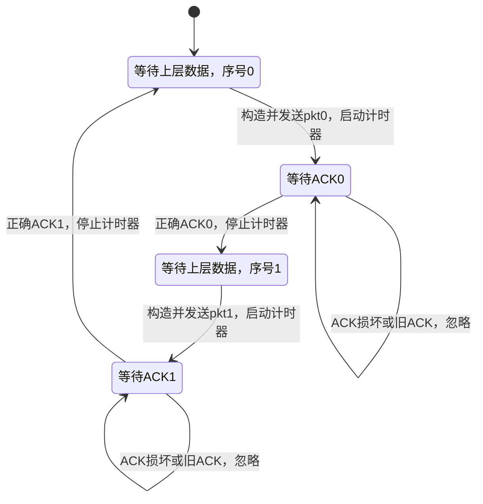
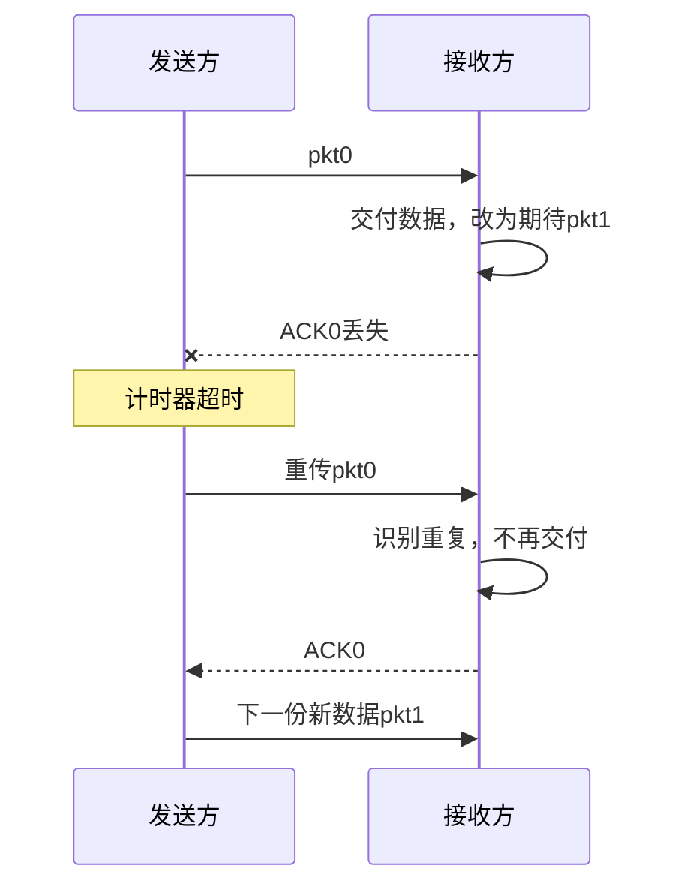
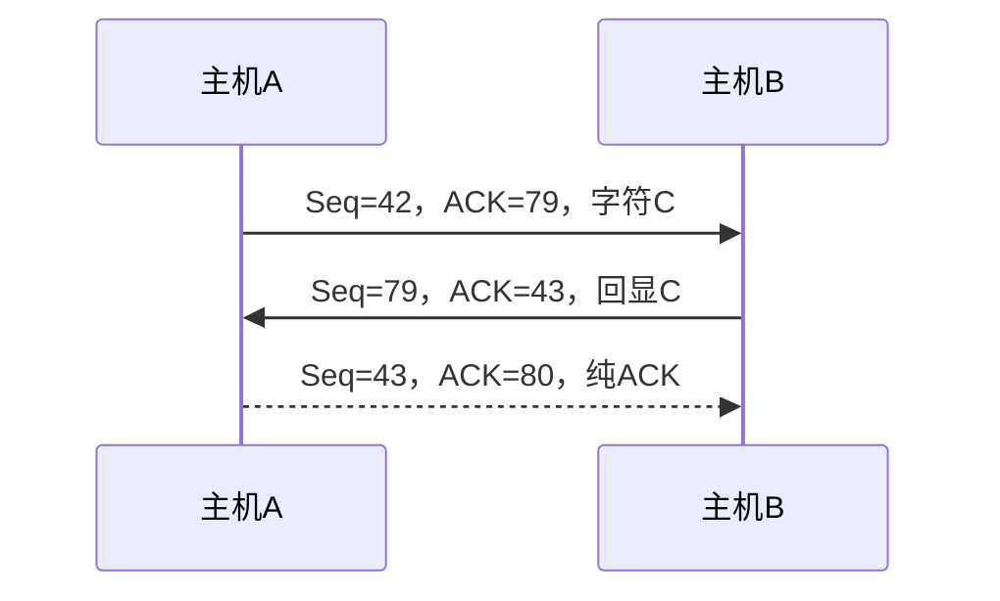
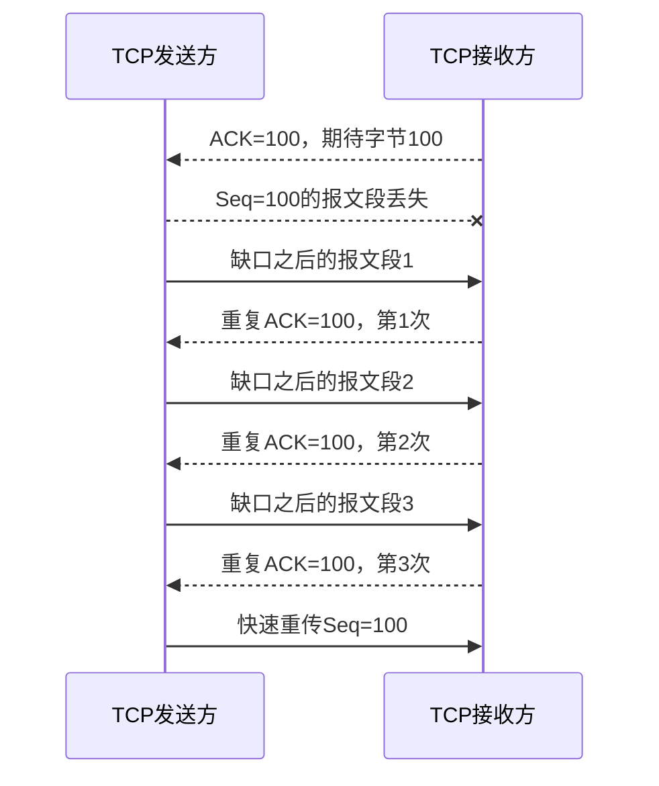

# 第七章 传输层（二）：可靠传输

> 对应课件：`第三讲_传输层(2)可靠传输.pptx`，共 96 页。重复动画、目录与总结已合并。保留可靠传输协议的状态转移、算法、计算例题与思考题，并补充必要推导。课件中的理想化模型与真实 TCP 标准在相关段落中区分说明。

## 1. 可靠传输问题与 TCP 服务

### 1.1 TCP 的服务模型与所需机制

TCP 在一对应用进程之间提供逻辑上的可靠、有序字节流管道，支持点到点、全双工通信，不保留应用报文边界。为此需要：

- 建立连接，为通信维护 socket、缓存和协议变量等状态。
- 可靠传输，以流水线、检错、确认和重传等机制恢复差错。
- 流量控制，使发送速率适应接收端处理和缓存能力。
- 拥塞控制，使发送行为适应网络承载能力。

“理想字节流管道”是服务抽象。实际连接可能因持续网络故障等原因失败，也没有固定时延保证。本章重点是可靠传输，流量控制、拥塞控制和连接管理不在这份课件的详细讨论范围内。

### 1.2 不可靠信道与可靠交付

底层网络可能出现比特翻转、分组丢失和乱序。例如外部干扰造成内容损坏，队列过载造成丢包，多路径或路径变化造成乱序。

可靠传输希望上层得到完整、正确、有序且不重复的数据。它不仅存在于 TCP，也用于链路层、基于 UDP 的应用协议（例如 TFTP），以及 5G、时延敏感网络和 RDMA（Remote Direct Memory Access，远程直接内存访问）等系统。

课件假设随机差错能够通过校验发现，不讨论攻击者有意篡改且绕过校验、或第三方伪造发送方的消息。后一类问题需要认证和密码学完整性等安全机制。

### 1.3 协议接口、术语与有限状态机

可靠传输/008-65220db8d9.png>)

| 接口 | 调用方向与用途 |
| --- | --- |
| `rdt_send(data)` | 上层调用发送端可靠协议，提交待发送数据 |
| `udt_send(packet)` | 可靠协议调用不可靠下层，发送分组 |
| `rdt_rcv(packet)` | 下层在分组到达时通知可靠协议，双方均可能收到数据或反馈 |
| `deliver_data(data)` | 接收端可靠协议把已经满足交付条件的数据交给上层 |

不同层的数据单元常称为：应用层 message、传输层 segment、网络层 packet/datagram、链路层 frame。本章在一般可靠协议部分统一用 packet（分组）指代传输单元，在 TCP 部分使用报文段和字节序号。

可靠协议是分布式算法，发送端与接收端分别执行自己的操作。每一端可用有限状态机（FSM）描述：当前状态、触发事件、守卫条件、动作和下一状态。图中的 `Λ` 表示不执行额外动作，而非“没有收到事件”。

## 2. 从 rdt 1.0 到 rdt 3.0

设计顺序是先在简单信道中保证正确，再逐步加入差错、丢失和性能要求。

| 协议 | 信道假设/待解决问题 | 新增机制 |
| --- | --- | --- |
| rdt 1.0 | 无损坏、无丢失，双方始终就绪 | 封装、发送、解封装和交付 |
| rdt 2.0 | 数据可能损坏，暂假设反馈可靠且无丢失 | 校验和、ACK/NAK、停等重传 |
| rdt 2.1 | ACK/NAK 也可能损坏 | 0/1 序号、接收端判重 |
| rdt 2.2 | 去掉单独的 NAK | 带序号的 ACK，重复 ACK 表示仍未正确推进 |
| rdt 3.0 | 数据或 ACK 还可能丢失 | 计时器与超时重传 |

这些模型先不处理任意久的旧分组滞留问题，后文再讨论序号回绕的边界条件。

### 2.1 rdt 1.0：完美信道中的乌托邦协议

假设分组不会丢失或损坏，上下层始终就绪，发送和接收能够及时处理所有数据，不需要流量控制与差错恢复。

| 角色与状态 | 事件 | 动作与下一状态 |
| --- | --- | --- |
| 发送方，等待上层 | `rdt_send(data)` | `make_pkt(data)`，`udt_send(packet)`，继续等上层 |
| 接收方，等待下层 | `rdt_rcv(packet)` | 提取数据，`deliver_data(data)`，继续等下层 |

等价的循环过程是：发送端从上层取数据、封装、交下层；接收端等待事件、从下层取分组、解封装、交上层。它没有 ACK、重传和重复检测，只适用于理想化前提。

### 2.2 rdt 2.0：差错检测、反馈与重传

自动重传请求（ARQ，Automatic Repeat reQuest）通过接收端的反馈驱动发送端重传，包含差错检测、反馈和重传三个要素。

- ACK（acknowledgment，肯定确认）：分组正确到达。
- NAK（negative acknowledgment，否定确认）：分组有错，需要重传。
- 发送方每发送一份数据就暂停，收到 ACK 才处理下一份，收到 NAK 则重传保存的分组，这就是停等（stop-and-wait）。

在这一模型中，确认帧不携带应用载荷，课件称为哑帧（dummy frame）。ACK 和 NAK 的类型仍有明确语义，不能理解为二者没有区别。

| 角色与状态 | 事件 | 动作 | 下一状态 |
| --- | --- | --- | --- |
| 发送方等上层 | 上层提交数据 | 封装含校验和的 `sndpkt`，保存并发送 | 等 ACK/NAK |
| 发送方等反馈 | 收到 ACK | 不重传，允许下一份数据 | 等上层 |
| 发送方等反馈 | 收到 NAK | 重发 `sndpkt` | 等 ACK/NAK |
| 接收方等下层 | 收到损坏分组 | 发 NAK，不交付数据 | 保持 |
| 接收方等下层 | 收到正确分组 | 提取并交付数据，发 ACK | 保持 |

缺陷在于 ACK/NAK 自身也可能出错，发送方此时不知道接收方是否已经收到数据。课件比较三条思路：要求重发反馈又会产生“请求本身出错”的问题；使用更强的纠错编码会增加处理和传输开销；直接重传数据最简单，但接收方可能重复交付。这引出序号。

### 2.3 rdt 2.1：用 1 bit 序号识别重复

发送方为新分组交替使用 `seq=0` 与 `seq=1`，重传沿用原序号。停等模型一次只有一个未确认分组，只需区分“当前新分组”和“前一个分组的副本”，所以在本模型下 1 bit 足够。

发送方有四个状态：等上层发送 0、等 0 的反馈、等上层发送 1、等 1 的反馈。令当前序号为 $b\in\{0,1\}$：

| 发送方事件 | 动作 |
| --- | --- |
| 在等上层状态收到数据 | 构造并保存 `pkt(b, data, checksum)`，发送，进入等反馈状态 |
| 收到校验正确的 ACK | 本分组完成，切换为等待发送 `1-b` |
| 收到损坏反馈或 NAK | 重传保存的 `pkt(b)`，继续等待 |

接收方有“等 0”和“等 1”两个状态：

| 接收方事件（当前期待 b） | 动作与状态 |
| --- | --- |
| 分组损坏 | 发 NAK，不交付，不改变期待序号 |
| 正确且序号等于 b | 交付一次，发 ACK，改为期待 `1-b` |
| 正确但序号等于 1-b | 这是重复分组，再发 ACK，但不重复交付，不改变状态 |

接收方无法知道上一次 ACK 是否被发送方正确收到，因此重复分组仍需确认。相对 rdt 2.0，两端都需要记住 0/1，状态数增加。重传只在出现问题时付出额外代价，而不是要求每份反馈都采用更复杂的纠错编码。

### 2.4 rdt 2.2：仅使用 ACK

rdt 2.2 为 ACK 加上最近正确接收的分组序号，取消 NAK。这里 `ACK(b)` 表示已正确收到编号为 b 的分组，**不是后文 TCP 的“下一个期望字节”语义**。

- 发送方等 `ACK(b)`：正确收到它就推进；ACK 损坏或收到 `ACK(1-b)` 则重传当前分组。
- 接收方期待 b：正确收到 b 就交付、发送 `ACK(b)` 并切换期待序号；收到损坏或重复分组则重发上次 ACK，不交付。
- 初始化时可令接收方保存一个代表“尚未收到 0”的 `ACK(1)`，以便第一份 0 损坏时回复旧 ACK。

两个协议的数据序号、判重和状态结构相同，区别在于反馈如何表达“本次没有推进”。

### 2.5 rdt 3.0：用超时处理数据或 ACK 丢失

如果数据或 ACK 丢失，仅等待反馈可能永久停住。rdt 3.0 在发送方增加计时器。发送分组时启动，收到正确匹配 ACK 时停止，超时则重传保存的分组并重新计时。

接收方与 rdt 2.2 相同。ACK 丢失、数据延迟或过早超时都可能造成重复，但接收方用序号判重并重新 ACK。



在等待上层数据时，迟到的旧 ACK 不应触发新发送。课件提出“ACK 损坏或序号不匹配时立即重传，还是等待超时”的问题：标准教学版 rdt 3.0 选择忽略并等待超时，避免旧反馈反复触发多余重传；可靠性由计时器保证。

四种课件场景：

| 场景 | 发送端 | 接收端 |
| --- | --- | --- |
| 无丢失 | 收到匹配 ACK 后发下一份 | 正确接收、交付、确认 |
| `pkt1` 丢失 | 超时重发 `pkt1` | 重传到达后交付并发 `ACK1` |
| `ACK1` 丢失 | 超时重发 `pkt1` | 发现重复，不再交付，但重新发 `ACK1` |
| ACK 延迟导致过早重传 | 可能先收到原 ACK，再收到重复 ACK | 只交付一份，正确处理多余副本 |



超时不是“分组必定丢失”的证明，它也可能只是延迟较大。协议必须同时应对真正丢失和无必要的重复发送。

## 3. 停等协议的效率与流水线

### 3.1 停等利用率推导

令分组长度为 $F$ bit，发送速率为 $R$ bit/s，单向传播时间为 $I$，只计传播的往返时间为 $RTT=2I$。忽略处理、排队及 ACK 的发送时间，则一轮需要：

$$
T_{\mathrm{cycle}}=F/R+RTT
$$

发送端只有 $F/R$ 时间在发送，利用率为：

$$
U_{\mathrm{SW}}=\frac{F/R}{F/R+RTT}=\frac{F}{F+R\cdot RTT}
$$

第一个 bit 在 $t=0$ 开始发送，最后一个 bit 在 $t=F/R$ 发完；接收方在 $t=F/R+I$ 收齐分组并回 ACK，发送方在 $t=F/R+2I$ 收到 ACK，才能开始下一轮。

### 3.2 长肥网络例题

课件给定 $F=1000$ bit，$R=1$ Mbps，单向传播时间 $I=270$ ms，因此：

$$
F/R=1\,\mathrm{ms},\qquad RTT=540\,\mathrm{ms}
$$

$$
U_{\mathrm{SW}}=\frac{1}{1+540}=\frac1{541}\approx0.1848\%
$$

每 541 ms 才能发一个 1000 bit 分组，理想平均发送速率约为 $1.848$ kbit/s，远低于链路的 1 Mbit/s。根因是仅有一个未确认分组，带宽和往返时延形成的“管道”大部分为空。

增大分组能提高利用率，但分组越大，包含至少一个错误 bit 的概率越大。若各 bit 独立出错且比特错误率为 $p$，补充推导为 $P_{\mathrm{err}}=1-(1-p)^F$。同时还要考虑 MTU 等长度限制。

### 3.3 流水线传输

流水线允许未收到前一份确认时继续发送多份数据，使信道中同时存在多个未确认分组。在未饱和时，三分组流水线的利用率可以达到停等的三倍。

在等长分组、无丢失、ACK 开销忽略的同一模型下，窗口最多允许 N 个未确认分组，则补充推导为：

$$
U_N=\min\left(1,\frac{NF/R}{RTT+F/R}\right)
$$

持续满速发送要求 $NF/R\ge RTT+F/R$，即：

$$
N\ge\left\lceil1+\frac{R\cdot RTT}{F}\right\rceil
$$

上例需至少 541 个分组的窗口才能填满管道。若公式中的 RTT 已包含完整数据分组的发送时间，应调整分母，不能重复计入 $F/R$。

流水线还引入新要求：序号空间应容纳多个未确认分组；发送端必须缓存未确认数据；协议必须处理多分组丢失、差错、延迟与乱序。反馈和重传的组织方式产生了 GBN 与 SR。

## 4. 滑动窗口与有限序号

### 4.1 窗口及指针

窗口限制可同时在途、尚未确认的数据量，控制发送端内存、接收端压力和网络负担，也使有限 bit 的序号成为可能。实际 TCP 的可发送量还受接收窗口和拥塞窗口约束。

可靠传输/017-e947210e9b.png>)

设 `base` 为最早未确认分组的逻辑序号，`nextseqnum` 为下一个新分组序号，窗口上限为 N：

| 范围 | 意义 |
| --- | --- |
| 小于 `base` | 已累计确认 |
| `[base, nextseqnum)` | 已发但尚未累计确认 |
| `[nextseqnum, base+N)` | 允许发送的新分组 |
| 不小于 `base+N` | 窗口外，暂时不能发送 |

发送一份新分组只使 `nextseqnum` 前进；收到推进确认后，`base` 才前进并释放新的窗口位置。接收端也维护自己的可接收序号范围，连续数据交付后使其窗口前移。

校注：课件中“发出一个报文后窗口下限前移”应按上述三个量区分，不能误认为发出后就已经确认。“发送窗口等于接收窗口”也不是所有协议的要求：GBN 的发送窗口为 N，接收窗口仅为 1；对称 SR 才常取两端窗口均为 N。

### 4.2 序号回绕的约束

若线上的序号字段为 k bit，序号空间为 $M=2^k$，使用到末尾后按模 M 回绕。在本章标准滑动窗口模型下：

- GBN 的接收窗口为 1，发送窗口满足 $N\le M-1$。
- 对称 SR 的两端窗口为 N，需要 $2N\le M$，即 $N\le2^{k-1}$。

这些条件防止接收端把一轮重传误判为下一轮新数据，并不单独解决任意久的历史分组滞留，见第 6.5 节。

下文伪代码为便于理解，使用单调增加的**逻辑序号**比较窗口范围。真实实现应将逻辑位置映射为有限线序号，并正确处理模运算，不能在回绕后直接使用普通整数大小比较。

## 5. 回退 N（GBN）

### 5.1 设计思想

GBN（Go-Back-N）允许发送方最多保留 N 个未确认分组，采用累计确认。这里 `ACK(n)` 表示序号不大于 n 的分组均已按序收到。

- 发送方保存全部未确认分组，按连续逻辑序号构成队列。
- 接收方只接受下一个期待的分组，不缓存失序分组，因此只需维护 `expectedseqnum`。
- 发送方对最早未确认分组使用一个计时器；超时后重传所有已发送但未确认的分组。

优点是接收端简单、缓存需求小；缺点是即便后续分组已经到达，也可能因为缺少中间一个分组而全部重传。

### 5.2 发送端事件与伪代码

| 事件 | 处理 |
| --- | --- |
| 上层提交数据，窗口未满 | 保存、发送新分组，`nextseqnum` 加一；若原先无未确认数据则启动计时器 |
| 上层提交数据，窗口已满 | 暂不接受或等待，课件用 `refuse_data(data)` 表示 |
| 收到有效新 `ACK(n)` | `base=n+1`；若无未确认分组则停表，否则为新的最早未确认分组重新计时 |
| 反馈损坏或旧/重复 ACK | 忽略，继续等待有效 ACK 或超时 |
| 超时 | 重传 `[base, nextseqnum)` 内全部分组，重新计时 |

```text
初始：base = nextseqnum = 1

rdt_send(data):
    if nextseqnum < base + N:
        saved[nextseqnum] = make_pkt(nextseqnum, data, checksum)
        udt_send(saved[nextseqnum])
        if base == nextseqnum:
            start_timer()
        nextseqnum += 1
    else:
        refuse_data(data)

收到校验正确的 ACK(n)，且 base <= n < nextseqnum:
    base = n + 1
    if base == nextseqnum:
        stop_timer()
    else:
        restart_timer()

timeout:
    for n in [base, nextseqnum):
        udt_send(saved[n])
    restart_timer()
```

### 5.3 接收端事件

收到正确且序号为 `expectedseqnum` 的分组：提取并交付数据，发送该序号的 ACK，然后 `expectedseqnum` 加一。

收到损坏、重复或其他失序分组：不缓存、不交付，重发最近按序收到的最大序号的 ACK，期待序号不变。

校注：课件第 57 页说“丢弃且不发送确认”，准确含义是**不确认该失序分组本身**。第 60～61 页给出的完整接收规则仍会重发前一个累计 ACK，本笔记采用这一规则。

### 5.4 窗口 N=4、pkt2 丢失的例题

1. 发送端连续发送 `pkt0、pkt1、pkt2、pkt3`，其中 `pkt2` 丢失。
2. 接收端接收 0、1，回复 `ACK0、ACK1`，期待 2。
3. 3 到达时不符合期待，丢弃 3，重发 `ACK1`。
4. 发送端收到 `ACK0、ACK1` 后腾出窗口，可继续发 4、5。
5. 接收端仍期待 2，所以丢弃 4、5，并继续发 `ACK1`。发送端忽略这些重复 ACK。
6. 2 成为最早未确认分组，其计时器超时后，发送端重传 **2、3、4、5**。
7. 接收端此次按序接收并交付 2～5，分别或累计确认，窗口继续前移。

关键是“回退”覆盖全部已发送而未确认的分组，并不只是重发最初窗口里的 2、3。

## 6. 选择重传（SR）

### 6.1 设计思想与缓存

SR（Selective Repeat）分别确认每个正确收到的分组，发送方只重传真正需要重传的分组，接收方缓存窗口内的失序数据，以便缺口补齐后按序交付。

可靠传输/018-361425bbbd.png>)

- 发送方保存未确认分组及其确认状态，每个未确认分组有独立的逻辑计时器。
- 接收方保存窗口内已经收到的数据，区分“收到”和“可按序交付”。
- 相比 GBN，可减少重复发送，但两端的缓存和状态维护更复杂。

“每包一个计时器”是逻辑模型，实际实现可用统一的定时调度结构管理多个到期时刻。若 ACK 本身损坏，发送方不能可靠识别其中的序号，通常丢弃该 ACK，等待对应分组的计时器触发；课件“ACK 错误就重发相应分组”不应理解为可盲信损坏 ACK 的字段。

### 6.2 发送方与接收方的完整事件规则

设发送窗口左端为 `send_base`、接收窗口左端为 `rcv_base`，两端窗口大小均为 N。下面区间均指逻辑序号。

| 发送方事件 | 动作 |
| --- | --- |
| 上层数据到达，下一序号在窗口内 | 保存并发送该分组，启动其计时器 |
| 分组 n 超时 | 仅重传 n，重新启动 n 的计时器 |
| 收到窗口内有效 `ACK(n)` | 标记 n 已确认，停止对应计时器 |
| ACK 对应窗口最左端 | 越过从左端起连续已确认的分组，更新 `send_base`，释放窗口 |
| 损坏、无效或无须处理的旧 ACK | 忽略 |

接收方：

| 收到的序号 n | 动作 |
| --- | --- |
| 在当前窗口 `[rcv_base, rcv_base+N-1]` 内，且数据正确 | 发送 `ACK(n)`；首次收到则缓存 |
| n 正好是 `rcv_base` | 从左端开始，将连续已收到的分组逐一交付上层，并推进 `rcv_base` |
| 在前一窗口 `[rcv_base-N, rcv_base-1]` 内 | 不再交付，但**必须重发 `ACK(n)`** |
| 其他范围或分组损坏 | 不接收、不交付，按本模型忽略 |

前一窗口的重复分组不能直接沉默丢弃：它可能是某次 ACK 丢失后发送方的重传。此时接收窗口已经前移，但发送窗口仍卡住，重发 ACK 才能让发送端推进。

### 6.3 两个 N=4 的例题

**例一：pkt2 丢失。**

1. 发送 0～3，其中 2 丢失。接收端交付 0、1，对 3 则缓存并发 `ACK3`。
2. 发送端收到 `ACK0、ACK1` 后发 4、5；接收端缓存 4、5，分别回复 `ACK4、ACK5`。
3. 发送端虽然知道 3～5 已收到，窗口左端仍是缺失的 2，不能越过缺口。
4. 2 超时后，发送端只重发 2。接收端收到它后，缺口补齐，将 **2、3、4、5** 连续交付上层，并发 `ACK2`。
5. 发送端收到 `ACK2`，结合已经保存的 3～5 的确认状态，将 `send_base` 一次推进到 6。

**例二：ACK2 丢失。**

接收端实际上已按序收到并交付 0～5，`rcv_base=6`，但发送端因缺 `ACK2` 仍卡在 2。2 超时重传后，接收方发现它在 `[6-4, 6-1]=[2,5]` 内，因此不再交付，却重新发 `ACK2`。如果不发，发送端可能反复超时，窗口始终不能前进。

### 6.4 为什么 SR 的窗口不能超过序号空间的一半

课件反例为序号空间 `{0,1,2,3}`、窗口 N=3：

- 接收方收到 0、1、2 后，窗口前移到 `{3,0,1}`。
- 若确认正常送达，未来的 0 可以是发送方循环使用序号后的新数据。
- 若先前确认未送达，发送方可能重发旧 0；但旧 0 也落在接收方当前窗口内。
- 接收方从相同序号和窗口状态，不能判定它属于哪一轮。

证明要点是让“最近一窗口的旧数据”与“当前可接收的新数据”在模 M 序号空间中互不重叠。两段各有 N 个位置，因此需要：

$$
2N\le M\quad\Longleftrightarrow\quad N\le\frac{M}{2}
$$

当 M=4 时最多取 N=2。此约束建立在标准模型对分组存活时间、序号复用和窗口推进的假设上。

### 6.5 极长延迟的历史分组

课件还给出更极端的思考：序号范围为 1～M，原始 `pkt1` 在网络中滞留，发送方超时后重传 1；接收方收到重传 1，然后正常收到 2～M。等序号循环回 1，原始 `pkt1` 才到达，就可能被当成新 1。

因此有限窗口约束之外，还需要让序号在旧副本可能存在的期间不被混淆。课件提出足够大的序号空间和限制分组存活的思路。对真实 TCP，还要结合连接状态和防旧分组机制理解。

校注：不能把 IP 的 TTL/Hop Limit 理解为严格的墙钟时间上限。特别是 IPv6 的 Hop Limit 限制跳数，不保证最大分组生存秒数；[RFC 8200 §8.2](https://www.rfc-editor.org/rfc/rfc8200.html#section-8.2) 明确要求依赖旧分组排除的上层协议具备自己的相应机制。

### 6.6 GBN 与 SR 对照

| 项目 | GBN | SR |
| --- | --- | --- |
| 发送端缓存 | 所有已发未确认分组 | 所有仍需保存的分组及逐包确认状态 |
| 重传计时 | 逻辑上一个，针对最早未确认分组 | 每个未确认分组分别计时 |
| 超时重传 | 所有已发未确认分组 | 超时的单个分组 |
| 确认方式 | 累计确认 | 逐包独立确认 |
| 失序处理 | 丢弃，不缓存，重发前一个累计 ACK | 在窗口内缓存并单独 ACK |
| 接收窗口 | 1 | 通常为 N |
| k bit 序号的发送窗口上限 | $2^k-1$ | 对称窗口为 $2^{k-1}$ |
| 主要代价 | 可能大量重发已到达数据 | 更多缓存、计时和确认状态 |

## 7. TCP 的字节序号与累计确认

### 7.1 字节编号与捎带确认

TCP 在不可靠 IP 服务上，通过流水线、检错、缓存、确认与重传建立可靠交付。与前述按分组编号的模型不同，TCP 为**每一个数据字节**编号：

- 报文段 `Seq` 是该段第一个数据字节的序号。
- 报文段 `ACK` 是下一个期望字节的序号，表示该序号之前的数据都已连续收到。
- 两个传输方向的序号空间相互独立。
- ACK 可以放进反向发送的数据报文段中，这称为捎带确认（piggybacking），也可以单独发送。

例如 `Seq=100`、数据长 20 字节，覆盖字节 `[100,120)`，其正常确认应为 `ACK=120`。`ACK=100` 表示仍缺从字节 100 开始的数据。

### 7.2 字符回显例题

课件中 A 向 B 发送一个字符 `C`，B 再回显该字符：

| 步骤 | 报文段 | 含义 |
| --- | --- | --- |
| A 发给 B | `Seq=42, ACK=79, data='C'` | A 的字符占字节 42，同时确认 B 先前的数据已连续收到至 78 |
| B 回给 A | `Seq=79, ACK=43, data='C'` | B 的回显字符占字节 79，同时期待 A 的下一字节 43 |
| A 发纯确认 | `Seq=43, ACK=80`，无数据 | 确认 B 的字节 79，期待 80 |

纯 ACK 不消耗新的数据字节序号。在本例中，A 的下一数据字节仍为 43。



## 8. 简化 TCP 发送方与重传

### 8.1 一只重传计时器与按序恢复

课件的简化 TCP 采用：发送端只为最早未确认数据管理一只重传计时器；超时时只重传最早未确认报文段；接收端累计确认并缓存失序报文段。它结合了 GBN 和 SR 的部分机制。

课件曾将 TCP 失序缓存概括为可选实现。本章后续算法明确采用缓存方案；现行 [RFC 9293](https://www.rfc-editor.org/rfc/rfc9293.html) 也建议将失序分组排队。真实 TCP 的丢失恢复还受扩展选项和具体实现影响，这里的“一只计时器”特指该可靠性教学模型。

设 `SendBase` 为最早未确认字节序号，`NextSeqNum` 为下一个新数据字节序号，初始均为 `InitialSeqNum`。暂不展开窗口、连接管理等约束：

| 事件 | 处理 |
| --- | --- |
| 应用提交长度为 L 的数据 | 以 `Seq=NextSeqNum` 构造并发送，`NextSeqNum += L`；若当前重传计时器未运行则启动 |
| 超时 | 重传包含最早未确认字节的报文段，并重启计时器 |
| 收到有效新 `ACK=y`，`SendBase < y <= NextSeqNum` | 更新 `SendBase=y`；若仍有未确认数据，重新计时，否则停表 |
| 收到旧或无效 ACK | 不推进 `SendBase` |
| 收到符合重复确认条件的 ACK | 计数，达到快速重传门槛时按第 10 节处理 |

新发数据不应无条件重启一个已经运行的计时器，否则持续发送可能拖延最早丢失数据的恢复。课件状态机中省略的计时器分支按事件规则补齐。

### 8.2 ACK 丢失、过早超时与累计确认的作用

使用课件的字节范围：第一段 `Seq=92, len=8`，第二段 `Seq=100, len=20`。

1. **ACK 丢失并触发重传**：若 `ACK=100` 丢失且尚无后续推进确认，92 所在段可能超时重传。接收方不重复交付，并再次确认。
2. **过早超时**：原报文还在传输，但定时器先到期，仅重传从 92 开始的最早未确认段。若像 GBN 那样重传所有在途数据，会额外重发从 100 开始的段；若每段各自计时且阈值都偏小，也可能连续发生多份无效重传。
3. **ACK 丢失却无须重传**：虽然 `ACK=100` 丢失，但若 `ACK=120` 在超时前到达，它累计确认了字节 92～119，因此两段都不必因前一个 ACK 丢失而重传。

后续还可发送 `Seq=120, len=15`，其正常累计确认号为 135。计时器应跟随最早仍未确认的数据，而不是永久绑定第一次发送的那一段。

## 9. 自适应超时、RTT 估计与 Karn 算法

### 9.1 RTT 的测量与平滑

超时过小会产生不必要重传，过大则延迟丢包恢复。RTT 随路径、排队和负载变化，不能仅使用固定常数。

`SampleRTT` 是某报文段发送到其确认到达的时间样本。`EstimatedRTT` 是对样本的指数加权移动平均：

$$
\mathrm{EstimatedRTT}_{new}=(1-\alpha)\mathrm{EstimatedRTT}_{old}+\alpha\mathrm{SampleRTT}
$$

典型参数 $\alpha=0.125=1/8$。新样本的权重较大，历史样本的权重按指数衰减，平滑值比瞬时测量更稳定。

可靠传输/rtt-samples.png>)

原图横轴为时间（秒），纵轴为 RTT（毫秒），蓝色瞬时样本波动明显，粉色平滑估计变化较缓。该图是课件的历史测量示意，不是当前网络状态。

### 9.2 波动估计与超时公式

只按平均值设置超时不够，还应为波动保留余量。课件使用平均绝对偏差的平滑估计：

$$
\mathrm{DevRTT}_{new}=(1-\beta)\mathrm{DevRTT}_{old}+\beta\left|\mathrm{SampleRTT}-\mathrm{EstimatedRTT}_{old}\right|
$$

典型 $\beta=0.25=1/4$，教学公式为：

$$
\mathrm{TimeoutInterval}=\mathrm{EstimatedRTT}+4\mathrm{DevRTT}
$$

这里的偏差估计不是统计学方差。按 [RFC 6298](https://www.rfc-editor.org/rfc/rfc6298.html)，实际计算先更新偏差、再更新平滑 RTT；偏差应使用更新前的平滑值。标准记号为 `SRTT`、`RTTVAR`，并计入时钟粒度 G：

$$
\mathrm{RTO}=\mathrm{SRTT}+\max(G,4\mathrm{RTTVAR})
$$

第一个可用样本 R 可初始化为 `SRTT=R`、`RTTVAR=R/2`；具体实现还要遵守超时初值及上下限等标准要求。

### 9.3 重传后的确认二义性

重传沿用原序号。若一个报文段发送后又被重传，后续 ACK 未必能说明它确认的是原始副本还是重传副本。

可靠传输/021-6f9fe4348c.png>)

可靠传输/022-fd7ec8929e.png>)

若从原发送时刻计时而 ACK 实际针对重传，会把等待重传的时间也算进去；若从重传时刻计时而 ACK 实际针对原副本，会测得过短 RTT。

因此 Karn 原则是不使用存在这种二义性的重传报文段来采样 RTT。TCP 时间戳选项能够消除相应二义性时是例外，见 [RFC 6298 §3](https://www.rfc-editor.org/rfc/rfc6298.html#section-3)。

### 9.4 指数退避与 Karn 的组合

仅忽略重传样本仍有问题：如果当前超时阈值本来就偏小，而又不更新估计，就可能反复过早超时。因此发生**重传计时器超时**后，还应执行指数退避：

$$
\mathrm{RTO}\leftarrow2\mathrm{RTO}
$$

随后用加倍的 RTO 重启计时器。连续超时会使阈值按指数增长，直到允许的上限。获得新的、无二义性的 RTT 样本后，再据平滑估计重新计算 RTO。

校注：课件将其简写为“每次重传就加倍”，准确说本处退避针对**超时重传**，不能将快速重传也机械地解释为必须加倍。课件还提到收到上层新数据即可重新估计，但新数据到达本身没有提供 RTT 样本，不应仅因此清除已有退避。上述校正依据 [RFC 6298 §5](https://www.rfc-editor.org/rfc/rfc6298.html#section-5)。

## 10. 快速重传

### 10.1 用重复 ACK 在超时前发现缺口

当一个报文段丢失而后续段到达时，接收方会反复确认同一个“下一期望字节”，发送方可据此推断存在缺口。

课件中的经典规则是：收到 **3 个重复 ACK** 后，不等重传计时器到期，立即重发相应的最早缺失报文段。这通常指在原有同值 ACK 之后再出现三个符合条件的重复 ACK，而不是仅把三个同值 ACK 总数视为门槛。



单次重复 ACK 也可能源于乱序，不能直接证明丢失。三个重复 ACK 是经典算法的触发条件，真实重复 ACK 的判定还有报文、窗口等条件，不是所有 `ACK<=SendBase` 都应计入。经典规则见 [RFC 5681 §3.2](https://www.rfc-editor.org/rfc/rfc5681.html#section-3.2)。

### 10.2 简化处理逻辑

```text
收到有效 ACK，确认号为 y:
    if y > SendBase:
        推进 SendBase（且确认号不得超过已发送范围）
        清零重复 ACK 计数
        若仍有未确认数据，重启计时器；否则停表
    else if y == SendBase 且符合重复 ACK 条件:
        当前重复 ACK 计数 += 1
        if 当前重复 ACK 计数 == 3:
            重传从 y 开始的缺失数据
    else:
        忽略旧或无效 ACK
```

这是可靠性部分的简化描述，真实 TCP 的快速重传还会与拥塞控制、快速恢复等机制配合。

## 11. TCP 接收方、延迟确认与 SACK

### 11.1 累计确认与延迟确认

正确且按序收到数据后，ACK 可推进；出现缺口时，ACK 仍指向第一个缺失字节。缓存后续数据并不代表能够立刻向应用按序交付。

为了减少 ACK 数量，TCP 允许延迟确认，用一个 ACK 累计确认多份数据，或等待反向数据以捎带确认。但等待过久会拖慢发送、干扰 RTT 估计，甚至引起无必要的重传。

课件采用的经典限制是最多约 500 ms，并且不能连续无限推迟。标准更准确地要求延迟**小于 0.5 s**，对连续满尺寸数据通常应至少每两个满尺寸报文段或每 `2×RMSS` 字节新数据确认一次，其中 RMSS 是接收端的最大报文段数据长度。见 [RFC 9293 §3.8.6.3](https://www.rfc-editor.org/rfc/rfc9293.html#section-3.8.6.3)。

### 11.2 接收端事件表

| 接收事件 | 课件采用的处理 |
| --- | --- |
| 收到期待的段，前面的数据均已确认 | 可暂缓 ACK；若下一段迟迟不来，应在上限以内确认 |
| 收到期待的段，前一个段仍在等待延迟确认 | 立即发累计 ACK，确认两段 |
| 收到高于期望序号的失序段，出现缺口 | 缓存失序数据，立即重发当前 ACK，帮助触发快速重传 |
| 收到填补全部或部分缺口的段 | 立即 ACK；若从缺口低端开始，可越过已经连续缓存的数据推进确认号 |

“收到后续数据”与“累计 ACK 推进”不能混为一谈，只有连续前缀扩展时累计 ACK 才前移。

### 11.3 TCP 与 GBN、SR 的关系

| 机制 | 简化 TCP | 对照 |
| --- | --- | --- |
| 基础确认语义 | 累计确认下一期望字节 | 类似 GBN 的连续前缀确认，但数值语义不同 |
| 失序数据 | 缓存，形成缺口时发重复 ACK | 缓存类似 SR |
| 重传计时器 | 教学模型中一只，针对最早未确认数据 | 类似 GBN |
| 超时重传范围 | 首先重传最早未确认段，而非所有在途段 | 在减少重传方面类似 SR |
| 额外机制 | 快速重传、自适应 RTO、延迟 ACK | 超出基本 GBN/SR 模型 |

课件称 TCP 结合 GBN 与 SR 的优点，应理解为具体机制上的结合。课件“重传开销优于 GBN 和 SR”是对上述示例的总结，不应推广为任意网络条件下严格优于两者的定理。

### 11.4 选择确认 SACK

基础累计 ACK 只能指出连续收到的数据前缀，不能详细告诉发送方缺口后哪些字节已经收到。SACK（Selective Acknowledgment）在保持 ACK 字段原语义的同时，通过 TCP 选项报告若干已收到、但尚未连成完整前缀的数据块。

每个 SACK 块用 `[Left Edge, Right Edge)` 表示，左边界是第一个已收字节，右边界是最后一个已收字节的下一序号。接收方与发送方在连接建立时通过 `SACK-Permitted` 协商使用能力。

补充示例：当前 `ACK=100`，已收到 `[120,140)`，则 SACK 可报告该范围，帮助发送方识别 `[100,120)` 的缺口。累计 ACK 仍是 100，不能因为 120～139 已到达就改为 140。发送方结合 SACK 信息可减少重传已经收到的数据。

课件所引 [RFC 2018](https://www.rfc-editor.org/rfc/rfc2018.html) 发布于 1996 年，不应将课件“最新 TCP 修改意见”当作当前时间上的最新提案。讲者备注明确指出：SACK 不改变 TCP 确认号语义，使用前需要协商。

## 12. 知识要点与课件对应

可靠传输各项机制分别解决不同问题：校验发现随机差错，反馈表示接收状态，序号识别重复和顺序，计时器解决丢失后的等待，缓存保存未完成或失序数据，窗口限制在途量，流水线改善高带宽长时延链路的利用率。

| 课件页码 | 本章内容 |
| --- | --- |
| 2～14 | 第 1 节：TCP 服务、可靠性问题、接口、FSM 与术语 |
| 16～18 | 第 2.1 节：rdt 1.0 |
| 20～29 | 第 2.2 节：ARQ、rdt 2.0 与反馈损坏问题 |
| 30～34 | 第 2.3 节：rdt 2.1、序号与判重 |
| 35～37 | 第 2.4 节：rdt 2.2 与 ACK 序号 |
| 39～44 | 第 2.5 节：rdt 3.0 状态机与四种运行场景 |
| 45～47 | 第 3.1～3.2 节：停等效率与长肥网络计算 |
| 49～55 | 第 3.3、4 节：流水线、缓存、窗口和有限序号 |
| 57～61 | 第 5 节：GBN 状态、算法和丢失 pkt2 的例子 |
| 63～70 | 第 6.1～6.4、6.6 节：SR 两端规则、两个例题、窗口证明与对比 |
| 71 | 第 6.5 节：极长延迟与旧分组混淆 |
| 73～75 | 第 7、8.1 节：字节序号、字符回显和简化 TCP |
| 77～80 | 第 8 节：发送方事件、计时器和三种重传场景 |
| 81～85 | 第 9 节：RTT 平滑、偏差、二义性、退避和 Karn |
| 86～87 | 第 10 节：快速重传及伪代码 |
| 89～95 | 第 11 节：延迟确认、接收事件、GBN/SR 对照和 SACK，含讲者备注 |
| 96 | 总结已合并；教材阅读范围为第 3.4、3.5.3、3.5.4 节 |

第 1 页为封面，第 15、19、38、48、56、62、72、76、88 页为重复目录。其余动画展开页的信息已汇入上述主题。
