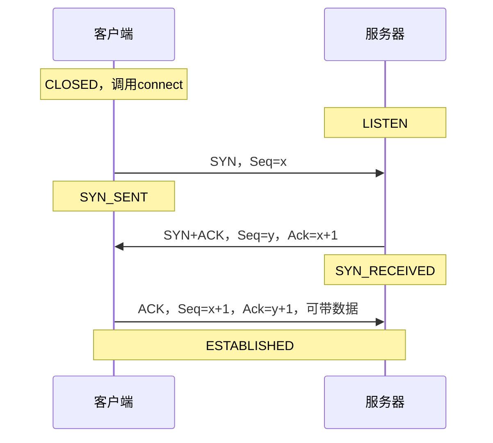
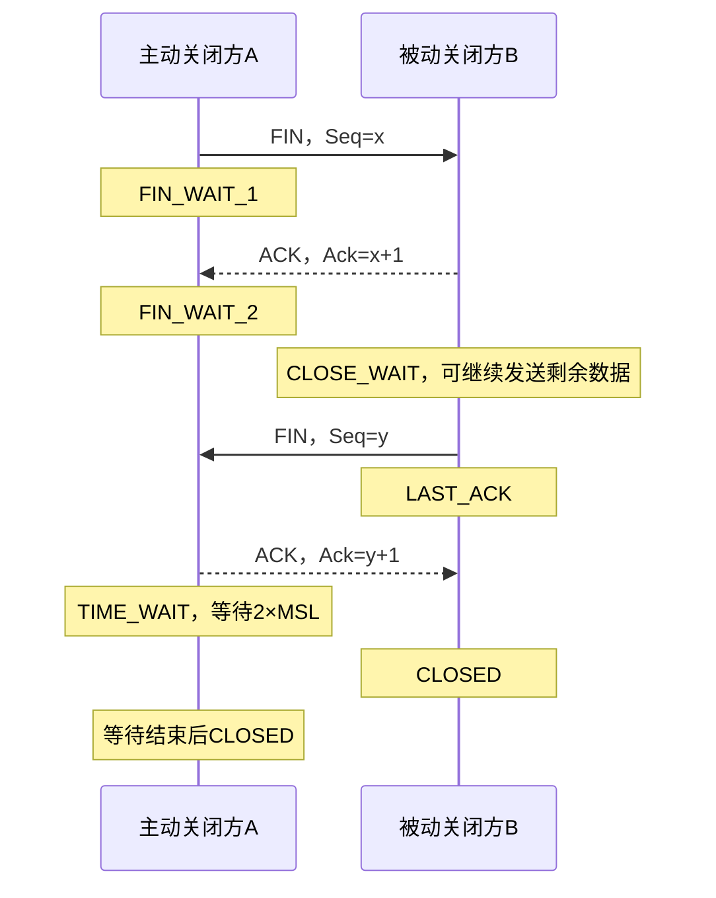
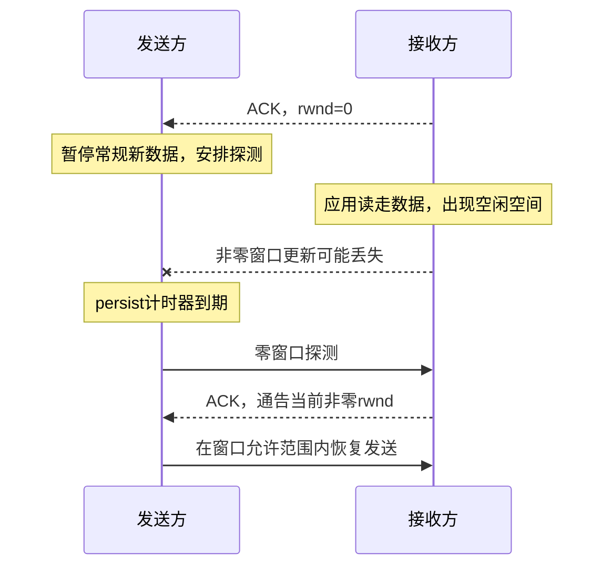
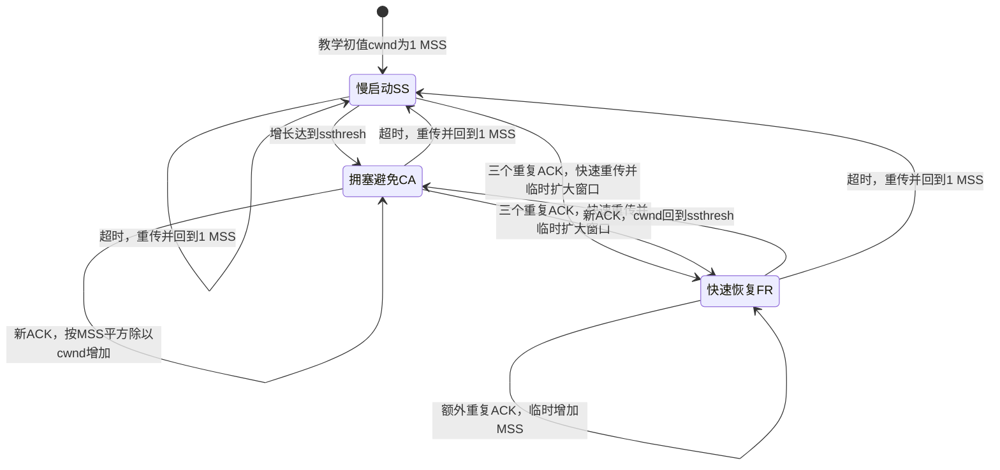

# 第八章 传输层（三）：连接管理、流量控制与拥塞控制

> 对应课件：`第三讲_传输层(3)连接管理、流量与拥塞控制.pptx`，共 69 页。重复目录、动画展开页和已有定义已合并。保留报文字段、选项、握手状态、窗口公式、算法、例题、原图和思考题。“校注”用于说明课件的简化假设或修正易误解的表述。

## 1. TCP 报文格式与选项

TCP 在一对进程之间提供全双工、可靠、有序且不保留应用报文边界的字节流。连接状态、可靠传输、流量控制、拥塞控制共同实现这一服务。本章承接[第七章：可靠传输](07-传输层-可靠传输.md)，重点说明连接如何建立和关闭，以及何时允许继续发送数据。

### 1.1 TCP 头部字段

```text
 0                              15 16                             31
+--------------------------------+--------------------------------+
|          Source Port           |        Destination Port        |
+--------------------------------+--------------------------------+
|                        Sequence Number                         |
+-----------------------------------------------------------------+
|                     Acknowledgment Number                       |
+----------------+---------------+--------------------------------+
|头部长度/保留位/控制标志，共16bit |          Receive Window        |
+--------------------------------+--------------------------------+
|            Checksum            |         Urgent Pointer         |
+--------------------------------+--------------------------------+
|                   Options / Padding（可变）                      |
+-----------------------------------------------------------------+
|                   Application Data（可变）                       |
+-----------------------------------------------------------------+
```

| 字段 | 长度与意义 |
| --- | --- |
| 源端口、目的端口 | 各 16 bit，用于标识通信端点及分用 |
| Sequence Number | 32 bit，通常为该段第一个数据字节的序号 |
| Acknowledgment Number | 32 bit，期待接收的下一个字节序号，ACK 标志置位时有效 |
| Data Offset / Header Length | 4 bit，TCP 头部长度，以 4 字节为单位 |
| Receive Window | 16 bit，通告发送该头部的一方还能接收的字节范围；可配合窗口扩大选项 |
| Checksum | 16 bit，进行端到端检错 |
| Urgent Pointer | 16 bit，在 URG 有效时说明紧急数据边界 |
| Options / Padding | 可变长度选项和对齐填充 |
| Application Data | 可变长度应用数据，控制报文段可以不带应用数据 |

普通 TCP 头部至少 20 字节，含选项时通常至多 60 字节；对应头部长度字段的值为 5～15。课件按经典头部画出保留区和六个常见控制位，现代头部还包含 ECN 相关控制位，不能认为图中的所有“未用”比特永远没有定义。

### 1.2 六个常见标志位

| 标志 | 含义 |
| --- | --- |
| URG | 紧急指针字段有效；紧急机制较少使用，并存在实现差异 |
| ACK | 确认序号字段有效 |
| PSH | PUSH 语义，要求将相应数据及时交付应用，避免无必要地继续等待聚合 |
| RST | 复位或拒绝不适当的连接/报文，不走正常 FIN 关闭过程 |
| SYN | 同步初始序号，用于建立连接 |
| FIN | 本方向的数据已经发送完毕，用于有序关闭该方向 |

校注：课件将 PSH 简写成“立即发送数据”，容易混淆发送时机、接收交付和报文边界。PSH 不提供实时到达保证，也不恢复 TCP 的应用报文边界，不能绕过窗口或拥塞控制。

### 1.3 MSS、窗口扩大和 SACK

连接管理、流量与拥塞控制/003-a03cc54ecc.png>)

**MSS（Maximum Segment Size，最大报文段数据长度）**指一个 TCP 段可携带的最大数据字节数，不包括 TCP/IP 头部。双方可在建立连接时分别通告自己能接收的 MSS，两个方向的值可以不同。

课件举例 1460 字节，其常见来源是：

$$
1500\ \text{字节的 IP MTU}-20\ \text{字节的 IPv4 基本头}-20\ \text{字节的 TCP 基本头}=1460\ \text{字节}
$$

这依赖 MTU、IP 版本和头部长度等条件，不能归结为所有以太网或所有 TCP 连接都固定取 1460。

**窗口扩大（Window Scale）**在连接建立时协商，之后按该方向约定的移位量 s 解释窗口字段：

$$
\mathrm{rwnd}=\mathrm{WindowField}\times2^s
$$

校注：扩大因子是分方向的，最大移位量为 14；SYN/SYN-ACK 自身的窗口字段不进行该移位。图中 `Window scale: 7` 表示后续相应窗口字段乘 128，不能直接把这份 SYN 中的 `Window size: 5840` 也乘 128。见 [RFC 7323 §2](https://www.rfc-editor.org/rfc/rfc7323.html#section-2)。

**SACK-Permitted 与 SACK**：握手中的 SACK-Permitted 表示支持选择确认，之后通过 SACK 选项报告已收到的非连续字节块，帮助发送方推断缺口。它报告的是“哪些块已收到”，并不改变基本累计 ACK 的含义，详见[第七章第 11.4 节](07-传输层-可靠传输.md)。

抓包还显示源端口 49214、目的端口 80、相对序号 0、SYN 标志和 40 字节 TCP 头，因此该段包含约 20 字节选项。图中的时间戳选项使用 `TSval` 与 `TSecr`；`NOP` 用于选项排列或对齐。抓包工具的“相对序号 0”不等于线上初始序号真的为零。

### 1.4 字节序号与确认序号

连接管理、流量与拥塞控制/sequence-byte-stream.png>)

`Seq` 表示数据载荷首字节的序号，`ACK` 表示下一期待字节。两个方向独立编号。课件第 7 页的字符 `C` 回显例与前一章相同：A 使用 `Seq=42, ACK=79`，B 回显使用 `Seq=79, ACK=43`，最后 A 纯确认 `Seq=43, ACK=80`。完整逐步解释合并保留在[第七章第 7 节](07-传输层-可靠传输.md)。SYN 和 FIN 也各占用一个序号，纯 ACK 不占用新的序号。

## 2. TCP 连接管理

### 2.1 建立连接需要确定什么

建立连接要使双方表达连接意愿，并初始化本次通信所需的序号、MSS、缓存及协议变量等状态。客户端典型流程为 `socket()`、`connect()`；服务器为 `socket()`、`bind()`、`listen()`、`accept()`。监听 socket 与每条已建立连接使用的连接 socket 不同。

课件将客户端、服务器分别简化为在握手相应阶段分配缓存和变量。实际状态、缓存和连接对象的具体分配时机属于实现细节，不能按课件图理解为所有系统都在完全相同的时刻一次性分配。

### 2.2 为什么两次握手不足

设客户端请求 `req_conn(x)`，服务器回复 `acc_conn(x)` 后立即认为建立成功。网络中存在可变延迟、重传和乱序，就可能出现：

1. 某次连接完成并关闭后，旧请求的一个副本才到达服务器。
2. 服务器已忘记旧连接，将该请求当成新连接，回复并进入已建立状态。
3. 客户端却没有对应的新请求，双方状态不一致，服务器可能维持一个无效连接。
4. 如果旧数据也迟到，还存在误认新旧连接数据的风险。

课件把这一点概括为“客户端确认服务器在线，但服务器没有确认客户端在线”。更准确地说，服务器没有收到能确认**本次服务器初始序号**的返回信息，无法仅靠一次旧请求判断对方是否仍参与当前这次建立过程。

### 2.3 三次握手及双方状态

令客户端初始序号为 x，服务器初始序号为 y，以下为不在 SYN 中携带数据的普通教学场景：

| 次序 | 方向与字段 | 主要动作及状态 |
| --- | --- | --- |
| 1 | 客户端发 `SYN=1, ACK=0, Seq=x` | 客户端进入 `SYN_SENT`；服务器原先处于 `LISTEN` |
| 2 | 服务器发 `SYN=1, ACK=1, Seq=y, Ack=x+1` | 确认客户端 SYN，同时给出自己的初始序号，进入 `SYN_RECEIVED` |
| 3 | 客户端发 `SYN=0, ACK=1, Seq=x+1, Ack=y+1` | 客户端进入 `ESTABLISHED`；服务器验证确认后也进入 `ESTABLISHED`，普通阻塞 `accept()` 可返回 |

第三次握手可以携带应用数据。两个 `+1` 来自 SYN 占用一个序号，而不是 SYN 的应用载荷长一字节。



若旧 SYN 到达，服务器选择当前新的 y 后，需要收到匹配 `Ack=y+1` 的确认，旧连接中的 ACK 或数据不能仅凭旧 x 完成该握手。这是三次握手配合初始序号选择所解决的新旧请求混淆问题。

握手报文也可能丢失。例如最后 ACK 丢失时，服务器可重传 SYN-ACK，客户端再作确认；不能把三次握手理解为双方完成后永远不会再遇到故障。

### 2.4 初始序号 ISN 的选择

若每次都从零开始，在同一四元组上先后建立的连接会重用相同序号，旧连接的迟到报文可能混入新连接。仅随意随机挑一个值也不自动解决所有问题，因为新旧数据覆盖的序号区间仍可能重叠。

课件介绍的早期方法是按时钟推进一个计数器，每隔 $\Delta T=4\,\mu s$ 加一，新连接以其低 32 bit 作为 ISN，使起始位置随时间按模 $2^{32}$ 前移。由参数可得时钟一轮约为：

$$
2^{32}\times4\,\mu s\approx17179.87\,s\approx4.77\,h
$$

32 bit 序号空间较大，但并非不会回绕。高数据速率会使字节序号很快绕一圈，单纯时钟方案还存在可预测性问题。序号安全性必须结合旧报文寿命、连接状态及相应保护机制考虑。

课件提到密码学哈希和随机化实现。标准说明可概括为时间项与连接四元组、秘密值相关函数的组合，而非任意抽一个完全独立的随机数：`ISN = M + F(本地IP, 本地端口, 对端IP, 对端端口, secret)`，见 [RFC 9293 §3.4.1](https://www.rfc-editor.org/rfc/rfc9293.html#section-3.4.1)。

### 2.5 有序关闭、半关闭与四次挥手

任意一端都可主动关闭。TCP 两个方向可以分别结束：一端发送 FIN 表示本方向不再有新数据，但仍可接收对方数据、发送 ACK，以及重传此前未完成的数据。接收 FIN 的一端知道对方不再发送，但可以先把自己的数据发完。

下面设 A 主动关闭，FIN 序号为 x，B 后续 FIN 序号为 y：

| 步骤 | 报文与状态 |
| --- | --- |
| A 发 FIN | `FIN=1, Seq=x`，A 从 `ESTABLISHED` 进入 `FIN_WAIT_1` |
| B 确认 | `Ack=x+1`，B 进入 `CLOSE_WAIT`；A 收到该 ACK 后进入 `FIN_WAIT_2` |
| B 也结束发送 | 发 `FIN=1, Seq=y`，进入 `LAST_ACK` |
| A 确认 B 的 FIN | 回 `Ack=y+1`，进入 `TIME_WAIT`；B 收到确认后进入 `CLOSED` |
| A 等待结束 | 经过 `2×MSL` 的 TIME_WAIT 后进入 `CLOSED` |



四次挥手是两个方向各发 FIN、各被确认的典型过程；B 对 A 的 ACK 与自己的 FIN 可以合并，因此并不固定需要四个独立报文段。同时关闭也会出现其他状态路径。

TIME_WAIT 使主动关闭方在最后 ACK 丢失、对方重传 FIN 时仍能再次响应，也有助于隔离旧连接的迟到报文。MSL 是最大报文段生存期的协议概念，不能与 IP 的剩余跳数混为一谈；具体等待时间取决于实现。

课件用 `close()` 说明发起关闭，但“本方向关闭后仍接收”的协议语义与应用 API 的完整行为应区分，需要半关闭时应用通常使用相应的 `shutdown()` 接口。

### 2.6 典型生命周期与异常

| 角色/阶段 | 状态路径 |
| --- | --- |
| 主动打开 | `CLOSED → SYN_SENT → ESTABLISHED` |
| 被动打开的连接对象 | `LISTEN → SYN_RECEIVED → ESTABLISHED` |
| 主动关闭 | `ESTABLISHED → FIN_WAIT_1 → FIN_WAIT_2 → TIME_WAIT → CLOSED` |
| 被动关闭 | `ESTABLISHED → CLOSE_WAIT → LAST_ACK → CLOSED` |

状态路径是课件的典型场景，监听 socket 本身还可以继续接受其他连接。表中“被动打开”不表示服务器唯一的监听对象被永久变成这一条连接。

FIN 或其 ACK 丢失时，通过 FIN 重传和再次确认恢复。纯 ACK 通常没有独立重传计时器，不能将“所有挥手报文都重传”理解为 ACK 也各自计时重发。

对端崩溃、断电或长期不可达时，能否及何时检测到故障取决于未确认数据、超时、应用操作及实现策略。连接失败后需要重新建立的是一条新连接，不能保证对端恢复后旧连接就自动续传。

### 2.7 SYN 洪泛与端口扫描原理

**SYN 洪泛（SYN flood）**利用服务器在握手未完成时维护半连接状态这一点。服务器收到 SYN 后发送 SYN-ACK，若迟迟收不到最终 ACK，会重试并等待；大量这类请求可能占满半连接队列、内存或处理资源，使正常连接难以建立。源地址伪造是课件列举的一种方式，并非所有此类攻击都必须伪造源地址。

课件给出的 SYN 等待时间 30～120 秒是实现示例，不是 TCP 固定的标准常数。SYN cookies 等防护的思路是减少握手完成前必须保留的状态，背景见 [RFC 4987](https://www.rfc-editor.org/rfc/rfc4987.html)。

**端口扫描**根据各端口对 TCP 探测报文的响应推断状态。保留课件机制，并区分结论强弱：

| 探测 | 观察 | 能支持的判断 |
| --- | --- | --- |
| SYN | SYN-ACK | 该地址/端口通常有可接受连接的 TCP 服务 |
| SYN | RST，通常带确认 | 通常表示没有监听该连接请求的服务 |
| SYN | 无响应 | 可能被过滤、丢包、主机不可达等，不能断言一定有防火墙 |
| FIN | RST，常见为 RST+ACK | 在相应协议栈实现和状态下，可支持端口关闭的判断 |
| FIN | 无响应 | 某些实现可能在开放端口上忽略它，也可能是过滤或丢失，不能单凭沉默确定开放 |

校注：课件的 `RFC 973` 编号有误；[RFC 973](https://www.rfc-editor.org/rfc/rfc973.html) 是 DNS 文档，经典 TCP 规范编号是 RFC 793，后由 RFC 9293 汇编更新。课件还指出某些 Microsoft TCP 实现对 FIN 的响应不同，这应作为系统差异的历史示例，不应推广到所有版本。

## 3. TCP 流量控制

### 3.1 接收缓存、应用读取与两类限制

TCP 从 IP 收到的数据先进入接收缓存，应用程序随后读取。收到甚至已经确认的数据，不一定已被应用消费。如果对端继续无节制发送，接收缓存就可能溢出。

连接管理、流量与拥塞控制/009-0d38a98775.png>)

流量控制调节发送端的在途数据量，使其适应接收端的缓存和消费能力。它保护的是接收端，而后文拥塞控制保护的是网络。

课件对比：UDP 本身不保证交付，缓冲区满时可以丢弃数据，因此 UDP 协议不内置 TCP 这种可靠交付所需的窗口流量控制。这并不意味着 UDP 应用永远不需要控制发送速度。

前面 GBN/SR 模型假设正确、按序的数据可立即交给上层，因此接收窗口随着交付推进；真实 TCP 还要考虑应用没有及时读走的数据，单靠 ACK 不能判断缓存已经释放。

### 3.2 接收窗口与发送约束

在课件的简化连续数据模型中：

- `RcvBuffer`：接收缓存总容量。
- `LastByteRcvd`：已经收到的数据末字节位置。
- `LastByteRead`：应用已读数据的末字节位置。
- `RcvWindow` / `rwnd`：可用接收空间。

$$
\mathrm{RcvWindow}=\mathrm{RcvBuffer}-(\mathrm{LastByteRcvd}-\mathrm{LastByteRead})
$$

接收端通过报头窗口字段通告空间，发送端限制：

$$
\mathrm{LastByteSent}-\mathrm{LastByteAcked}\le\mathrm{RcvWindow}
$$

左边是已发未确认的字节数。实际实现还需处理窗口所对应的确认位置、乱序空洞、动态缓存及序号回绕，不能对任意场景直接以最大收到序号减去已读序号计算内存占用。

补充算例：接收缓存为 8192 字节，已收到但尚未读走 4096 字节，则可通告 4096 字节；如果发送方已有 3000 字节未确认，仅按该窗口还可新增约 1096 字节，之后还须同时满足拥塞控制限制。

### 3.3 零窗口、窗口更新与坚持计时器

当接收窗口为零，发送方停止按常规窗口发送新的数据。应用随后读出数据、窗口重新打开时，接收端可发送窗口更新；但窗口更新本身可能丢失。如果双方随后都等待对方，就会停滞。

课件用“发送由应用、超时或收到报文触发”的事件模型引出零窗口探测。校注：真实 TCP 并非只有收到数据才能通告非零窗口，关键问题是**必须可靠获知窗口已经重开**，不能只依赖一次可能丢失的更新。

零窗口探测（Zero-Window Probe）使用坚持/持续计时器（persist timer）：

1. 发送端得知窗口为零后安排探测。
2. 计时器到期，发送一个促使对端响应的探测报文。
3. 接收方返回包含当前 ACK 和窗口的响应。
4. 窗口仍为零则继续等待并再次探测，窗口打开则恢复正常发送。

课件将探测序号示意为前一段的最后一字节序号。实际探测可涉及少量新数据或已发送数据，具体序号及形式取决于连接状态和实现；零窗口不禁止必要探测。它与“因网络丢失而启动的普通超时重传”解决的问题不同。见 [RFC 9293 §3.8.6.1](https://www.rfc-editor.org/rfc/rfc9293.html#section-3.8.6.1)。



### 3.4 糊涂窗口综合征与 Clark 策略

糊涂窗口综合征（Silly Window Syndrome，SWS）是窗口反复以很小增量移动、导致大量微小报文的低效模式，不只是零窗口探测本身的问题。

连接管理、流量与拥塞控制/010-d4ff472957.jpeg>)

接收端若一读走一个字节就立即通告一个字节，发送端可能为这一字节付出完整 TCP/IP 头及处理开销。大量这样的报文浪费网络资源。

Clark 接收端策略是避免频繁通告微小增量：通告零窗口后，等可用空间显著增大，再扩大窗口。课件使用阈值：

$$
\mathrm{FreeSpace}\ge\min\left(\frac{\mathrm{RcvBuffer}}2,\mathrm{MSS}\right)
$$

即至少能容纳半个缓存或一个 MSS，两者取较小值。它还可与延迟 ACK 配合，希望等待期间应用读走更多数据。但延迟 ACK 仍有时间和频率限制，不能无限推迟；课件的约 500 ms 上限应理解为严格小于 0.5 秒，满尺寸数据通常至少每两个段确认一次。

### 3.5 发送方聚合与 Nagle 算法

发送方也可积累数据再发送，难点在于它不知道应用何时还会产生数据：等待太短会出现小包，等待太久又增加应用时延。

课件采用 Nagle 的典型规则：

- 没有未确认数据时，即使新数据很少，也可发送。
- 已有未确认数据时，先缓存后续零碎写入。
- 当能发送一个 MSS 的完整段，或已发数据全部获得确认时，允许继续发送相应数据；仍受可用窗口限制。

校注：课件说“用一个 TCP 段把缓存字节全部发走”只适合缓存能放进该段的场景，不能让一个普通数据段超过允许的 MSS。Nagle 的规则、接收端 SWS 避免和拥塞窗口限制彼此配合，不能以 ACK 已到达为由忽略窗口。

Nagle 能适应不同 RTT、MSS 和应用写入速度，减少小包开销；代价是可能增加时延，特别是与延迟 ACK 相互等待时。ACK 只说明 TCP 已接收，不代表对端应用已经读走数据，所以 Nagle 不能替代接收窗口机制。相关说明见 [RFC 9293 §3.7.4](https://www.rfc-editor.org/rfc/rfc9293.html#section-3.7.4)。

## 4. 网络拥塞与拥塞窗口

### 4.1 拥塞的起因和代价

交通拥堵的类比是：车辆短时大量进入道路，超过承载能力，车速下降甚至停滞；网络中则是大量分组进入路由器和链路，超过处理、缓存或发送能力。

- 缓存溢出会造成丢包。
- 链路接近满载时，排队等待时间可能显著上升。
- 丢失数据需要重传，过长延迟还可能导致不必要的重传。
- 一个分组若在后续跳被丢弃，此前转发它消耗的带宽和处理资源也没有形成有效交付。

连接管理、流量与拥塞控制/011-34cb15ccbe.png>)

图中横轴为包含额外开销的输入负载，纵轴为输出率。曲线用于说明“进入网络的负载很重，但有效吞吐量很低”，不表示任何链路只要接近满载就必然立即崩溃。

| 比较项 | 流量控制 | 拥塞控制 |
| --- | --- | --- |
| 要保护的对象 | 接收端缓存与应用消费能力 | 网络链路、队列及转发资源 |
| 主要状态 | 接收窗口 `rwnd` | 拥塞窗口 `cwnd` 等 |
| 调整依据 | 接收端显式通告可接收范围 | 丢失、ACK、时延或网络显式反馈 |

### 4.2 网络辅助与端到端控制

网络辅助控制由路由器或交换机向端系统显式反馈，例如设置拥塞指示位或给出速率指示。课件以 ATM、X.25 为历史例子，也指出 TCP 可利用 ECN（Explicit Congestion Notification，显式拥塞通知）。

传统端到端控制不依赖网络设备提供这种显式拥塞反馈，而由端系统根据丢包、ACK 和时延等现象推断拥塞。并不意味着传输双方之间没有 ACK 等反馈。

TCP 拥塞控制需要回答：如何感知拥塞，如何限制在途数据，检测到不同事件后如何调整限制。

### 4.3 cwnd、rwnd 与可发送量

发送端维护拥塞窗口 `cwnd`，限制未确认数据量：

$$
\mathrm{LastByteSent}-\mathrm{LastByteAcked}\le\mathrm{cwnd}
$$

结合接收窗口约束，有：

$$
\mathrm{FlightSize}\le\min(\mathrm{cwnd},\mathrm{rwnd})
$$

$$
\mathrm{NewDataBudget}\approx\max\left(0,\min(\mathrm{cwnd},\mathrm{rwnd})-\mathrm{FlightSize}\right)
$$

`FlightSize` 指已经发送但尚未获得累计确认的数据量。`cwnd` 是允许的上限，不代表发送端一定有这么多数据在途。应用没有数据或 `rwnd` 很小时，两者尤其不能混用。

当持续有数据、窗口是主要限制且 RTT 相对稳定时，平均发送速率近似为：

$$
\mathrm{rate}\approx\frac{\mathrm{cwnd}}{\mathrm{RTT}}\quad\text{字节/秒}
$$

若接收窗口更小，则还要用 `min(cwnd,rwnd)`；实际速率还受应用、链路及发送调度等限制。

### 4.4 拥塞信号与 AIMD

课件的经典 TCP 模型用两类“丢失事件”判断需要降低发送强度：重传计时器超时，以及收到三个重复 ACK。它们是对网络状态的推断，不是拥塞的绝对证明；乱序、差错或时延波动也可能触发相关现象。

AIMD（Additive Increase, Multiplicative Decrease，加性增、乘性减）的基本思路是：

- 正常阶段谨慎探测，每个 RTT 约增加一个 MSS。
- 丢失后按比例缩小窗口，使负载迅速回落。

窗口因此在理想模型下呈锯齿状变化。但 TCP 并非所有丢失都仅“减半”：慢启动、超时和快速恢复的具体处理不同，见下一节。

## 5. 经典 TCP Tahoe / Reno 拥塞控制

本节对应课件的经典 Reno 教学模型，使用慢启动（SS）、拥塞避免（CA）和快速恢复（FR）三个阶段，配合快速重传。不同 TCP 算法和现代扩展可能采用其他规则，不能把本节所有常数视为每个系统的固定值。

### 5.1 单位、初值和慢启动阈值

下文除专门说明外，`cwnd`、`ssthresh`、`FlightSize` 和 MSS 均按**字节**计量。若图中窗口写成 10，是指 10 个 MSS，此时可令 $C=\mathrm{cwnd}/\mathrm{MSS}$ 使用段数单位。

`ssthresh`（slow-start threshold）是从快速增长转向谨慎增长的阈值，随丢失情况调整。本章按课件第 47 页约定：`cwnd < ssthresh` 为慢启动，达到阈值后进入拥塞避免。课件其他表中的 `>` 是边界取法的简化，本文统一使用“达到”这一条件。

课件初值为 `cwnd=1 MSS`，状态图示例设 `ssthresh=64 KB`。两者是用于讲解的历史/示例取值。初始窗口不必总是 1 MSS，例如 [RFC 6928](https://www.rfc-editor.org/rfc/rfc6928.html) 讨论了较大的初始窗口；这不改变经典超时恢复时回到小窗口的规则。

### 5.2 慢启动：每个 RTT 近似翻倍

从 `cwnd=1 MSS` 开始，初始速率约为 `MSS/RTT`。若使用线性增加去寻找远大于这一速率的可用带宽，启动过慢，因此先采用指数增长。

教学实现是在每收到一个确认新数据的 ACK 时：

$$
\mathrm{cwnd}\leftarrow\mathrm{cwnd}+\mathrm{MSS}
$$

当一窗口内的每个满尺寸段均有相应 ACK，且有足够数据可发时，一个 RTT 后窗口约加倍：`1、2、4、8…… MSS`。每次 ACK 腾出位置并增大窗口，只要约束允许即可继续发送，不必把一个 RTT 当成固定等待周期。

“慢”是相对一开始就按较大接收窗口全速发送而言，慢启动自身是快速的指数增长。达到 `ssthresh` 或检测到丢失后，需改变策略。

校注：应对确认**新数据**的 ACK 增长，而不是对每个重复 ACK 都如此增长。延迟 ACK、应用受限等情况会使“每 RTT 严格翻倍”不成立。

### 5.3 拥塞避免：每个 RTT 近似增加一个 MSS

窗口较大后继续指数增长容易越过网络承载能力，因此改用较慢的线性探测。课件给出每个新 ACK 的更新式：

$$
\mathrm{cwnd}\leftarrow\mathrm{cwnd}+\frac{\mathrm{MSS}^2}{\mathrm{cwnd}}
$$

例题：`MSS=1460` 字节，`cwnd=14600` 字节，即 10 MSS。第一个新 ACK 增加：

$$
\frac{1460^2}{14600}=146\ \text{字节}=0.1\ \mathrm{MSS}
$$

大约一窗口的 10 个 ACK 使窗口总计增加约一个 MSS。由于每次分母中的 `cwnd` 都在变化，这不是精确增加 1460 字节。若接收端合并确认，每 ACK 更新式也不必严格对应每 RTT 一个 MSS。

### 5.4 两类丢失信号的区别

三个重复 ACK 表明后续分组至少仍有一些到达，并产生反馈；超时则说明预期的推进确认迟迟没有到达。经典 Reno 因而对前者保留一定发送能力，对后者作更强回退。

| 算法 | 收到三个重复 ACK | 发生超时 |
| --- | --- | --- |
| Tahoe | 快速重传，降低阈值，`cwnd` 回到 1 MSS，重新慢启动 | 降低阈值，`cwnd` 回到 1 MSS，重新慢启动 |
| Reno | 快速重传并进入快速恢复 | 回到 1 MSS，重新慢启动 |

课件列举 Tahoe（1988）和 Reno（1990）的历史阶段。[RFC 5681](https://www.rfc-editor.org/rfc/rfc5681.html) 是 2009 年对相关算法的规范说明，并不是在 1990 年发布的文档。

### 5.5 快速重传与快速恢复的窗口变化

课件将阈值更新简化为 `ssthresh=cwnd/2`。在已发数据填满拥塞窗口的模型下，这可作为近似。更一般的计算依据是**实际在途数据**：

$$
\mathrm{ssthresh}\le\max\left(\frac{\mathrm{FlightSize}}2,2\mathrm{MSS}\right)
$$

经典教学实现常直接取右边的值。不能在应用或接收窗口限制发送时，仍把远大于在途量的 `cwnd` 无条件代入。

第三个重复 ACK 到达时：

1. 重传最早缺失报文段，不等待 RTO。
2. 降低 `ssthresh`，暂设 `cwnd=ssthresh+3 MSS`，进入快速恢复。
3. 之后每再收到一个重复 ACK，`cwnd` 临时增加一个 MSS，窗口允许时可以继续发送新数据。
4. 收到推进的新 ACK 后，经典 Reno 退出恢复，把 `cwnd` 收回到 `ssthresh`，进入拥塞避免。
5. 恢复期间若发生超时，则重新慢启动。

`+3 MSS` 是对已有三个后续段离开网络的临时记账，后续重复 ACK 的增加也有类似作用。它不是把没有被确认的缺失数据认作已交付，也不是网络容量突然增加。

校注：课件中的 `cwnd/2+3`、`ssthresh+3`、`cwnd=1` 只有在按 MSS 段数计量时才量纲一致。若窗口按字节计，应分别写 `cwnd/2+3 MSS`、`ssthresh+3 MSS`、`1 MSS`。规则见 [RFC 5681 §3](https://www.rfc-editor.org/rfc/rfc5681.html#section-3)。

### 5.6 Reno 事件表与状态机

下面保持课件的简化模型，不展开 Limited Transmit、NewReno、SACK 恢复等扩展。`dupACKcount` 只统计符合条件的重复确认，新的推进 ACK 到达时清零。

| 当前状态 | 事件 | 窗口/阈值动作 | 下一状态 |
| --- | --- | --- | --- |
| SS | 新 ACK | `cwnd += MSS`，清零重复 ACK 计数，按可用窗口发数据 | 未达阈值仍 SS，达到阈值转 CA |
| CA | 新 ACK | `cwnd += MSS²/cwnd`，清零重复 ACK 计数，按可用窗口发数据 | CA |
| SS 或 CA | 第一个、第二个重复 ACK | 记录次数；本教学版不改变 `cwnd`、`ssthresh` | 保持 |
| SS 或 CA | 第三个重复 ACK | 降低 `ssthresh`；`cwnd=ssthresh+3 MSS`；快速重传 | FR |
| FR | 额外重复 ACK | `cwnd += MSS`；允许时发送新数据 | FR |
| FR | 新的推进 ACK | `cwnd=ssthresh`，清零重复 ACK 计数 | CA |
| SS、CA 或 FR | 超时 | 降低阈值；`cwnd=1 MSS`；重传缺失段并清零重复 ACK 计数 | SS |

对同一报文段连续发生 RTO 时，标准还区分第一次超时与后续重传超时，并非每次都再次机械地减半阈值。重传计时器的指数退避见[第七章第 9 节](07-传输层-可靠传输.md)。



### 5.7 两个初始窗口为 10 MSS 的时序例题

**Tahoe：丢失后回到 1 MSS。**

连接管理、流量与拥塞控制/013-5e1a9bc4c3.png>)

发送方先发 Data1～Data10，其中 Data2 丢失。收到对 Data1 的确认后又可发送 Data11，后续到达数据使接收端重复确认已有连续前缀。三个重复 ACK 触发重传 Data2，但 Tahoe 将拥塞窗口降到 1 MSS，因此已发送的后续数据较多时，暂时不能继续发新数据。缺口补上、累计确认推进后，才重新按慢启动规则发送。

校注：原图在第三个重复确认附近写成 `DUP ACK[2]`，与此处 Data2 仍缺失的情景不符；按图的分组标签约定，它仍应是对 Data1 连续前缀的重复确认。

**Reno：保留 ACK 时钟并快速恢复。**

连接管理、流量与拥塞控制/014-274d547069.png>)

该图从 Data9～Data18 的窗口开始，Data10 丢失。初始对连续前缀的 ACK 允许发送 Data19，之后的重复确认反映缺口后仍有段到达。

当第三个重复 ACK 到达，按图中 10 MSS 的在途窗口计算：

$$
\mathrm{ssthresh}=5\mathrm{MSS},\qquad
\mathrm{cwnd}=5\mathrm{MSS}+3\mathrm{MSS}=8\mathrm{MSS}
$$

重传 Data10；之后额外重复 ACK 使临时窗口变为 9、10…… MSS，配合在途数据减少，可继续发送 Data20、Data21 等。收到补齐缺口后的推进确认时，退出恢复并令 `cwnd=5 MSS`，再进入拥塞避免。

两张图的 `ACK[n]` 使用“已连续收到的分组编号”作为示意标签，**不是线上 TCP ACK 字段的逐字节数值**，不能把图中的 ACK9 直接当成期待字节 9。

### 5.8 轮次曲线与简化图的阅读

连接管理、流量与拥塞控制/tahoe-reno-comparison.png>)

该图是另一场景：初始阈值 8 MSS，窗口先按 `1、2、4、8` 增长，再线性增至 12 MSS。假设此时收到三个重复 ACK，新阈值约为 6 MSS。

| 后续阶段 | Tahoe | Reno |
| --- | --- | --- |
| 丢失恢复开始 | `cwnd=1 MSS` | 临时 `cwnd=6+3=9 MSS` |
| 等待恢复期间 | 重新慢启动，仍受在途量限制 | 额外重复 ACK 可临时增大窗口 |
| 恢复完成 | 增长到新阈值后进入 CA | 新推进 ACK 到达时收回至 `6 MSS`，再进入 CA |

校注：原图黑色 Reno 曲线压缩了快速恢复及退出过程，没有完整画出新 ACK 到达时的窗口回落，不能将它逐点解释为“从 9 开始永不收回地每轮加一”。准确事件处理以上表及第 5.6 节为准。

## 6. 长期 TCP 连接的平均吞吐量

课件假设连接长期存活，慢启动时间占比小，只考虑拥塞避免和快速恢复；RTT 和每次丢失前的峰值窗口 W 近似不变，忽略临时 `+3 MSS`。

丢失前窗口为 W，速率近似为 $W/RTT$；丢失后窗口降到 $W/2$，速率约为 $W/(2RTT)$。在线性锯齿模型中，平均窗口是两个端点的算术平均：

$$
\overline{\mathrm{cwnd}}=\frac{W+W/2}{2}=\frac34W
$$

$$
\overline{\mathrm{throughput}}\approx\frac{0.75W}{\mathrm{RTT}}
$$

W 若以字节计，结果为字节/秒；W 若以 MSS 段数计，分子还要乘 MSS。这是有明确假设的近似，不适用于频繁超时、RTT 剧变、短连接或应用发送量不足等任意情形。

补充算例：峰值窗口为 20 MSS、MSS=1460 字节、RTT=0.1 秒，则平均有效数据速率约为：

$$
\frac{0.75\times20\times1460}{0.1}=219000\ \mathrm{B/s}=1.752\ \mathrm{Mbit/s}
$$

它不包含 TCP/IP 及链路层头部的额外线上开销。

## 7. AIMD、公平性与应用选择

### 7.1 公平性与效率是两个目标

K 条条件相近的 TCP 连接共享带宽为 R 的同一瓶颈时，理想目标是每条长期平均获得约 $R/K$。公平性是连接之间的分配问题，效率是瓶颈总带宽是否得到有效使用，两者应分别考察。

连接管理、流量与拥塞控制/021-d20204e160.png>)

令两个连接的吞吐量为 $x_1,x_2$：

- 公平线：$x_1=x_2$，表示两者得到相同带宽。
- 效率线：$x_1+x_2=R$，表示恰好用满瓶颈。
- 两线交点为 $(R/2,R/2)$。
- 总负载小于 R 是未充分利用，大于 R 则超出容量，会产生排队、丢弃等问题。

课件第 59～62 页逐步画出这两条线，此处合并为最终图。课件参考论文为 *Analysis of the increase and decrease algorithms for congestion avoidance in computer networks*（1989）。

### 7.2 为什么 AIAD 和 MIMD 不会自动改善分配

**加性增、加性减（AIAD）。**

连接管理、流量与拥塞控制/022-36db13e61f.png>)

两连接同时增加相同的 a，或同时减去相同的 a，在不触及零等边界时，差值保持：

$$
(x_1+a)-(x_2+a)=x_1-x_2
$$

减法同理。因此可能在效率线附近来回振荡，但不会自动缩小最初的不公平差距。

**乘性增、乘性减（MIMD）。**

连接管理、流量与拥塞控制/023-dda67cdf3c.png>)

两者同乘系数 q 时，比例不变：

$$
\frac{q x_1}{q x_2}=\frac{x_1}{x_2}
$$

原本不公平的带宽比例会被保留，因此也不能仅靠这种增减方式保证向公平点收敛。

### 7.3 AIMD 如何逐步改善公平性

连接管理、流量与拥塞控制/024-7b07921f08.png>)

在两个连接参数相同、同时获得相同加性增长且共同经历按比例降低的理想模型中：

1. 加性增加使点沿斜率为 1 的方向向总容量边界移动，暂时保持差值。
2. 遇到拥塞后，两者按相同比例减少，例如各减半，沿通向原点的方向退让。
3. 减半使差距也减半：$\lvert x'_1-x'_2\rvert=\lvert x_1-x_2\rvert/2$。
4. 重复这一过程，分配在效率边界附近振荡，同时趋近公平线。

这解释了经典 AIMD 的公平趋势，不能脱离共同瓶颈、相近参数、相近反馈等假设推广为无条件公平。

### 7.4 参数差异与多连接应用

RTT、MSS、算法或丢失情况不同，窗口增长换成实际吞吐量后的效果也不同。即使连接间近似公平，应用间也未必公平，因为一个应用可以建立多条连接。

课件例题：原先已有 9 条连接共享带宽 R。

| 新应用建立的连接数 | 参与分配的总连接数 | 新应用理论份额 |
| --- | --- | --- |
| 1 | 10 | $R/10=0.1R$ |
| 11 | 20 | $11R/20=0.55R$ |

这在相同条件下说明“按连接分配”不等于“按应用分配”，也不保证按用户公平。

### 7.5 关于 TCP 和 UDP 的思考题

**TCP 提供更多机制，能否据此说它总比 UDP 更好？**

不能仅按机制数量比较。可靠、有序的字节流很适合需要完整数据的应用，但重传、等待和连接状态也有代价。UDP 给应用保留了数据报边界和自定义传输行为的空间，实时应用可按时效丢弃过期数据，也可在 UDP 上构建自己的可靠性与控制机制。应根据应用需求判断。

**如何避免 UDP 流量压制会退让的 TCP 流量？**

如果 UDP 应用不随拥塞降低速率，而竞争的 TCP 持续退让，确实可能出现不公平。应由应用或其上层传输实现拥塞控制、速率调节，网络也可通过排队调度、资源隔离和流量管理避免单个流耗尽资源。不能把所有 UDP 流量都当作不响应拥塞的流量，或认为 UDP 应用天然无法实现拥塞控制。应用侧要求可参见 [RFC 8085 §3.1](https://www.rfc-editor.org/rfc/rfc8085.html#section-3.1)。

## 8. 课件页码对应与阅读范围

| 课件页码 | 本章对应内容 |
| --- | --- |
| 2 | 第 1 节导言；重复 TCP 服务定义与第七章合并 |
| 4～7 | 第 1 节：TCP 头部、标志、选项、字节序号及回显例题交叉引用 |
| 9～15 | 第 2.1～2.3 节：连接目标、两次握手失败、三次握手与状态 |
| 16～17 | 第 2.4 节：起始序号、时钟与随机化 |
| 18～22 | 第 2.5～2.6 节：关闭、半关闭、TIME_WAIT、异常及生命周期 |
| 23～24 | 第 2.7 节：SYN 洪泛、SYN/FIN 扫描及判断范围 |
| 26～28 | 第 3.1～3.2 节：接收缓存、UDP/GBN/SR 对比和接收窗口公式 |
| 29～31 | 第 3.3 节：窗口重开、零窗口探测及 persist 计时器 |
| 32～36 | 第 3.4～3.5 节：SWS、Clark、延迟 ACK、发送聚合及 Nagle |
| 38～44 | 第 4 节：拥塞代价、反馈方式、窗口限制与 AIMD 总体思想 |
| 45～47 | 第 5.1～5.3 节：慢启动、阈值、拥塞避免及 1460 字节计算例 |
| 48～51 | 第 5.4～5.5 节：丢失事件、Tahoe/Reno 和快速恢复 |
| 52～54 | 第 5.7～5.8 节：10 MSS 时序例与对比曲线 |
| 55～56 | 第 5.6 节：完整事件表和状态机，单位与阈值统一说明 |
| 57 | 第 6 节：长期连接吞吐量与平均窗口推导 |
| 58～62 | 第 7.1 节：K 条连接的公平目标及两连接坐标图 |
| 63～66 | 第 7.2～7.3 节：AIAD、MIMD、AIMD 与公平趋势 |
| 67 | 第 7.4 节：不同参数和并行连接的份额例题 |
| 68 | 第 7.5 节：TCP/UDP 的比较与 UDP 竞争流量问题 |
| 69 | 总结已并入各节；教材阅读范围为第 3.5、3.6、3.7 节 |

第 1 页为封面，第 3、8、25、37 页为重复目录，其余页的技术内容均已映射至上表。
