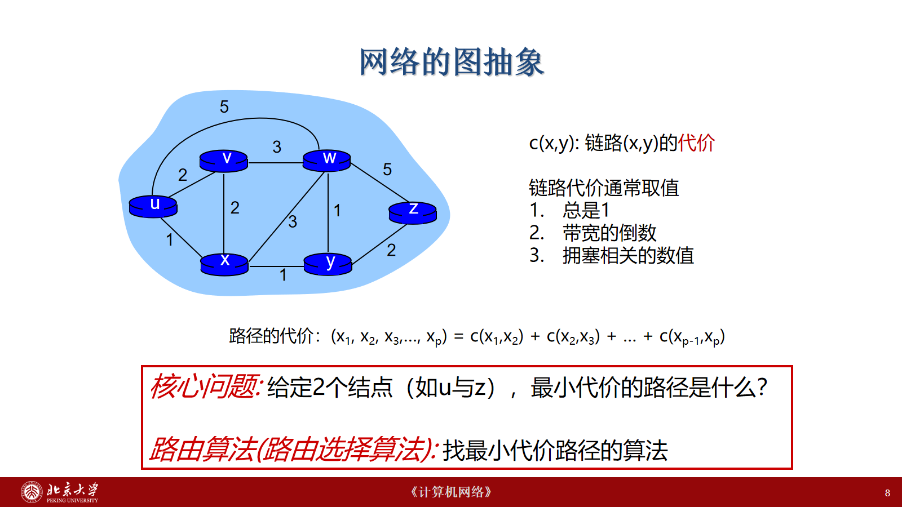
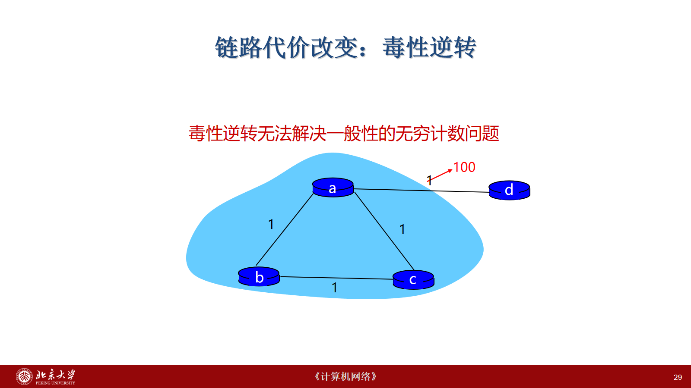
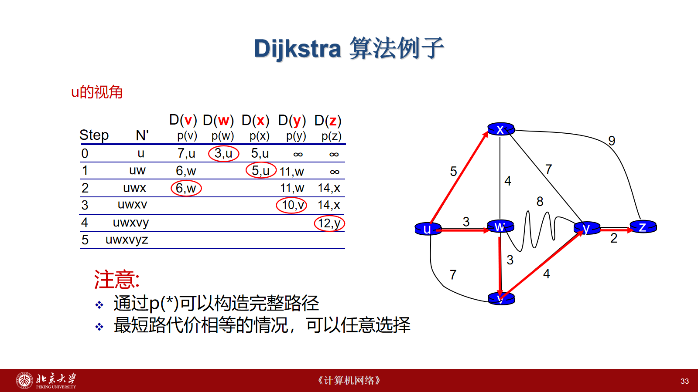
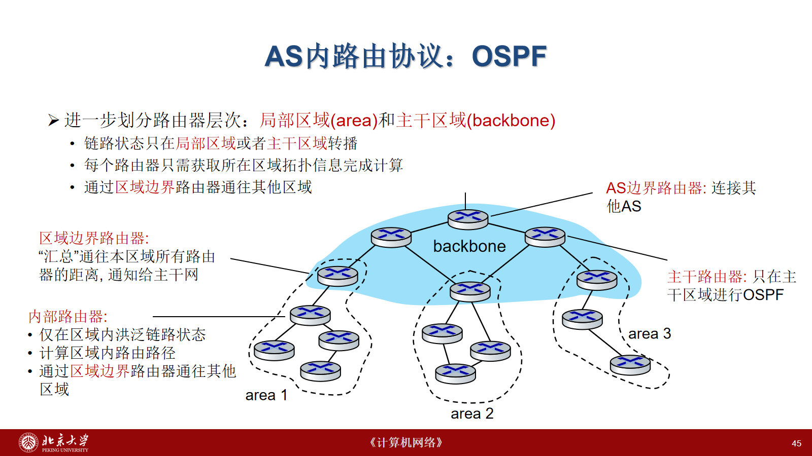
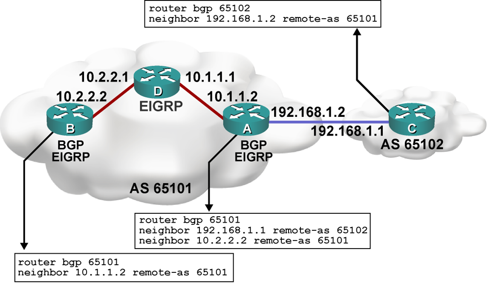
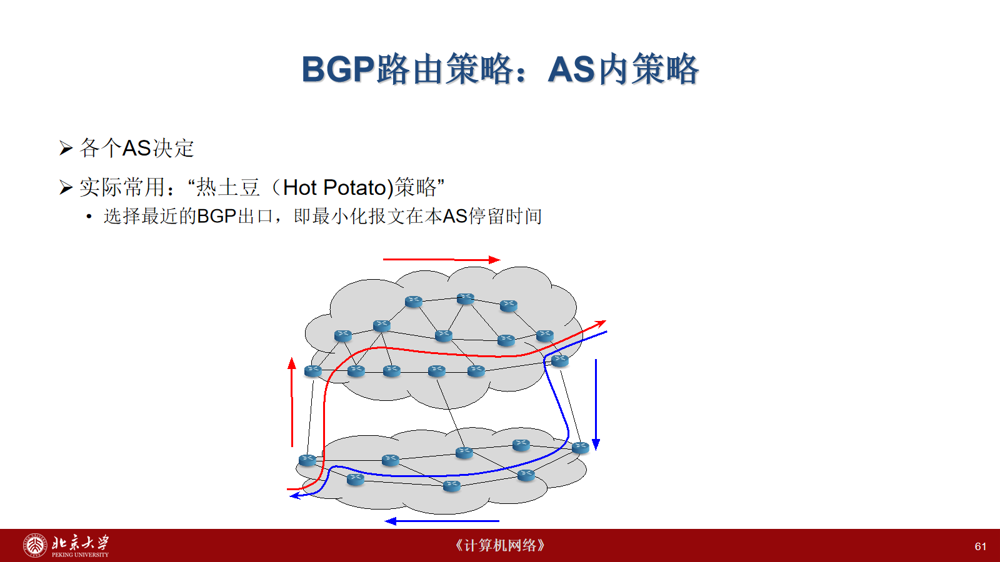
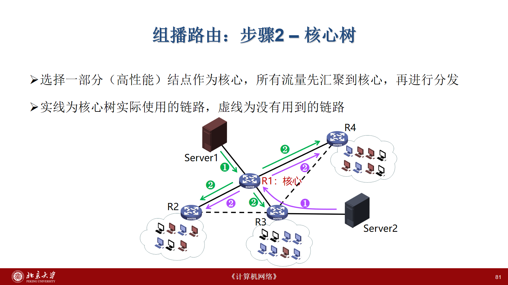

# 网络层（三）：路由技术

> 来源：北京大学《计算机网络》2026 年秋课件“第四讲_网络层（3）路由计算”，封面题为“网络层（3）路由技术”，共 87 页。
> 本章按原课件知识顺序整理，合并动画步骤，保留计算例题与关键拓扑；“校注”为对简化或易误解表述的说明。页码对应见文末，教材范围为 5.1—5.4。
> 本章是仓库第 9 章，不代表网络层前两份课件已经收录。

## 1. 转发、路由与网络模型

### 1.1 数据平面与控制平面

- **转发（forwarding）**是路由器本地动作：查看报文头部，根据转发表将分组从输入接口送到正确输出接口。
- **路由（routing）**是网络范围的路径选择：决定分组从源到目的经过哪些路由器，并据此形成各节点的转发信息。
- 传统分布式控制：每台路由器运行路由算法模块，交换信息，协同计算。
- SDN 控制：路由器上的轻量控制代理 CA 与远程控制器交互，由控制器负责主要路径计算。**逻辑集中不等于只有一台物理服务器**，控制器可以由集群实现。

“好路径”可以指低开销、低时延、高速度或低拥塞。指标不同，得到的路径可能不同；实际路由还要考虑计算与存储限制、异步更新、故障鲁棒性和资源公平性。

### 1.2 图抽象和链路代价

用 $G=(N,E)$ 表示网络：节点是路由器，边是链路，$c(x,y)$ 是链路代价。常见度量包括每条链路均为 1（最少跳数）、带宽倒数（高带宽代价低）、拥塞相关的数值。

路径 $P=(x_1,\ldots,x_p)$ 的总代价为：

$$
C(P)=\sum_{i=1}^{p-1}c(x_i,x_{i+1}).
$$

本章路由例题使用非负链路代价。没有直连链路时以 $\infty$ 表示，节点到自己的代价为 0。

第 7—8 页图中的边及权重：

| 边 | 代价 | 边 | 代价 |
|---|---:|---|---:|
| u—v | 2 | u—x | 1 |
| u—w | 5 | v—x | 2 |
| v—w | 3 | x—w | 3 |
| x—y | 1 | w—y | 1 |
| w—z | 5 | y—z | 2 |

例如 $u\to x\to y\to z$ 的代价为 $1+1+2=4$。

**校注：**第 7 页文字列举边集合时漏写了图中的 $(u,w)$，但图和第 14 页例题均使用该边，上表按图补全。第 33 页使用另一幅图，不能混用权重。

### 1.3 最短路树和算法分类

所有节点到同一个目的节点的选定最短路径可组成以目的节点为根的**汇集树（sink tree）**。有并列最短路径时需要一致地选定路径；任意并列路径的全集不必是一棵树。

| 维度 | 类型 | 含义 |
|---|---|---|
| 信息 | 全局信息 | 节点掌握完整拓扑和链路开销；典型为链路状态 LS |
| 信息 | 局部信息 | 直接知道邻居及相邻链路代价，通过交换逐步学习；典型为距离向量 DV |
| 变化 | 静态 | 路由不自动随网络状态变化 |
| 变化 | 动态 | 周期更新或响应链路代价、故障等变化 |

LS 通常基于 Dijkstra，DV 基于 Bellman–Ford。“全局信息”不意味着计算只能由中心执行：LS 中各路由器也可以独立计算。

## 2. Bellman–Ford 与距离向量

### 2.1 Bellman–Ford 方程

设 $d_x(y)$ 是从 $x$ 到 $y$ 的真实最小代价。路径第一步必须走向 $x$ 的某个邻居 $v$：

$$
d_x(y)=\min_{v\in\operatorname{Nbr}(x)}
\{c(x,v)+d_v(y)\},\quad x\ne y.
$$

即“第一跳代价 + 邻居到目的的最优代价”。这是分布式更新的依据。

**第 14 页例题：**$D_v(z)=5$、$D_x(z)=3$、$D_w(z)=3$，且 $c(u,v)=2$、$c(u,x)=1$、$c(u,w)=5$：

$$
D_u(z)=\min\{2+5,\;1+3,\;5+3\}=4.
$$

下一跳选择 $x$。$D$ 表示当前估计，收敛后才等于真实最短距离 $d$。

### 2.2 单机算法：松弛全部边

第 15 页算法图片的步骤：

~~~text
对每个 v：dist[v] = ∞，prev[v] = null
dist[s] = 0
重复 |V| - 1 轮：
    对每条有向边 (u, v)：
        若 dist[v] > dist[u] + w(u, v)：
            dist[v] = dist[u] + w(u, v)
            prev[v] = u
再次遍历每条边：
    若仍存在可松弛的边，则报告从 s 可达的负权环
~~~

无负权环时，最短简单路径至多有 $|V|-1$ 条边；反复松弛让信息继续传播。朴素时间复杂度为 $O(|V||E|)$。无向图实现时需考虑两个方向。最后的失败返回表示负权环检测，不是说存在不可达节点就失败。网络路由例题通常不使用负权，但单机 Bellman–Ford 可处理负权边。

### 2.3 分布式 DV 保存和更新什么

节点 $x$ 保存：

1. 相邻链路代价 $c(x,v)$；
2. 自己的向量 $D_x=[D_x(y):y\in N]$；
3. 最近收到的每个邻居的向量 $D_v$。

向量提供距离估计，不自动包含完整路径。实际转发还需记录达到最小值的邻居作为下一跳。

初始化时 $D_x(x)=0$，直连邻居为链路代价，其余为 $\infty$。收到邻居的新向量或发现本地链路代价改变后，对每个目的重算：

$$
D_x(y)\leftarrow
\min_{v\in\operatorname{Nbr}(x)}\{c(x,v)+D_v(y)\}.
$$

若自己的向量改变，通知邻居；否则本轮不继续传播。

~~~mermaid
flowchart LR
 A["链路变化 / 收到邻居向量"] --> B["更新缓存与代价"]
 B --> C["对每个目的执行 Bellman–Ford"]
 C --> D{"自身 DV 改变？"}
 D -- 是 --> E["更新下一跳并通知邻居"]
 D -- 否 --> F["等待下一事件"]
 E --> F
~~~

DV 的特征是**异步、事件驱动、分布式**。节点不需要同步执行同一轮，也不必最初掌握全网拓扑。课件描述触发更新模型；实际协议还可能安排周期更新，不能理解成永远不周期发送。

### 2.4 三节点收敛例题（第 20—21 页）

$c(x,y)=2$、$c(y,z)=1$、$c(x,z)=7$，按目的顺序 $(x,y,z)$：

| 节点 | 初始向量 | 收到邻居初始向量后 | 稳定值 |
|---|---|---|---|
| x | (0,2,7) | (0,2,3) | (0,2,3) |
| y | (2,0,1) | (2,0,1) | (2,0,1) |
| z | (7,1,0) | (3,1,0) | (3,1,0) |

在 $x$：

$$
D_x(y)=\min\{2+0,\;7+1\}=2,\qquad
D_x(z)=\min\{2+1,\;7+0\}=3.
$$

新的 $x\to z$ 路由经 $y$；$z\to x$ 同理。向量变化继续传给邻居，直到不再有变化。

### 2.5 好消息快：代价下降

第 22 页初始 $c(x,y)=4$、$c(y,z)=1$、$c(x,z)=50$。当 $c(x,y)$ 降为 1：

- $t_0$：$y$ 检测变化，将到 $x$ 的距离改为 1，通知邻居；
- $t_1$：$z$ 收到后将到 $x$ 的距离从 5 改为 $1+1=2$，通知邻居；
- $t_2$：$y$ 收到 $z$ 的新值，经 $z$ 的候选为 $1+2=3$，不如直连 1，不再改变。

改善沿网络迅速传播，称为“好消息传播快”。

### 2.6 坏消息慢：无穷计数

从相同初始图出发，若 $c(x,y)$ 升为 60，变化前 $D_y(x)=4$、$D_z(x)=5$：

| 更新者 | 计算依据 | 新估计 |
|---|---|---:|
| y | $\min(60,1+5)$ | 6 |
| z | $\min(50,1+6)$ | 7 |
| y | $\min(60,1+7)$ | 8 |
| … | 相互使用过期的低估值 | … |
| z | 经 y 不再优于直连，改走 x | 50 |
| y | $\min(60,1+50)$ | 51 |

问题是 $z$ 的旧距离 5 本来依赖 $y$，但普通 DV 没告诉 $y$ 这一点。两者误以为对方知道更好的路，可能暂时形成转发环。

第 27 页将动画中的交换量写为“48 次消息”。这是课件选定时序及计数口径，不是任意异步实现的固定次数。关键是距离可能逐级上涨，链路失效或代价极大时收敛不可接受，即 **count-to-infinity**。“无穷”不要求数值真的无限增长，协议可能定义有限不可达值。

### 2.7 毒性逆转及局限

若 $a$ 到 $c$ 的下一跳是 $b$，则 $a$ **专门向 $b$** 通告 $D_a(c)=\infty$，防止 $b$ 反过来依赖 $a$。向其他邻居不必也通告无穷；本地实际距离也不是被改成无穷。

上例中 $z$ 经 $y$ 到 $x$，故向 $y$ 通告到 $x$ 的距离为 $\infty$。链路升价后：

$$
D_y(x)=\min(60,\;1+\infty)=60.
$$

随后 $z$ 可改走直连的 50，$y$ 再改为经 $z$ 的 51，避免刚才的两节点互相误信。

图中 $a,b,c$ 构成边权均为 1 的三角形，$a-d$ 从 1 升为 100。毒性逆转针对“我正经由你”的依赖，不能普遍阻断绕过第三个节点的旧路由依赖，因此不能保证消除三个或更多节点的环路及无穷计数。

## 3. 链路状态与 Dijkstra

### 3.1 先传播拓扑，再独立计算

LS 的过程：

1. 发现邻居、获知相邻链路开销；
2. 洪泛链路状态；
3. 各节点在所得拓扑上，以自身为源运行 Dijkstra；
4. 从最短路树构造转发表。

“所有节点信息相同”描述同步后的稳定状态；变化传播期间可能短暂不一致。

记号：

- $N'$：最短距离已确定的节点集合；
- $D(v)$：源 $u$ 到 $v$ 的当前估计；
- $p(v)$：当前最佳路径上 $v$ 的前驱，不一定是源节点的下一跳。

初始化 $N'=\{u\}$，对邻居令 $D(v)=c(u,v)$，其余为 $\infty$。反复选择未确定节点中距离最小的 $w$ 加入 $N'$，对其未确定邻居执行：

$$
D(v)\leftarrow\min\{D(v),D(w)+c(w,v)\}.
$$

若第二项更小，更新 $p(v)=w$。直到全部可达节点确定。非负权保证当前最小值不会被后续绕行改小。

### 3.2 完整例题（第 33—34 页）

本例边权：
$u-v:7$，$u-w:3$，$u-x:5$，
$w-v:3$，$w-x:4$，$w-y:8$，
$v-y:4$，$x-y:7$，$x-z:9$，$y-z:2$。

表中写“距离,前驱”，已确定项用“—”：

| 步骤 | $N'$ | v | w | x | y | z |
|---:|---|---|---|---|---|---|
| 0 | u | 7,u | 3,u | 5,u | ∞ | ∞ |
| 1 | uw | 6,w | — | 5,u | 11,w | ∞ |
| 2 | uwx | 6,w | — | — | 11,w | 14,x |
| 3 | uwxv | — | — | — | 10,v | 14,x |
| 4 | uwxvy | — | — | — | — | 12,y |
| 5 | uwxvyz | — | — | — | — | — |

关键更新：

- 加入 $w$：到 $v$ 从 7 改成 $3+3=6$；
- 加入 $x$：到 $z$ 暂为 $5+9=14$；
- 加入 $v$：到 $y$ 从 11 改成 $6+4=10$；
- 加入 $y$：到 $z$ 从 14 改成 $10+2=12$。

最终路径 $u\to w\to v\to y\to z$，总代价 12。沿前驱 $p(z),p(y),p(v),p(w)$ 逆推，再取源之后第一个节点才得到下一跳。

| 目的 | 最短距离 | u 的下一跳 / 输出链路 |
|---|---:|---|
| v | 6 | w / (u,w) |
| w | 3 | w / (u,w) |
| x | 5 | x / (u,x) |
| y | 10 | w / (u,w) |
| z | 12 | w / (u,w) |

并列最短路径可以选择其一；实际系统也可能支持等价多路径。不能把目的节点的前驱直接当成源的下一跳。

### 3.3 DV 与 LS 比较

| 方面 | LS | DV |
|---|---|---|
| 交换内容 | 本地链路事实 | 到各目的的计算结果 |
| 范围 | 洪泛到所属范围 | 与邻居交换 |
| 本地计算 | 独立运行最短路 | 依赖邻居估计迭代 |
| 稳定拓扑消息量 | 课件记为 $O(nE)$ | 课件理想轮次模型记为至多 $O(nE)$ |
| 收敛 | 先传播再计算，仍可能暂时不一致 | 可能慢收敛、无穷计数 |
| 错误传播 | 错误链路信息影响各节点，但计算独立 | 错误结果可能被继续使用和传播 |

**复杂度校注：**第 35 页将 Dijkstra 写为 $O(n^2)$ 或 $O(n\log n)$。一般邻接表加二叉堆为 $O((n+E)\log n)$，稀疏图 $E=O(n)$ 才简化为 $O(n\log n)$。DV 的上界也依赖轮次、传输与稳定性条件，不能当作任意异步故障场景的保证。“LS 影响小”也不等于能免疫错误通告。

## 4. 层次路由与自治系统

### 4.1 路由表为什么需要分层

第 37—38 页中，R1 到 PC1、PC2 都走 R2，到 PC5、PC6 都走 R4，其余经 R3。可以合并可聚合的目的，并以默认路由表示“其他”，降低条目、存储和查找开销。

但**地址聚合依赖地址分配与拓扑**。非连续地址不能任意当作连续前缀；“PC1—PC2”只是教学示意，不是真实 IP 聚合语法。

不同机构还希望自行决定内部路由与管理策略。层次路由同时处理：

- 扩展性：控制网络扩大时状态与交换开销的增长；
- 自治性：不要求所有机构公开或服从统一的全部内部细节。

### 4.2 AS、IGP 和 EGP

**AS（Autonomous System）**是统一管理与路由策略下的一组网络，有 AS 号。课件解释为一个管理机构控制的网络。AS 内可采用统一度量，不同 AS 对“最优”未必有共识。

- **IGP**：AS 内路由，如 RIP、OSPF、IS-IS、EIGRP。
- **外部网关协议 EGP 类别**：AS 间路由，互联网主要使用 BGP。
- EGP 这一协议类别不应与历史上名为 EGP 的具体协议混淆。

第 41 页用“AS2 内全部网络”取代多个外部子网条目，是层次化示意。**真实 BGP 仍按 IP 前缀发布可达性**，不是用 AS 号代替 IP 地址查表。AS 可以类比一个“超级管理域”，但不是天然连续的 IP 子网。

### 4.3 常见内部协议

| 协议 | 课件要点 | 阅读时的边界 |
|---|---|---|
| RIP | 经典 DV，以跳数为度量，每 30 秒交换 | “不再使用”宜理解为不适合现代大规模网络，不代表全球零部署 |
| EIGRP | 思科发展，距离向量路线，课件标注 2013 年开放及 RFC 7868 | 开放技术描述不等于 Standards Track 标准 |
| OSPF | 链路状态协议，RFC 2328 | 本章重点 |
| IS-IS | 同属链路状态，源于 ISO | 与 OSPF 的区别不只是标准组织，报文与运行方式也不同 |

## 5. OSPF：区域与数据库同步

### 5.1 四步过程

发现邻居 → 获知或配置链路 cost → 洪泛链路状态 → 建立拓扑并运行 Dijkstra。

带宽倒数、时延、跳数是课件解释度量的例子。部署中的 OSPF cost 是可配置接口度量，不应理解为默认自动按实时拥塞或实测时延更新。

### 5.2 区域结构

AS 内再划分 area，骨干区域连接其他区域：

- **内部路由器**：接口均在同一区域；
- **区域边界路由器 ABR**：连接多个区域，负责区域间路由信息；
- **骨干路由器**：至少一个接口属于骨干区域；
- **AS 边界路由器 ASBR**：交换或引入其他路由域的信息。

区域内维护详细拓扑，跨区域通过边界路由器。不同 LSA 类型的传播范围不同，不能把“只在局部或骨干转播”理解为所有通告具有相同范围。

**校注：**第 45 页“主干路由器只在主干区域进行 OSPF”过严；ABR 也可以是骨干路由器，角色可以重叠。依据 RFC 2328 的分类。

### 5.3 LSDB、LSA 与五种报文

LSDB 是链路状态数据库，LSA 是其中的链路状态通告记录。LSA 不是独立的第六类 OSPF 报文。

| 报文 | 作用 |
|---|---|
| Hello | 发现、维护邻居 |
| Database Description，DD | 交换数据库摘要，包括 LSA 头部 |
| Link State Request，LSR | 请求缺少或待更新的 LSA |
| Link State Update，LSU | 携带需要传播的 LSA |
| Link State Acknowledgment，LSAck | 确认 LSA，支持可靠洪泛 |

课件把 LSR/LSU 展开为 LSA Request/Update，正式名称是 Link State Request/Update。LSAck 确认的是 LSA，不是简单逐个确认整个 LSU 包。

### 5.4 邻接建立

第 47 页的主要顺序：

1. Hello 发现邻居；
2. 同步前协商 DD 主从角色与序列号；
3. Exchange 交换 DD，找出数据库差异；
4. Loading 用 LSR 请求、LSU 传递、LSAck 确认；
5. Full 表示邻接所需数据库同步完成。

**校注：**这是简化时序。完整状态还包括 Down、Attempt（特定网络）、Init、2-Way、ExStart 等；不是所有双向邻居都必须进入 Full。DD 主从是路由器同步角色，不是选择“服务器”；Full 也不意味着全互联网一致。

## 6. BGP：可达性与策略

### 6.1 为什么 AS 间不能只比较最短路

各 AS 对代价、商业关系与允许转运的流量有不同要求。不仅要决定“流量往哪发”，还要决定“愿意为谁转发”。

课件的“全球 AS 5 万+、路由器百万级”是历史性粗略量级，未作为 2026 年实时统计核实。规模和自治策略共同推动分层。

BGP 交换**前缀可达性及路径属性**，不是全网物理链路图，也不是无条件选择物理跳数最少的路径。

### 6.2 eBGP、iBGP、IGP 分工

| 关系 | 功能 |
|---|---|
| eBGP | 不同 AS 的对等体交换外部可达性 |
| iBGP | 同一 AS 的 BGP 路由器传播 BGP 信息 |
| IGP | 提供本 AS 内部到路由器/下一跳的路径 |

边界路由器常同时参与三者。iBGP 不是 IGP，也不能替代内部下一跳可达性。

BGP 对等体通过 **TCP** 交换报文，课件重点为路径通告。建立会话时交换所需路由，随后主要增量通告变化或撤销，不是周期完整广播。课件“边界路由器很少”是相对内部节点的解释，不是大型 AS 的固定保证。

### 6.3 路径通告例题

网络 X 属于 AS3：

1. AS3 的 3a 向 AS2 的 2c 通告“AS3, X”；
2. AS2 按策略接受或拒绝，接受后在内部用 iBGP 传播；
3. AS2 若愿向 AS1 提供该路径，通告“AS2, AS3, X”；
4. AS1 也可能直接从 AS3 学到“AS3, X”，再依自身策略选择。

~~~mermaid
flowchart RL
 X["目的前缀 X"] --- A3["AS3"]
 A3 -- "通告 AS3, X" --> A2["AS2"]
 A2 -- "通告 AS2, AS3, X" --> A1["AS1"]
 A3 -- "另一条通告 AS3, X" --> A1
~~~

箭头是控制信息方向，AS1 发往 X 的数据沿选定路径反向到 AS3。AS-PATH 记录 AS 序列，可用于发现包含本 AS 的环路。对外通告还体现愿意承接相应流量的策略，但不保证此后永不故障。

### 6.4 从路由到输出接口

第 56 页中，BGP 告诉内部路由器外部 X 应经 1c；内部路由又给出到 1c 使用接口 1，最终 X 的转发项使用接口 1。

应区分：

- **BGP NEXT_HOP**：路径属性中的下一跳地址；
- **即时下一跳、输出接口**：真正发送当前分组时使用的邻接与接口。

二者可能通过递归查内部路由表关联。AS-PATH 不是逐台路由器的源路由列表。

### 6.5 配置例题（第 57 页）

AS65101 内 B—D—A 使用 EIGRP；A 与 AS65102 的 C 直连：

| 链路 | 两端地址 |
|---|---|
| B—D | B 10.2.2.2；D 10.2.2.1 |
| D—A | D 10.1.1.1；A 10.1.1.2 |
| A—C | A 192.168.1.2；C 192.168.1.1 |

A：

~~~text
router bgp 65101
neighbor 192.168.1.1 remote-as 65102
neighbor 10.2.2.2 remote-as 65101
~~~

C：

~~~text
router bgp 65102
neighbor 192.168.1.2 remote-as 65101
~~~

B：

~~~text
router bgp 65101
neighbor 10.1.1.2 remote-as 65101
~~~

remote-as 与本地 AS 不同为 eBGP，相同为 iBGP。B 与 A 不必物理直连，但必须有内部可达路径。这只是会话示意，不含全部前缀发布、下一跳与出口策略，不能当作完整可部署配置。

### 6.6 策略选择

第 58 页的简化顺序：

1. 本地偏好，先体现政策；
2. 较短 AS-PATH；
3. 较近 NEXT_HOP，即较小内部代价；
4. 附加平局规则，例如路由器 ID。

这不是所有设备的完整选路表。必须先考虑路由可用性及下一跳可达，其他属性和配置也可能改变结果。不能把 AS-PATH 最短放在所有政策前面。

**用户网络 X 多宿主：**X 同时连 B、C 两个提供商，但不愿做两者的转运网络，就不向 B 通告经 C 学来的相应路由。物理连接不等于承诺中转。

**提供商 B：**A 向 B 通告 AW，B 可向自己的客户 X 通告 BAW。但 W、C 都不是 B 的客户时，B 可以不向 C 通告 BAW，让 C 经 A 去 W。原则是只承担政策允许的来自或去往自己客户的流量。

**热土豆策略：**在更高优先级条件允许的候选中，选择内部距离最近的 BGP 出口，尽快把流量交出去，减少本 AS 的内部传输负担。

最近出口不保证端到端路径最短，两个方向的路径也可能不同。

### 6.7 2021 年 Facebook 故障

第 62—65 页说明 BGP、DNS 与运维可达性的依赖。Meta 2021-10-05 官方说明：维护命令意外断开骨干连接，安全检查未阻止；DNS 站点因数据中心不可达而撤销相关 BGP 通告，外部无法访问 DNS；运维通道同样受影响，拖慢恢复。

这不是 DNS 协议直接撤销全互联网路由，而是健康检查与路由公告的部署联动。服务进程仍运行，不代表网络仍可达。重试、流量迁移及管理通道中断会扩大影响。

课件写“超过 7 小时”，并给出广告 6000 万美元、市值 473 亿美元、个人资产 60 亿美元等损失估计。这些是**课件转载的历史估计，未单独核实**，不作为算法或故障机制的依据。

## 7. 广播路由

广播是在一个广播范围内把同一分组送到全部目标。课件用服务器给 3 个网络中的 30 个用户发视频说明。

### 7.1 四类办法

| 办法 | 操作 | 取舍 |
|---|---|---|
| 多次单播 | 源为每个目标分别发一份 | 需知道全部地址，共享链路重复传输 |
| 多目标路由 | 携带目标集合，在必要分叉处复制 | 降低共享段重复，但目标集合复杂且源仍需全部地址 |
| 泛洪 | 从除入接口外的其他接口发出 | 仅需邻居，容错性强，需控制环路与重复 |
| 生成树 | 只沿树边发送 | 无环，但需建立与维护树 |

30 用户示例中，多次单播让共享上游反复携带 30 份；分叉复制可以降低共享段开销。具体数量依拓扑而定，不能将“每链路一份”套到任意有环网络。

### 7.2 控制泛洪

无控制泛洪将每个入站包复制到其他线路。只要仍有可用路径，容易覆盖连通范围，但环路造成广播风暴。TTL 限制存活时间，不保证过期前不出现副本爆炸。

**序号控制：**

1. 分组携带源 $S$ 与广播序号 $n$；
2. 查询是否已见过 $(S,n)$；
3. 已见则丢弃，否则记录并向其他接口转发。

实际还需处理缓存期限、序号回绕与源重启，不能只靠一个永不清理的记录。

**逆向路径转发 RPF：**

检查分组是否从本机通往**源**的最佳路径接口到达。是则向其他接口转发，否则丢弃。查的是源的反向路径，不是组播目的的普通查表。

第 72 页到 N1 的最佳接口为 1，源来自 N1 的包从接口 1 到达后可向 2、3 转发。RPF 不能保证网络完全不产生重复包，有的副本会到达后才被丢弃。

### 7.3 生成树

在覆盖范围的树上发送，没有环，避免循环副本。路由器不一定掌握整棵树，只需知道树上的邻居。

树必须随故障维护；一棵生成树也不保证对所有源都是最短路径树。

## 8. 组播路由

组播只发给一个组的接收成员。分叉点复制，共享路径尽量只传一份。理想要求是成员各收一份、非成员不接收，并尽可能优化路径。

### 8.1 两个层次的问题

1. **成员管理：**边缘路由器知道哪个接口后有该组成员；
2. **路由建树：**路由器间形成通往这些成员的转发结构。

IGMP 主要解决 IPv4 本链路成员管理，不单独完成全网组播路由。主机加入或退出，路由器查询成员状态。

第 77 页不同单播地址的主机加入同一组 **226.15.37.123**。组地址是逻辑标识，不是固定服务器地址，也不意味着成员在同一子网。“公开地址”不应理解成无需管理或全球任意可达。

### 8.2 IPv4 地址

组播范围 **224.0.0.0/4**，前四位为 1110，剩余 28 位构成组播地址空间，历史上称 D 类。

| 地址 | 含义 |
|---|---|
| 224.0.0.0/24 | 本地链路控制范围，通常不向外路由 |
| 224.0.0.1 | 本链路所有系统 |
| 224.0.0.2 | 本链路所有路由器 |
| 224.0.0.5 | OSPF AllSPFRouters |
| 224.0.0.251 | mDNS IPv4 链路本地组播地址 |

**校注：**第 78 页把 224.0.0.251 称为“LAN 上所有 DNS 服务器”，不准确。它用于 Multicast DNS，常用 UDP 5353，不是普通单播 DNS 服务器集合。参见 RFC 6762。

### 8.3 源点树与核心树

| 方案 | 建树方式 | 收益 | 代价 |
|---|---|---|---|
| 源点树 | 每个源独立建树 | 针对源优化路径 | 源多时计算和状态开销大 |
| 核心 / 共享树 | 多个源经核心汇集后分发 | 共享结构，减少状态 | 可能绕路，依赖核心选择 |

R1 为核心，Server1、Server2 先送到 R1，再沿实线分发。虚线链路虽然存在，却未用于共享树。所以 Server2 到某些成员的跳数可能多于其独立源点树。

第 75 页的逐源最短路径是目标，不是所有组播方案的保证；核心树恰好体现最短路径与少状态之间的取舍。

应用包括音视频会议、共享白板、实时行情、数据分发、多方游戏与仿真。列举应用不表示每个现代产品都实际使用网络层 IP 组播。

## 9. Anycast：选播 / 任播

Anycast 将同一服务地址部署在多个节点，分组到达路由策略选出的一个实例，常称“最近的组成员”。

| 方式 | 目标 |
|---|---|
| 单播 | 一个指定目标 |
| 广播 | 范围内全部目标 |
| 组播 | 某组的所有接收成员 |
| Anycast | 多个候选服务实例中的一个 |

“最近”取决于路由，不保证地理最近、RTT 最低或负载最低。它能在适当部署下缩短路径、分散流量并支持故障冗余，但不保证精确均衡。

DNS 是典型应用。**校注：**第 86 页“没有指定 DNS 服务器”容易误解。客户端仍向一个确定的 DNS 服务 IP 发请求；该地址若由多个站点以 Anycast 发布，网络才把请求导向其中一个。Anycast 不负责自动给客户端配置 DNS。

## 10. 复习与易混点

1. 转发是本地动作；路由形成路径与转发信息。
2. LS 全局信息不等于物理集中；DV 不要求节点知道全拓扑。
3. DV 的估计可能依赖过期信息；毒性逆转不是一般环路的完整解决方案。
4. Dijkstra 的前驱不等于源的下一跳，必须逆推路径。
5. LSA 是记录，DD/LSR/LSU/LSAck 是不同同步报文。
6. iBGP 传 BGP 路由，IGP 管内部可达性，不能互换。
7. BGP 最佳由策略决定，不单由 AS-PATH 长度决定。
8. RPF 检查到源的反向接口；IGMP 管成员，不独立完成建树。
9. 核心树少状态与源点树短路径是取舍。
10. Anycast 选一个实例，不是复制给所有实例。

## 11. 页码覆盖与核验

| 页码 | 本章位置 / 处理 |
|---|---|
| 1—2 | 来源和结构；移除教师邮箱等非技术内容 |
| 3—11 | §1：平面、SDN、目标、图、汇集树、分类 |
| 12 | 重复目录合并 |
| 13—19 | §2.1—2.3：方程、算例、图片伪代码、DV |
| 20—21 | §2.4：动画合并为向量表 |
| 22—27 | §2.5—2.6：代价变化与无穷计数 |
| 28—29 | §2.7：毒性逆转及局限 |
| 30 | 重复目录合并 |
| 31—35 | §3：Dijkstra 完整计算与转发表、比较 |
| 36 | 重复目录合并 |
| 37—43 | §4：聚合、层次、AS、IGP/EGP |
| 44—47 | §5：OSPF、LSDB、报文和同步 |
| 48—61 | §6.1—6.6：BGP、通告、接口、配置、策略 |
| 62—65 | §6.7：历史故障，未核实估计明确标注 |
| 66 | 重复目录合并 |
| 67—73 | §7：广播、泛洪、RPF、生成树 |
| 74—83 | §8：成员、地址、两种树、应用 |
| 84—86 | §9：Anycast，删除警察局装饰类比 |
| 87 | §10：知识梳理与教材范围 |

读取全部 87 页文本及备注；备注仅有历史页码或空内容，没有新增技术段落。第 15 页算法图片、第 57 页配置图片及第 8、29、33、45、61、81 页关键图已视觉核对。必要技术图使用相对路径，原 PPTX 不在发布文件内。

### 校注与参考来源

- 原课件：课程 _104128_1，内容项 _1727334_1，文件资源 13553795_1；核验日期 2026-11-09。文件身份和 SHA-256 见 [来源核验记录](sources/network-routing-2026-11-09.json)。
- [RFC 2328 — OSPF Version 2](https://datatracker.ietf.org/doc/html/rfc2328)：区域、路由器分类、报文与状态。
- [RFC 4271 — BGP-4](https://www.rfc-editor.org/info/rfc4271/)：AS 路径、可达性和下一跳查找。
- [RFC 6762 — Multicast DNS](https://www.rfc-editor.org/info/rfc6762/)：224.0.0.251 和 UDP 5353。
- [Meta：2021-10-04 故障详情](https://engineering.fb.com/2021/10/05/networking-traffic/outage-details/)：骨干、DNS/BGP 与恢复困难。

标准及官方说明于 2026-11-09 查阅。算法推导和校注用于澄清课件，不冒充教师原话。
