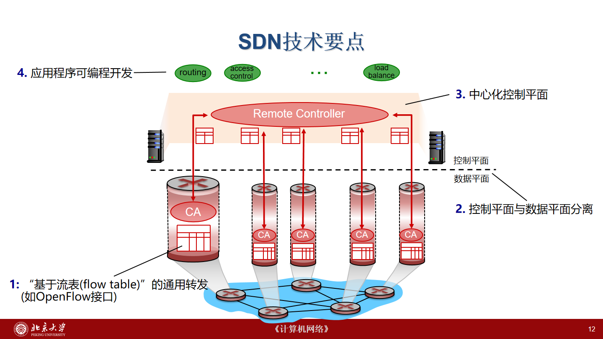
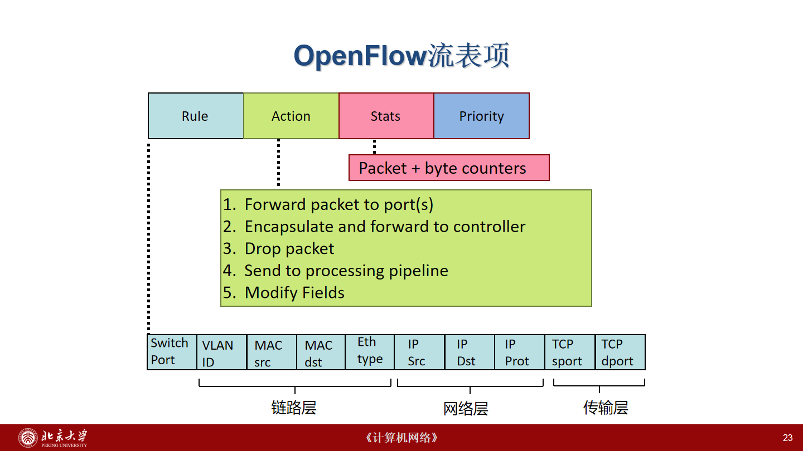
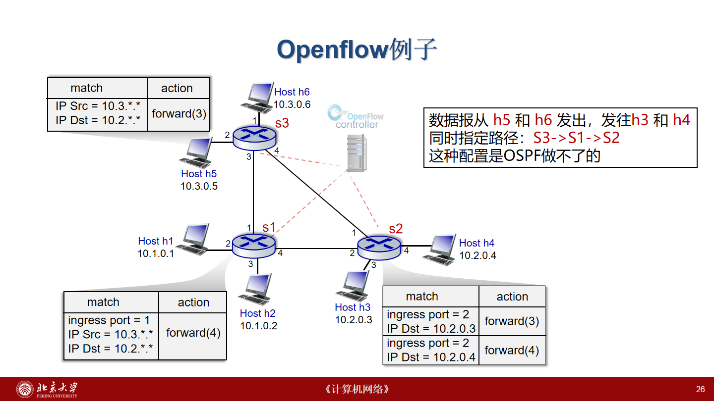
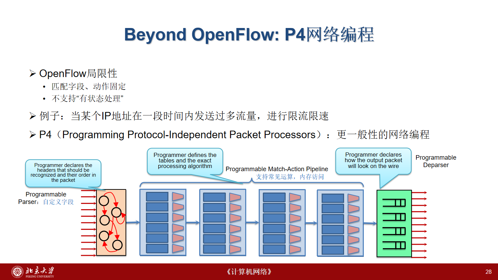
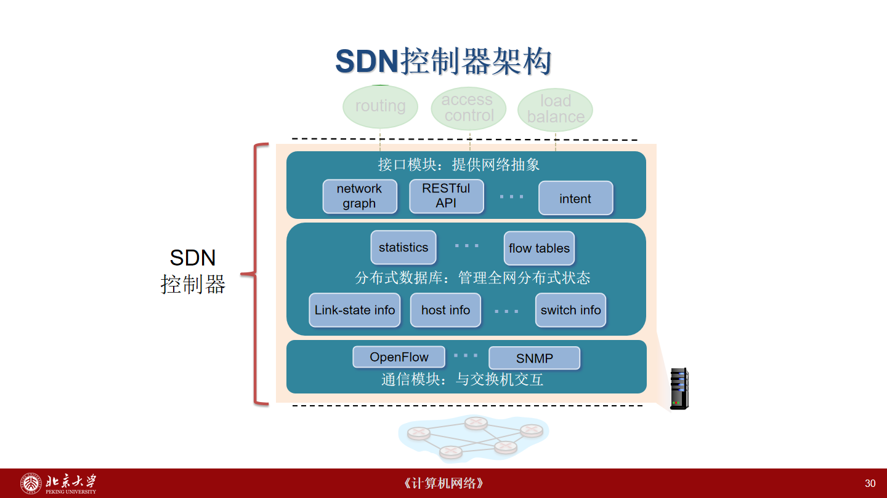

# 网络层（四）：软件定义网络 SDN

> 来源：北京大学《计算机网络》2026 年秋课件“网络层（4）软件定义网络 SDN”，共 40 页；2026-11-11 核验资源 13579528_1。
> 按“为什么需要 SDN → 数据平面 → 控制平面 → 故障处理”的顺序整理。重复目录、动画与装饰已合并，保留流表例题和关键图。课件中的历史判断不作为实时产业统计；“校注”和“推导”不是教师原话。
> 教材对应 4.4、5.5。前置阅读：[路由技术](09-网络层-路由技术.md)。

## 1. 为什么需要重新设计网络控制

### 1.1 传统网络的耦合

传统路由器同时承担两类工作：

- **数据平面**：逐包解析、查表、交换、输出，追求高速、确定的处理；
- **控制平面**：运行路由协议、交换网络状态、计算路径、形成转发表。

传统设备的数据平面硬件、操作系统和网络应用紧密耦合，接口往往由厂商专有定义。增加新功能常常需要设备和软件一起升级；跨厂商统一配置、扩展报文处理功能也较困难。课件以 PC 从专用封闭系统到开放接口的演化作类比：希望网络应用能独立开发，而不必每次重新制造整台设备。

“传统网络不可编程”是相对于开放、通用可编程接口的概括，不应理解成传统设备完全不能配置或没有软件。

### 1.2 分布式路由的局限

DV 依赖邻居逐步传播估计，可能慢收敛、无穷计数；LS 先洪泛链路状态，再由节点独立计算。网络规模扩大时，传播、计算、同步以及运维的复杂度都会上升。AS、区域能控制传播范围，但不自动解决全网流量调度问题。

这里不是否定分布式协议：分布式方法能避免依赖单个中心，已经支撑大规模互联网。SDN 改变的是**控制组织方式和可编程接口**，仍需解决状态传播、故障恢复及一致性。

### 1.3 最短路不等于最好的流量分配

**流量工程（Traffic Engineering，TE）**根据流量需求和资源约束安排路径，目标包括提高带宽利用率、减轻拥塞。课件提到线性规划、网络流等方法。

最短路优化某条路径的代价；TE 关注多条流共享链路后的整体负载。一条链路同时出现在很多最短路径中，可能成为瓶颈。

课件第 8—10 页的三个问题：

1. 让 $u\to z$ 走 $u-v-w-z$，而 $x\to z$ 走 $x-w-y-z$。调整链路代价有时能诱导目标路径，但不保证所有要求能同时满足。
2. 把同一源目的的流量分配到 $u-v-w-z$ 和 $u-x-y-z$ 两条路径。
3. 在 $w$ 上区别对待同一目的、不同来源或类别的流量，而非只按目的地址查表。

**边界：**课件针对基础的、按目的地址、单一路径的最短路模型。现实网络可能有 ECMP、多路径和其他流量工程扩展，不应推导成“所有传统网络都无法分流”。

**辅助推导：**若需求 $d$ 有候选路径集合 $\mathcal P_d$，令 $x_{d,p}$ 为分给路径 $p$ 的速率，则可写：

$$
\sum_{p\in\mathcal P_d} x_{d,p}=h_d,\qquad x_{d,p}\ge 0,
$$

$$
\sum_d\sum_{\substack{p\in\mathcal P_d\\e\in p}}x_{d,p}
\le U C_e .
$$

$h_d$ 是需求，$C_e$ 是链路容量，$U$ 是最大利用率；最小化 $U$ 是一种可能目标。这是用于解释课件“全局优化”的补充模型，不是课件给出的完整算法。数据不足、需求不可满足、流不可任意切分时还需修改约束；控制器也不会凭空知道需求矩阵。

## 2. SDN 的核心架构

### 2.1 四个技术要点

1. **基于流表的通用转发**：匹配多种字段，再执行动作。
2. **控制平面与数据平面分离**：交换机负责快速执行，控制系统负责策略与规则生成。
3. **逻辑中心化控制**：向应用提供全局网络视角。
4. **网络应用可编程**：路由、访问控制、负载均衡等可以作为软件应用。

交换机保留轻量控制代理 CA，与控制器交互。逻辑集中不等于一台服务器；控制器可由多台机器协同实现，以满足性能、扩展性和容错要求。

### 2.2 三层分工和两类接口

| 层次 | 主要内容 | 不应混淆的边界 |
|---|---|---|
| 网络应用 | 路由、访问控制、负载均衡、TE | 表达策略或计算规则，不必逐包处理 |
| 控制器 / 网络操作系统 | 维护状态、提供抽象、协调规则下发 | 不是普通主机操作系统，也不替每台交换机搬运所有数据包 |
| SDN 交换机 | 维护流表，按规则匹配与执行 | 仍有硬件能力、表容量、处理速度等限制 |

- **南向接口**：控制器与数据平面设备之间的接口，课件重点是 OpenFlow。
- **北向接口**：控制器向应用提供的抽象与服务，可涉及网络图、统计、路径或意图。
- 不同厂商可以实现接口两端，但协议版本、能力与配置仍须兼容，不能仅凭“支持 SDN”就假设全部可互换。

典型流程是应用提出需求，控制器计算并安装流表，交换机独立转发匹配到的包。不是每个包都必须先到控制器再转发。

### 2.3 收益、条件与历史脉络

课件强调开放接口、全局管理、改善收敛与流量工程、降低编程难度。收益依赖控制器能力、通信延迟、状态新鲜度以及规则正确性；集中控制本身不保证无故障或最优。

课件历史节点：

- 2006—2007：斯坦福 Ethane，通过集中控制管理校园网络安全；
- 2008：OpenFlow；
- 2014：P4。

SDN 是一组架构思想，不是一种单独协议。课件区分狭义的 OpenFlow 路线与广义的控制/转发分离、可编程网络。第 19 页关于市场、厂商和标准组织的评价属于讲义背景，不能当成 2026 年市场份额或实时结论。

## 3. 数据平面：从查路由表到匹配—动作

### 3.1 流是什么

**流（flow）**是由选定字段共同定义的一组报文。例如来源网段、目的网段和传输层端口符合相同条件的报文可归为一类。它不必等同于一个 TCP 连接，也不必总用五元组。

普通流表可概括为：

- 匹配头部或元数据；
- 统计计数器；
- 匹配后执行的动作。

OpenFlow 的课堂抽象另外突出**优先级**，用于多个表项同时匹配时选择规则。

匹配字段可以跨层：

| 类别 | 课件示例 |
|---|---|
| 入接口 | Switch Port |
| 链路层 | VLAN ID、MAC 源/目的、EtherType |
| 网络层 | IP 源/目的、IP 协议号 |
| 传输层 | TCP 源/目的端口 |

动作包括输出到一个或多个端口、送控制器、丢弃、进入后续处理流水线、修改字段。统计常包括报文数与字节数。匹配传输层字段时，还需确保前面的协议类型等条件符合解析前提。

### 3.2 规则匹配与优先级

第 22 页以通配符表示：

~~~text
src=1.2.*.*, dest=3.4.5.*  -> drop
src=*.*.*.*, dest=3.4.*.*  -> forward(2)
src=10.1.2.3, dest=*      -> send to controller
~~~

这是课堂示意，不是可直接粘贴运行的命令。前两条可能同时匹配某个报文，必须使用优先级表达“特殊拒绝规则优先于一般转发规则”。不能仅按展示顺序断言执行哪条，也不能不加条件地认为任意流表自动使用最长前缀匹配。

**标准校注：**OpenFlow 1.3.5 的流表还包含超时等字段和指令；多表流水线、table-miss、group、meter 超出了四格简图。未命中不必然送控制器，取决于配置。协议消息还包括双方均可发送的 symmetric 类，不能只记作两个方向。[ONF 规范 §§5—6](https://opennetworking.org/wp-content/uploads/2014/10/openflow-switch-v1.3.5.pdf)。

### 3.3 用统一抽象表示不同网络设备

| 功能 | 匹配 | 动作 |
|---|---|---|
| 路由器 | 目的 IP 前缀等 | 输出到选定接口 |
| 二层交换机 | 目的 MAC | 输出，必要时复制 |
| 防火墙 | IP、协议、端口等策略条件 | 允许或丢弃 |
| NAT | 地址、端口和其他必要条件 | 修改字段并转发 |

“能用匹配—动作表示”不等于只要一条表项就具备完整 NAT、防火墙或负载均衡系统。完整功能还可能需要连接状态、地址分配、反向规则及其他处理。

课件将基于开放设备实现多类网络功能联系到网络功能虚拟化。复习时分清两个关注点：SDN 侧重控制组织和可编程接口；网络功能的软件化/虚拟化侧重功能如何部署。二者可以结合，但不是同一个定义。

### 3.4 第 25 页三道配置例题

1. **目的 IP 为 51.6.0.8**：匹配该目的 IP，输出到端口 6，其余不相关字段通配。
2. **禁止 TCP 目的端口 22**：匹配 TCP 和目的端口 22，动作丢弃。这里是目的端口，不是交换机输出接口 22；仅匹配端口数值不足以表达协议条件。
3. **目的 MAC 为 22:A7:23:11:E1:02**：匹配目的 MAC，输出到交换机端口 3。

三个层次的“端口”不要混：交换机物理/逻辑接口、TCP/UDP 端口号、控制器的管理连接端口各有不同含义。

## 4. 指定路径的完整例题

第 26 页有三个交换机 S1、S2、S3；h5/h6 属于 10.3.*.*，h3/h4 属于 10.2.*.*。要求两组通信都沿 **S3 → S1 → S2**，即使 S3 与 S2 之间有直连链路。

| 设备 | 匹配条件 | 动作 |
|---|---|---|
| S3 | 源 IP 10.3.*.*，目的 IP 10.2.*.* | 输出端口 3，到 S1 |
| S1 | 入端口 1，源 IP 10.3.*.*，目的 IP 10.2.*.* | 输出端口 4，到 S2 |
| S2 | 入端口 2，目的 IP 10.2.0.3 | 输出端口 3，到 h3 |
| S2 | 入端口 2，目的 IP 10.2.0.4 | 输出端口 4，到 h4 |

以 **h5 → h3** 为例：

1. h5 的报文进入 S3 端口 2；匹配源、目的网段规则；
2. S3 从端口 3 发往 S1；
3. S1 从端口 1 收到，匹配三项条件，从端口 4 发往 S2；
4. S2 从端口 2 收到，匹配目的 10.2.0.3，从端口 3 交给 h3。

h6 → h4 在 S3 的入端口不同，但第一级规则不限制入端口，所以走同一中间路径；到 S2 后按目的地址分流。

这组规则仅描述课件所需**正向流量**，没有给出回程、ARP、未知目的、默认规则或完整安全策略，不能当成可以直接部署的完整配置。

课件说“OSPF 做不了”，应限定为 **OSPF 本身按其度量计算路径，不能直接表达这组多字段流规则**。这并不意味着现实中绝对不能通过修改权重或组合其他技术实现某条相同路径。

## 5. Open vSwitch 与 P4

### 5.1 软件交换机

Open vSwitch（OVS）是课件给出的软件交换机例子，常用于云计算和虚拟化。与硬件交换机相比，软件通常更容易迭代，但吞吐和时延取决于实现及资源。

第 27 页以“内核态转发、用户态与控制器交互”解释其架构。这里记录的是课件所画实现路径，不把它扩展成所有 OVS 部署都必须如此。

### 5.2 从填写表项到编程流水线

OpenFlow 的课堂模型是：设备已经提供一套可识别字段与动作，控制器填规则。P4 将编程范围扩展到数据平面处理过程。

| 阶段 | 程序指定什么 | 作用 |
|---|---|---|
| Parser | 要识别哪些头部、怎样解析 | 将字节序列转成结构化字段 |
| Match–Action Pipeline | 表、匹配键、动作和处理逻辑 | 查表、修改、计算及目标支持的状态操作 |
| Deparser | 哪些头部按何顺序输出 | 重新形成输出报文 |

课件以“某 IP 一段时间内发送过多流量，则限速”说明仅靠静态匹配的局限。有状态逻辑必须跨报文记住信息，还需考虑时间窗口、计数、冲突和目标资源，而不仅是读取当前包头。

**校注：**第 28 页“OpenFlow 不支持有状态处理”应读作与更一般可编程流水线的对比，不是完全没有状态；OpenFlow 本身已有计数器和 meter 等机制。P4 也不是可无限执行普通程序的通用 CPU，具体能力受目标架构约束。前一项可参照上述 ONF 规范；本轮 P4 规范链接未成功读取，不据此补写具体硬件保证。

## 6. 控制器：状态、抽象与通信

### 6.1 三类模块

1. **通信模块**：通过 OpenFlow、SNMP 等和设备交换状态、配置与事件。
2. **分布式状态管理**：维护链路、交换机、主机、统计和流表等信息。
3. **接口 / 抽象模块**：提供网络图、RESTful API、意图等，供上层应用使用。

控制器里存的“网络状态”是不断收集与更新的视图，不是始终零延迟的真实世界。故障检测、消息传输和多副本同步都可能形成滞后。

### 6.2 控制器向交换机发什么

| 类别 | 课件描述 | 典型目的 |
|---|---|---|
| 读状态 | 查询设备状态或数据并获得回复 | 了解能力、统计与配置 |
| 配置 | 设置交换机相关参数 | 修改运行参数 |
| 修改状态 | 添加、删除、修改流表项 | 安装或更新策略 |
| Packet-out | 指示交换机从某接口发包 | 流量注入或处理某个具体包 |

协议基于 TCP，课件提到可选加密。理解上要区分“传输可靠”与“系统规则已经全部正确生效”：收到消息、应用规则、跨设备一致完成不是同一事件。

### 6.3 交换机向控制器报告什么

- **流删除通知**：表项因命令或生命周期等原因被删除。
- **端口状态事件**：端口发生变化等。
- **Packet-in**：把报文或相关信息交给控制器处理，课堂常见情况是未匹配流量。

Packet-in 不等于所有包都上送；Packet-out 也不等于安装长期规则。一个处理具体包，一个修改未来匹配行为时通常要用流表修改，两者角色不同。

## 7. 链路故障后的六步闭环

第 34—35 页把数据平面、控制器和应用串起来：

~~~mermaid
flowchart TD
 A["S1 检测到链路/端口故障"] --> B["端口状态消息上报"]
 B --> C["控制器更新链路状态数据库"]
 C --> D["触发已注册的路由应用回调"]
 D --> E["读取拓扑与链路状态，重新计算路径"]
 E --> F["把路径转换成各设备流表项"]
 F --> G["通过 OpenFlow 安装新规则"]
 G --> H["交换机按更新后的规则转发"]
~~~

1. S1 发现故障，发送端口状态消息。
2. 控制器更新链路状态数据库。
3. 路由应用事先通过北向接口订阅相关变化，此时收到回调。
4. 应用读取拓扑及链路状态，运行 Dijkstra 等算法计算新路径。
5. 将抽象路径转换成各设备的匹配条件、下一跳/输出口等流表项。
6. 控制器通过南向的状态修改消息下发。

必须区分三个对象：**物理链路是否可用、控制器数据库怎么看、设备当前安装了哪些规则**。它们更新有先后。计算出新路径还不算整个网络完成切换。

**辅助分析：**恢复总延迟可按阶段拆成检测、上报、状态处理、计算、规则安装等部分，但阶段可能并行，不能机械相加成测量结果。课件没有给出恢复时延数值。本章也没有实际运行故障实验，不把流程示意写成实验报告。

## 8. 控制器实例和部署挑战

### 8.1 OpenDaylight

课件架构包括拓扑、转发、交换机、主机与统计管理等基本服务，以及 SAL（Service Abstraction Layer）。应用可以集成在控制器内部，也可以通过外部 REST API 访问。南向示例有 OpenFlow、SNMP、OVSDB。

重点是**用服务抽象连接上层应用与底层协议**，而不是让每个应用自己实现全部设备通信。

### 8.2 ONOS

课件给出分布式核心，南向抽象覆盖 device、link、host、flow、packet，北向抽象覆盖统计、设备、路径、拓扑、流规则等。

**Intent（意图）接口**强调“要实现什么”，由框架选择具体实现；较低层 API 更直接告诉系统“怎样做”。例如“让 A 与 B 满足某种连通策略”与“给交换机装这些具体规则”处于不同抽象层。

第 37 页是课堂架构图，不是所有版本的接口兼容性或应用部署方式保证。

### 8.3 尚未消失的难题

- 性能：事件、统计、规则下发量大时控制器能否及时处理；
- 可靠性：控制器或连接故障时怎样继续转发、恢复控制；
- 安全性：谁有权改变全网策略，如何隔离应用和保护控制信道；
- 一致性：不同控制副本和不同设备怎样协调更新；
- 跨域：多个 AS/ISP 不会自然共享全部状态或统一策略。

逻辑集中能让策略更清晰，也会使控制系统错误影响更广，不能简单说“集中就没有网络配置错误”。

### 8.4 Google B4

第 39 页给出 Google B4，作为全球数据中心间流量工程的实际 SDN 案例，论文发表于 SIGCOMM 2013；讲者备注也只强调该应用例子。它说明集中流量管理可以用于真实 WAN，不意味着校园网或所有互联网场景都应照搬其条件。本章未引用任何未经读取核实的性能百分比。[Google 官方论文页](https://research.google/pubs/b4-experience-with-a-globally-deployed-software-defined-wan/)。

## 9. 自测与易错点

1. **SDN 是否让所有分组经过控制器？**否。正常匹配流表后在数据平面执行。
2. **逻辑集中是否是一台主机？**否，可以是物理分布式集群。
3. **北向、南向如何分？**应用—控制器为北向，控制器—设备为南向。
4. **流是否必然是一条 TCP 连接？**否，取决于匹配字段。
5. **为什么有优先级？**多个规则可能同时匹配，需要确定选择规则。
6. **Packet-out 与流表修改是否相同？**前者处理具体发包，后者改变后续规则。
7. **P4 比填写 OpenFlow 规则多编程什么？**解析、流水线逻辑、报文重组等数据平面结构。
8. **知道最短路径就能避免拥塞吗？**不能，多需求共享链路还要考虑容量与分配。
9. **控制器算出路由后是否完成恢复？**还需转换规则、下发并在相关设备生效。
10. **SDN 是否代替 BGP？**本章没有这样的结论；控制架构、域内应用与跨域路由政策是不同问题。

练习：不看第 26 页，写出 h6 到 h4 在 S3、S1、S2 的入/出端口，再解释为什么回程没有被这四条规则自动解决。

## 10. 页码覆盖与来源核验

| 页码 | 对应内容 |
|---|---|
| 1—2 | 来源、目录 |
| 3—6 | §1.1—1.2 传统架构与局限 |
| 7—10 | §1.3 流量工程、三类需求 |
| 11—17 | §2 架构、四要点、接口、应用 |
| 18—19 | §2.3 历史与技术范围 |
| 20 | 重复目录合并 |
| 21—24 | §3.1—3.3 流、表项、通用抽象 |
| 25 | §3.4 三个规则例题 |
| 26 | §4 路径及端口逐跳核对 |
| 27—28 | §5 软件交换机、P4 |
| 29 | 重复目录合并 |
| 30—33 | §6 控制器与交互消息 |
| 34—35 | §7 故障六步流程 |
| 36—38 | §8.1—8.3 控制器与挑战 |
| 39 | §8.4 B4 |
| 40 | 小结、教材和延伸阅读 |

已读取全部 40 页文本及讲者备注，视觉核对第 12、23、26、28、30、34、35、39 页；正文保留其中五幅解释机制所需原图，其余合并为文字和流程。没有上传原始课件。

- 教学网课程：_104128_1；内容项：_1727804_1；资源：13579528_1。
- [本轮来源、版本和校验记录](sources/network-update-2026-11-11.json)。
- 课件延伸阅读：*The road to SDN: an intellectual history of programmable networks*，ACM SIGCOMM CCR 2014；*P4: programming protocol-independent packet processors*，ACM SIGCOMM CCR 2014。本轮未阅读全文，不以此补写论文实验结论。
