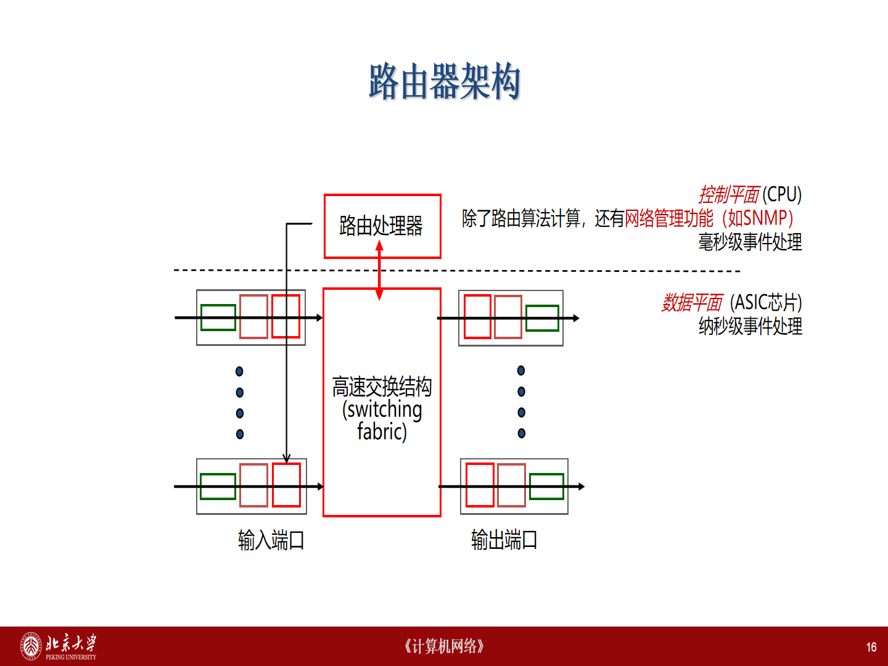
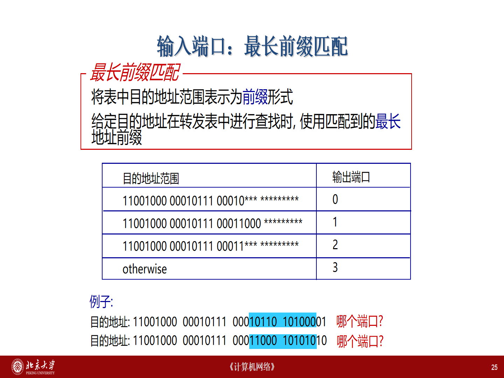
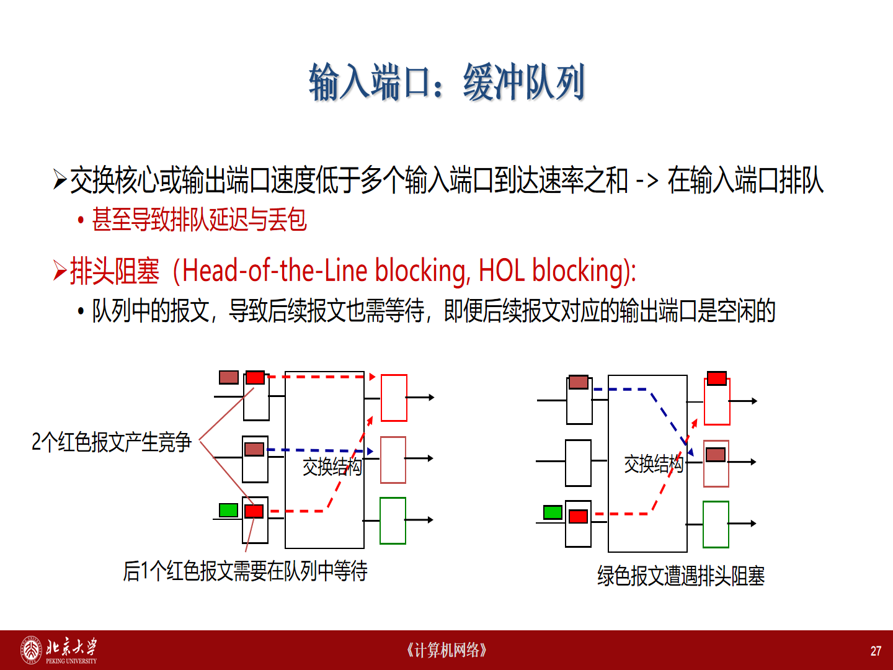
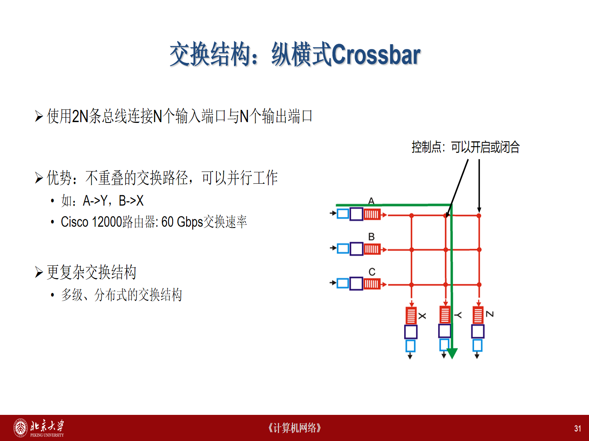
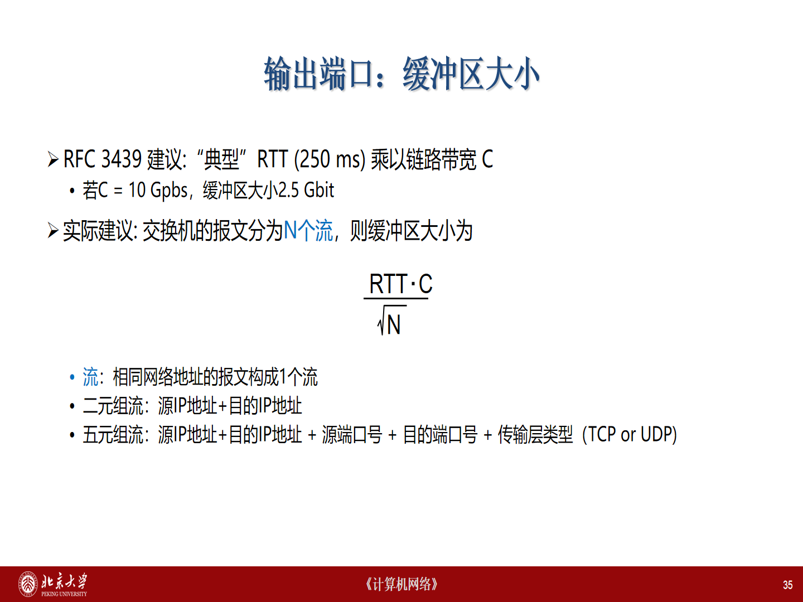
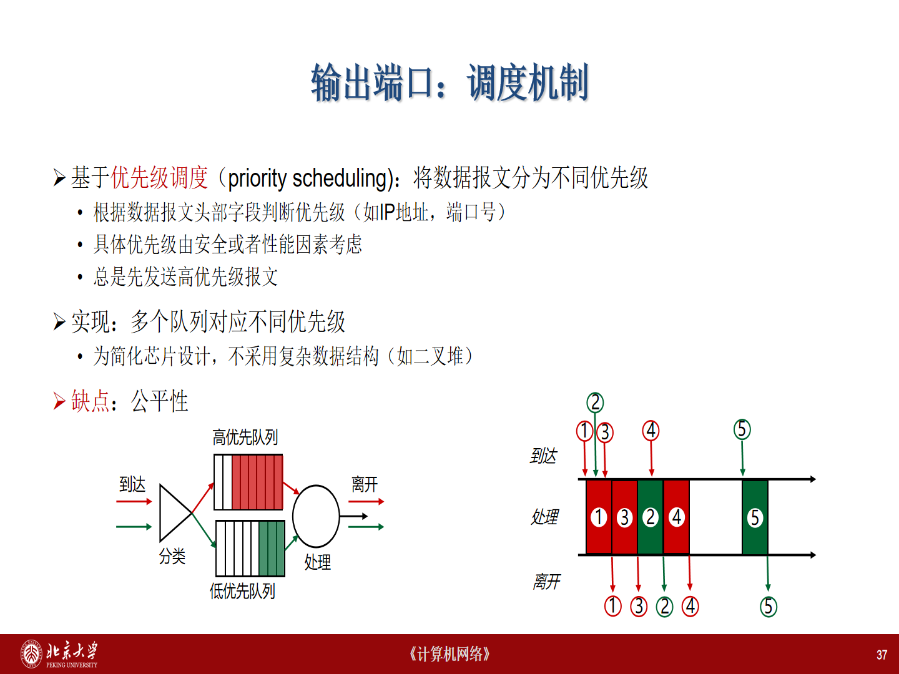
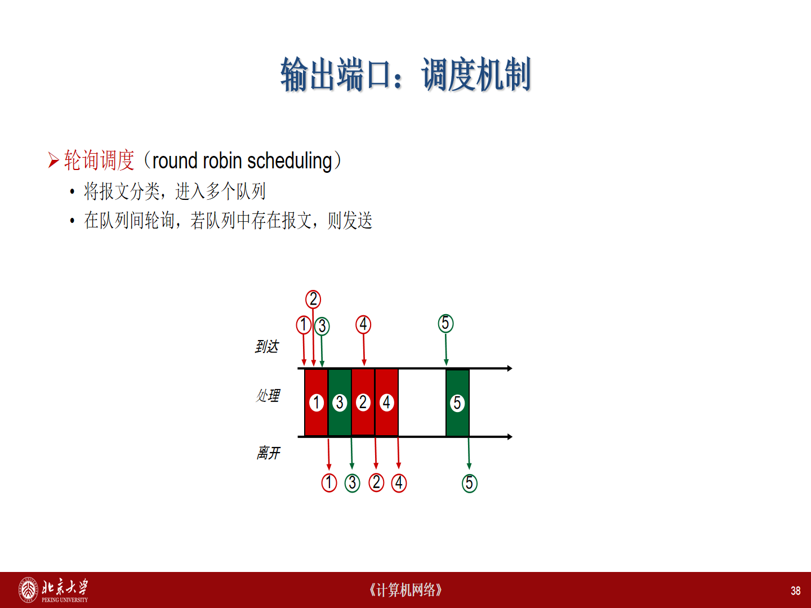
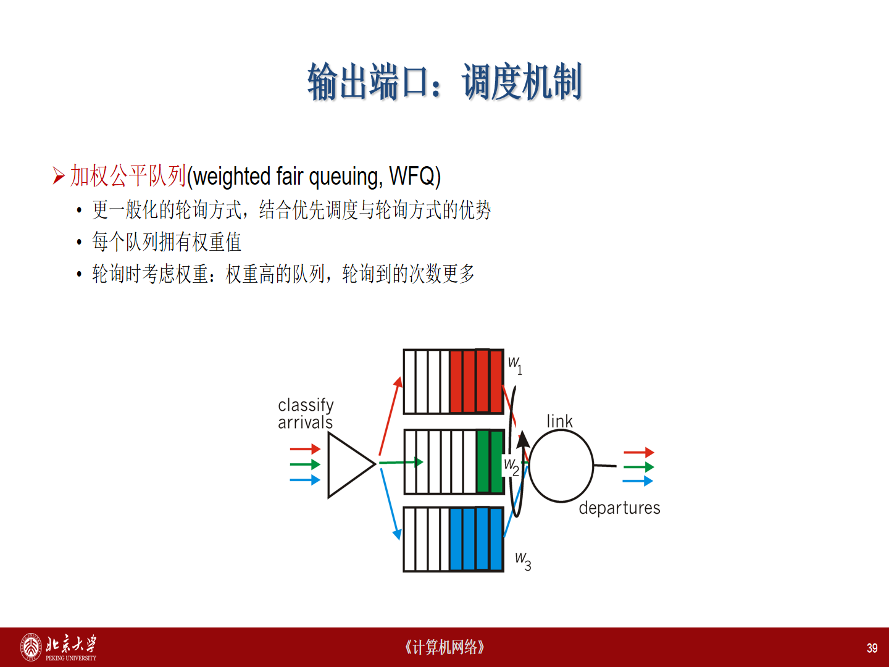

# 网络层（一）：基本概念与路由器

> 对应《第四讲_网络层（1）基本概念与路由器》，40页，2026年秋。保留服务模型、转发过程、最长前缀例题、交换结构、缓存公式与调度机制。原第09章《路由技术》保留，本篇补充其前置知识。

## 1. 网络层提供什么服务（第3–8页）

传输层连接进程，网络层负责主机之间跨网络、多跳传输。发送主机把传输层单元封装为IP数据报，路由器检查网络层首部并转发到下一跳，目的主机解封装并根据协议号交给传输层或相应网络控制协议。

主机和路由器均有网络层。普通中间路由器无需像目的主机那样处理应用内容，链路层与物理层完成每一跳的具体传输。

### 1.1 服务模型的几个维度

网络层可以选择是否建立连接、是否保证交付、是否保持顺序，以及是否保证带宽或时延。这些维度相关但不等价。例如面向连接的分组网络不等于电路交换，虚电路也可用分组交换实现。

课件对照Internet与ATM不同服务：Internet尽力而为，不承诺带宽、可靠性、顺序或时延；ATM的CBR、VBR等类别以不同程度的资源或性能约束为目标。表格用于理解服务选择，不应把所有ATM业务统称为“保证一切”。

第6页的服务模型对比可整理为下表。“可靠”是该教学模型的服务约定，不表示在任意设备故障、合同外流量等条件下永不丢失。

| 架构与服务类别 | 带宽约定 | 可靠交付 | 保序 | 时延约定 | 拥塞反馈（课件口径） |
| --- | --- | --- | --- | --- | --- |
| Internet best effort | 无保证 | 否 | 否 | 无保证 | 无显式反馈，端系统可从丢失推断 |
| ATM CBR | 恒定速率 | 是 | 是 | 有 | 模型假设无拥塞 |
| ATM VBR | 保证速率 | 是 | 是 | 有 | 模型假设无拥塞 |
| ATM ABR | 保证速率 | 否 | 是 | 无 | 有 |
| ATM UBR | 无保证 | 否 | 是 | 无 | 无 |

### 1.2 Internet数据报服务

IP采用无连接、尽最大努力交付：

- 发送前不需建立一条网络层端到端连接。
- 每个数据报携带目的地址，独立参加转发。
- 网络可能丢包、乱序或重复，不向上承诺可靠按序交付。
- 相同源目的的数据报理论上可能走不同路径，但路由稳定时常沿相同路径或按流选定的路径转发，不能理解为随机乱走。

这种简单、灵活的核心使网络容易连接多种链路和应用。若应用需要可靠性，通常由端系统的传输层等机制实现，而不是要求所有中间路由器保存端到端可靠状态。

## 2. 转发与路由，数据平面与控制平面（第9–13页）

**转发（forwarding）**是单台设备的局部操作：数据报从输入接口到达，设备根据表项选输出接口。**路由（routing）**是全网路径计算和信息交换：它决定哪些路径可达、如何形成供转发使用的规则。

| 维度 | 数据平面 | 控制平面 |
| --- | --- | --- |
| 工作 | 逐包查表、匹配并执行动作 | 计算路径、选择路由、维护网络状态 |
| 范围 | 单个设备的局部快速处理 | 多设备共同决定全网行为 |
| 常见硬件 | 交换/转发ASIC、接口卡 | CPU、路由处理器或控制器集群 |
| 状态 | 转发表FIB等 | 路由协议状态、路由表等 |

传统控制平面中，各路由器运行算法和协议并交换信息，分布式计算路由。SDN将控制逻辑集中到控制器，设备通过控制代理接收和执行规则。这里“中心化”是**逻辑中心化**，控制器可以由多个物理服务器组成，不等于单机单点。

校注：数据平面和控制平面的区分不是SDN出现后才存在，SDN让其分离与可编程控制更突出。课件把术语背景简化到SDN，不宜作为严格历史断言。

## 3. 路由器的整体架构（第15–21页）

典型路由器包括输入端口、交换结构、输出端口和路由处理器。数据平面追求线速处理，控制平面负责路由协议、管理和控制。课件用纳秒级与毫秒级说明两类工作的典型时间尺度，具体值依设备和任务而异。

### 3.1 从路由表到FIB

控制平面可能同时接收直连路由、静态路由和OSPF、BGP等协议的信息。路由管理模块选择合适路由，形成核心路由表，再下发到数据平面生成转发表（Forwarding Information Base，FIB）。设备也可以不运行动态路由协议，只使用静态和直连路由。

课件给出的管理优先级示例：直连0、静态1、eBGP 20、OSPF 110、RIP 120、iBGP 200，数值越小越优先。这是一类设备的行政距离示例，**不是所有厂商的统一协议标准**。路由优先级用于比较同一目的前缀的候选路由，不能替代转发时的最长前缀匹配。

### 3.2 一个IPv4数据报的普通转发过程

1. 输入端口处理物理层和链路层，解开当前链路封装，检查IP头。
2. 取得目的IP，在FIB中执行最长前缀匹配。
3. 无可用路由时丢弃，并在适用条件下产生ICMP差错。
4. 检查并递减TTL，若耗尽则不继续转发；IPv4头部校验和随头部变化更新。
5. 确定输出接口、下一跳IP及所需链路层地址，必要时通过邻居解析取得映射。
6. 经交换结构到达输出侧，使用下一跳链路的封装发出。

普通转发前后，源/目的IP一般保持不变，TTL与IPv4头部校验和改变，链路层首尾部重新生成。NAT、隧道等属于需要单独讨论的例外。

### 3.3 路由器也可以是端系统

对途经数据，路由器执行转发；对发送给它自身的SSH、SNMP、路由协议报文等，它又是协议终点，需要完整的相关协议栈。因此“路由器通常不看传输层”只适用于普通转发路径，不适用于所有功能。

家用设备还可能集成NAT、DHCP、DNS转发、防火墙、无线AP、认证等功能。这些功能不都是纯IP路由算法的一部分。

## 4. 输入端口与最长前缀匹配（第22–27页）

### 4.1 分布式查表与线速

高速路由器通常让各输入接口卡独立查表，避免每个包都送到中央CPU。输入卡拥有转发表副本，依据首部执行“匹配-动作”。线速指接口能持续处理其标称链路到达速率，多个接口并发还要求交换结构有足够总容量。

传统转发主要按目的IP匹配；通用转发可以组合多个字段，如源/目的地址、端口或协议类型。能力与芯片、规则资源和设备策略有关。

### 4.2 最长前缀匹配的规则

一个目的地址可能同时匹配多个前缀，选网络位最长的那项。长前缀描述更具体的目的范围，默认路由`0.0.0.0/0`只在没有更具体匹配时使用。

将课件二进制表写成CIDR：

| 目的前缀 | 输出端口 |
| --- | --- |
| 200.23.16.0/21 | 0 |
| 200.23.24.0/24 | 1 |
| 200.23.24.0/21 | 2 |
| 其他，0.0.0.0/0 | 3 |

- `200.23.22.161`在`200.23.16.0/21`内，输出0。
- `200.23.24.170`同时匹配`200.23.24.0/21`和`200.23.24.0/24`，选更长的`/24`，输出1。
- `200.23.30.8`只匹配第二个`/21`范围，输出2。
- 不在这些范围内的地址走默认项输出3。

后两例是为检验规则补充的例子。`/21`掩码为255.255.248.0，第三个字节以8为跨度，所以16–23与24–31是两个不同区间。选择顺序不能简单依赖表项出现先后，除非具体实现已经按优先规则排序。

### 4.3 TCAM

TCAM（Ternary Content Addressable Memory）每位支持0、1和不关心值，可并行比较多个表项，很适合前缀匹配。并行命中后仍要选择最长或相应优先级的规则。课件“一个时钟周期”强调并行查找优势，不代表整个转发管线只需一个周期，资源规模、功耗和成本也限制表项容量。

### 4.4 输入队列与HOL

若交换结构或目标出口不能及时接收，分组在输入端排队。一个FIFO队列头部的红色报文等待繁忙出口时，后面的绿色报文即使目标出口空闲也无法越过它，这就是Head-of-Line blocking。

拥塞不只在输出端发生。输入缓存容量有限，持续超负载会产生排队时延和丢包。按输出分别组织虚拟队列等方案可以减轻这类HOL，但属于进一步实现设计，不是任意FIFO自动具备的能力。

## 5. 交换结构（第28–32页）

### 5.1 共享内存

早期设备通过CPU把到达报文从输入端复制到内存，查表后再复制到输出端。一次转发需要至少一次写入和一次读出，内存带宽与总线复制成为瓶颈。控制处理器既做路径计算又参与数据搬运，难以扩展到大量高速端口。

### 5.2 共享总线

输入端口先查表，附加指出目标出口的内部标签，通过总线广播。各输出端口检查标签，只接收属于自己的报文。无需中央CPU逐包搬运，但所有输入竞争共享总线，总交换速率受到总线带宽约束。

### 5.3 Crossbar与多级结构

N个输入和N个输出通过横纵通路及交叉控制点连接（课件的基础结构用2N条通路连接N×N个交叉点）。目标输出不同且内部路径不冲突的多个传输可以并行，如A到Y与B到X。多个输入同时请求同一输出仍需仲裁，并不是所有排列都可以无限并行。

更大设备采用多级、分布式交换结构。课件给出的不同厂商Gbps/Tbps指标是具体产品历史示例，比较前需确认是否按单向、双向或全机聚合口径计量。

若每个输入线速为R，N个输入同时满速时，理想交换核心需要支持约`NR`的聚合输入处理能力，同时仍受输出端口冲突限制。

## 6. 输出队列与缓冲区（第33–35页）

多个输入汇聚到同一输出时，交换结构到达速率可能超过该链路发送速率，输出侧产生排队。缓存只能吸收有限突发，不能永久解决平均输入速率大于输出速率的问题。

### 6.1 缓冲区经验式

传统经验按一个典型RTT乘瓶颈链路速率估算缓存：

$$
B\approx RTT\times C.
$$

例：`RTT=0.25s`、`C=10Gbps`，得到`B=2.5Gbit=312.5MB`（十进制单位），不是2.5GB。

若存在大量相对独立、未完全同步的长TCP流，课件介绍较小缓冲区经验式：

$$
B\approx\frac{RTT\times C}{\sqrt{N}}.
$$

N是相关假设下的流数，不能不加条件地用所有五元组数量代入。该经验式依赖统计复用和流行为，突发、同步、短流或延迟目标可能要求其他设计；条件和实验讨论见[Appenzeller、Keslassy、McKeown：Sizing Router Buffers（SIGCOMM 2004）](https://yuba.stanford.edu/~nickm/papers.html)。缓冲越大也不总越好，过大队列可能引起bufferbloat。

### 6.2 流的定义

二元组流按源IP与目的IP分组；五元组流进一步包括源端口、目的端口和传输协议。流是分类与状态管理单位，不一定与“一个用户”或“一个网页请求”相同。

## 7. 输出调度与丢弃（第36–39页）

**调度**决定下一个发送谁，**丢弃策略**决定缓冲不足时扔掉谁，二者不应混淆。

### 7.1 FIFO

按到达顺序服务，简单直观。缓存满时可采用尾丢弃（丢新到包）、按优先级丢弃或随机丢弃等。FIFO本身不解决不同流之间的服务公平性。

### 7.2 严格优先级

不同类别进入不同队列，始终优先发送高优先队列。这样能保护重要流量，但高优先流量持续到达时，低优先队列可能饥饿。真实链路通常不会在一个包已经发送到一半时中断它，优先级主要影响下一包的选择。

### 7.3 Round Robin

在各非空队列间轮询，每次取一个包。各队列都有机会，但若包长不同，“每轮一个包”并不等于每轮相同字节量或相同带宽。计算题中应先确认是否假设等长包。

### 7.4 WFQ

加权公平队列为各类设置权重，尝试按权重分配服务份额。在所有相关队列持续有数据时，队列i的理想份额近似：

$$
R_i\approx C\frac{w_i}{\sum_jw_j}.
$$

课件把WFQ解释为加权轮询，便于理解权重。严格地说，WFQ是对按比特公平服务模型的分组化近似，不等于简单按权重多取几个任意长度包；它需要考虑包长和虚拟完成时间等因素。空队列未使用的容量可由有需求队列使用。

## 8. 复习时的完整链路（第40页）

路径信息进入控制平面，控制平面选择路由并形成FIB。数据到达输入端，解封装并匹配规则，经交换结构到输出端，等待调度后重新封装发送。拥塞可能发生在输入、内部交换或输出，不是看到丢包就能断言“路由算法错误”。

应能独立完成：区分路由/转发和路由表/FIB；计算最长前缀；说明每跳IP和MAC字段变化；判断输入HOL；比较三种交换结构；转换缓存的bit/byte单位；分析FIFO、优先级、RR、WFQ的公平性与适用条件。

## 页码与校注来源

| 课件页码 | 对应内容 |
| --- | --- |
| 3–8 | 网络层功能、服务模型、无连接数据报 |
| 9–13 | 转发、路由、数据/控制平面与SDN |
| 15–21 | 路由器架构、路由表/FIB、逐跳转发 |
| 22–27 | 输入端口、最长前缀、TCAM、HOL |
| 28–32 | 三类交换结构与聚合交换速率 |
| 33–35 | 输出队列、缓冲区公式、流的定义 |
| 36–39 | FIFO、优先级、RR与WFQ |
| 40 | 全章小结 |

第1、2、14页为封面或目录，已合并。数值换算和补充的前缀例子是笔记推导；缓存量经验式不是任何负载下的保证。IPv4转发和TTL的规范依据见[RFC 1812](https://www.rfc-editor.org/rfc/rfc1812.html)，课件引用的缓存架构背景见[RFC 3439](https://www.rfc-editor.org/rfc/rfc3439.html)。

本次使用2026-11-09保存的完整课件副本，来源资源ID与2026-11-15最后成功读取的课程索引一致；2026-11-16登录受阻，未声称已在线重新下载核对。版本、哈希和逐页覆盖范围见[本轮来源记录](sources/network-foundations-2026-11-16.json)。
