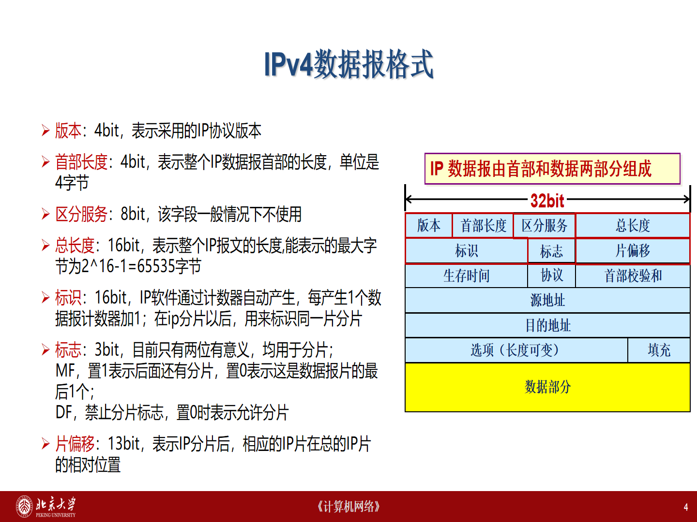
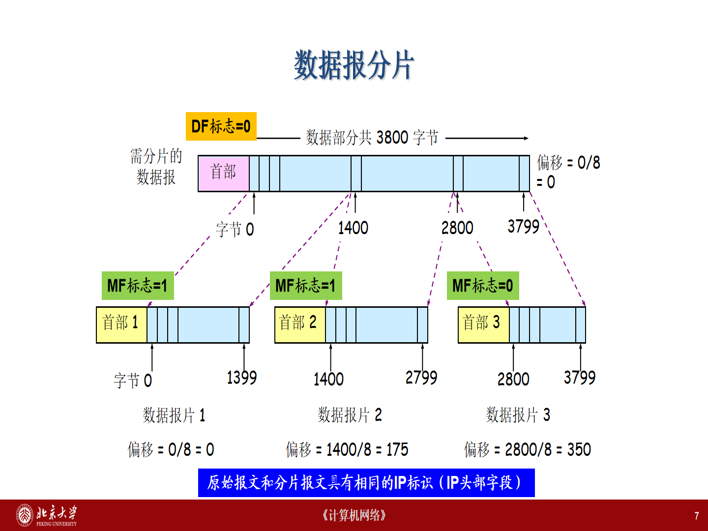
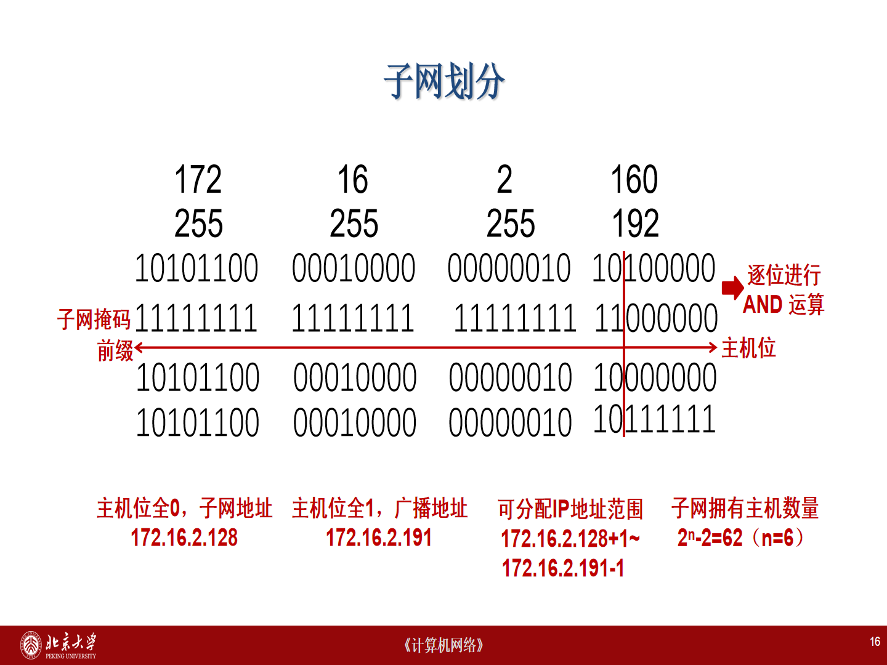
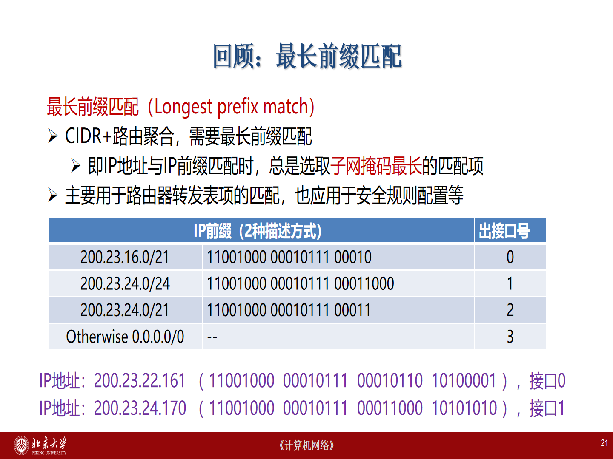
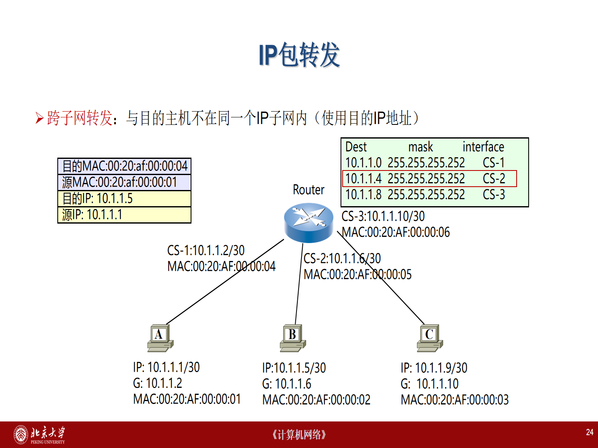
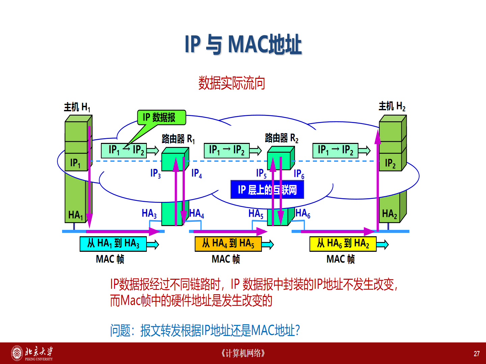
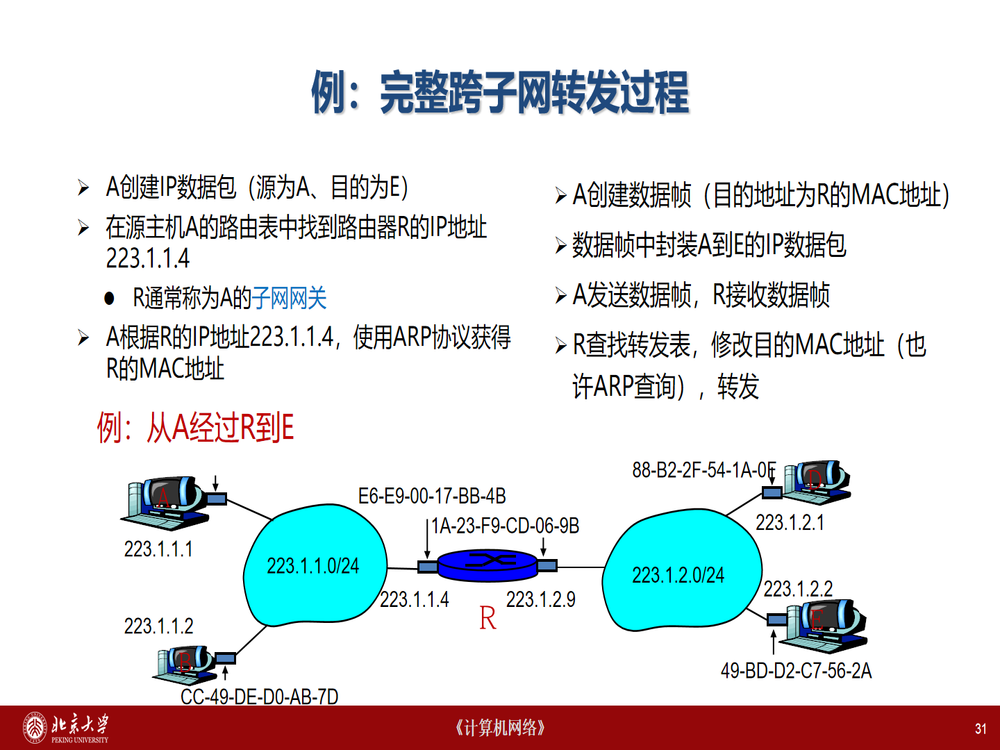
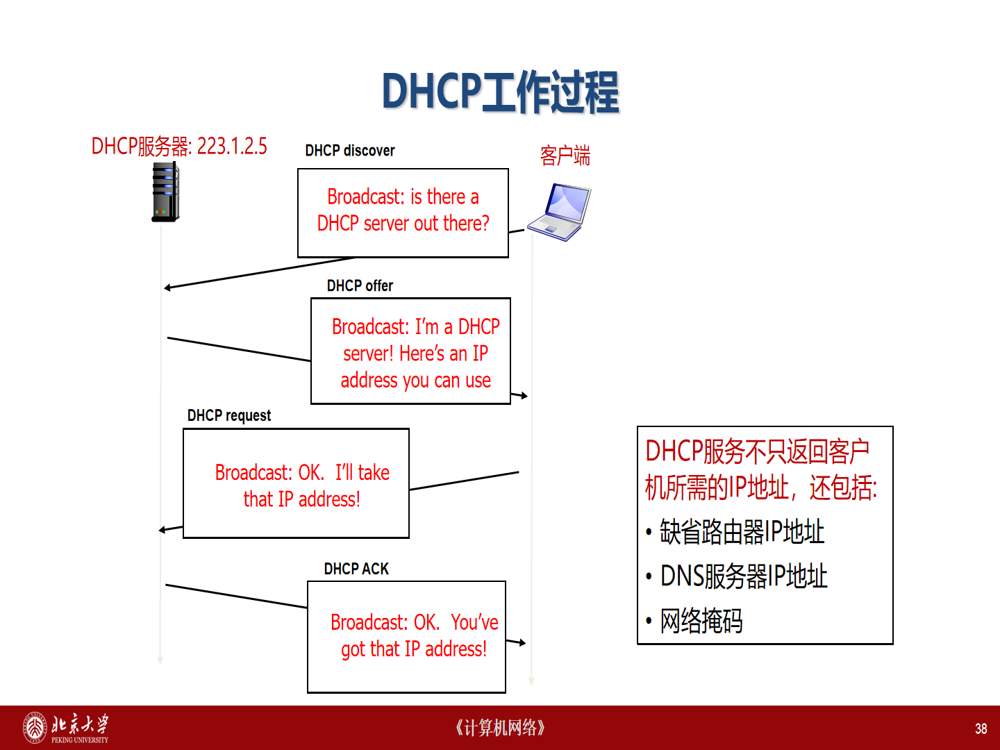
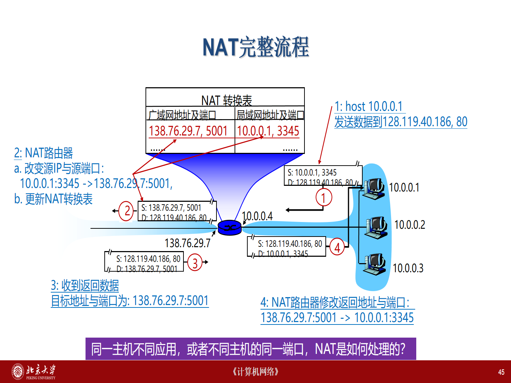
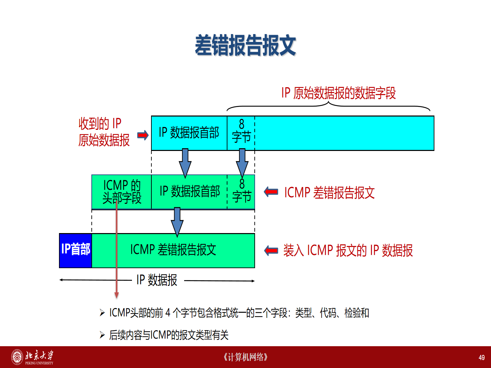

# 网络层（二）：IPv4、ARP、DHCP、NAT与ICMP

> 对应《第四讲_网络层（2）网络层协议》，55页，2026年秋。保留报头字段、分片与子网计算、逐跳转发、协议交互、例题和关键图。重复目录及动画合并；原课件存在明显数字或协议描述错误时以“校注”说明。

## 1. IPv4及数据报格式（第3–5页）

IPv4提供无连接、尽最大努力的数据报服务，核心功能包括寻址与分片。IP数据报由首部和数据组成，封装的上层内容可以是TCP段、UDP报文或ICMP等。



| 字段 | 位数 | 含义与易错点 |
| --- | --- | --- |
| Version | 4 | IPv4取4，不是首部长度 |
| IHL | 4 | 首部长度，单位4字节，通常5，即20字节，最大15即60字节 |
| 区分服务字段 | 8 | 现代解释包括DSCP与ECN，不能简单说永远不用 |
| Total Length | 16 | 整个IPv4数据报的字节数，包含首部，最多65535 |
| Identification | 16 | 将同一原始数据报的分片关联起来，不是TCP字节序号 |
| Flags | 3 | 含DF（禁止分片）、MF（后面还有分片）及保留位 |
| Fragment Offset | 13 | 该片数据相对原始数据区的偏移，单位8字节 |
| TTL | 8 | 每经过一次路由转发递减，耗尽则丢弃，避免无限循环 |
| Protocol | 8 | 指示上层处理协议，如ICMP=1、TCP=6、UDP=17 |
| Header Checksum | 16 | 只检查IPv4首部，不检查载荷 |
| Source / Destination | 各32 | 源与目的IP地址 |
| Options / Padding | 可变 | 选项及对齐填充，首部长度仍需是4字节倍数 |

TTL历史名称是Time To Live，但现代常按跳数处理。IP首部校验和随TTL等首部字段变化需要更新，不能拿它代替传输层校验。Identification的生成策略也不是协议要求所有系统必须采用同一个全局递增计数器。

## 2. MTU、分片与重组（第6–9页）

### 2.1 MTU与路径MTU

链路MTU限制该链路一次能承载的网络层包大小，路径MTU则是路径中相关链路MTU的最小值。若IPv4报文超过出口MTU，且DF=0，源端或中间路由器可能分片；若DF=1，不能分片，需要丢弃并在适用情况下通知源端。

IP分片与TCP分段是不同层的操作。TCP的MSS限制TCP数据量，MTU限制网络层包大小，两者之间还隔着IP/TCP首部。

### 2.2 分片字段

同一原始数据报的分片保留相同Identification，并利用源/目的地址和Protocol等上下文正确关联。每个分片都有自己的IP首部、总长度、偏移及MF标志。

- DF=0：允许分片，并不表示本包一定已经分片。
- MF=1：原始数据报后面还有数据片。
- MF=0：这是最后一片，或者本来就是未分片数据报。
- Offset只计算原始**数据区**偏移，不包括首部，单位8字节。
- 除最后一片之外，片中数据长度通常需为8字节整数倍。

### 2.3 课件例题



原始数据部分3800字节，分为1400、1400、1000字节三片：

| 片 | 原始数据区间 | 数据长度 | Offset | MF |
| --- | --- | --- | --- | --- |
| 1 | 0–1399 | 1400 | 0 | 1 |
| 2 | 1400–2799 | 1400 | 175 | 1 |
| 3 | 2800–3799 | 1000 | 350 | 0 |

若各首部20字节，片的Total Length分别1420、1420、1020字节。课件采用1400字节数据片，不应在没有给出MTU时擅自解释成“以太网1500 MTU下的最大分片”，后者无选项时常允许1480字节载荷。

一般地，出口MTU为M、该片首部长度为H时，非末片可用最大数据长度为：

$$
L=8\left\lfloor\frac{M-H}{8}\right\rfloor.
$$

例如M=1500、H=20时，L=1480。该式假设相关选项与首部长度已经确定。

### 2.4 目的端重组

IPv4只在最终目的端重组，不在每个中间路由器重新拼回。途中已经分片的数据还可能再次分片，偏移始终相对原始数据区。只要有一片长期缺失，目的端就无法得到完整原数据报，最终可能等待超时并丢弃重组状态。

IPv6的分片机制不同，中间路由器不执行IPv4式途中分片，不能直接照搬这些规则。

## 3. IP地址、接口和子网（第11–18页）

### 3.1 地址分配给接口

IP地址是接口的网络层标识，不是把整台设备永久钉在某个地址上。路由器常有多个接口，分别位于不同子网；一台主机也可以同时有有线、无线等接口。点分十进制IPv4由4段组成，每段0–255，总计32位。

给定前缀长度n，前n位标识网络前缀，剩余`32-n`位是主机部分。子网掩码的连续1对应网络位，后面的0对应主机位。

### 3.2 子网的含义

同一IP子网中的接口可以依靠链路层机制互通，无须先跨越网络层路由。子网由接口组成：不同设备的接口可以属于同一个子网，同一设备的不同接口可以属于不同子网。

严格通信还受VLAN、链路连通及配置等条件影响，不能仅看两个地址前缀相同就断言物理上一定可达。

### 3.3 子网计算例题

给定`172.16.2.160`与掩码`255.255.255.192`，即`/26`。最后一字节：

```text
地址：10100000 = 160
掩码：11000000 = 192
按位与：10000000 = 128
```

所以网络地址为`172.16.2.128/26`。主机位6位，总共64个地址，广播地址为`172.16.2.191`，普通可分配范围为`.129`到`.190`，共62个。



`2^h-2`是常规广播子网的主机数规则，不能无条件应用于`/31`点对点链路、`/32`主机路由等特殊使用方式；`/31`例外见[RFC 3021](https://www.rfc-editor.org/rfc/rfc3021.html)。

### 3.4 特殊地址

| 地址或模式 | 常见含义 |
| --- | --- |
| 主机位全0 | 网络前缀自身，如172.16.2.128/26 |
| 主机位全1 | 该子网的定向广播，如172.16.2.191 |
| 255.255.255.255 | 本地有限广播，通常不经路由转发 |
| 0.0.0.0 | 未指定地址，可见于尚未配置地址的启动通信 |
| 127.0.0.0/8 | 环回地址块，常用127.0.0.1 |

校注：课件“全0网络地址”容易与网络前缀主机位全0、未指定地址和默认路由混淆。`0.0.0.0/0`表示匹配所有目的的默认路由前缀，不能与报文源地址`0.0.0.0`等同。环回主要测试本机协议栈，不证明物理网卡、线缆或外网连接正常。定向广播还可能因安全策略被禁用。

### 3.5 分类编址与CIDR

历史分类编址把A、B、C类单播地址固定分成不同网络位数，D类用于组播，E类保留。固定边界难以贴合实际网络规模。CIDR允许按需要选择前缀长度，并用`地址/n`表示。

CIDR同时服务于地址分配和路由聚合，课件后续以无类前缀为主要计算方法，不需要继续把所有私有地址解释成仍受A/B/C类边界约束。

## 4. 地址聚合与最长前缀匹配（第19–24页）

ISP可以对多个连续、对齐的子网发布一个聚合前缀，减少外部路由表规模。例如`200.23.16.0/20`可概括第三字节16到31范围，并进一步划为多个`/23`组织网络。

如果其中`200.23.18.0/23`迁移到另一ISP，可以由新ISP发布更具体路由。外部路由器同时看到原`/20`和新`/23`时，为该子网选择更长的`/23`。



| 前缀 | 出接口 |
| --- | --- |
| 200.23.16.0/21 | 0 |
| 200.23.24.0/24 | 1 |
| 200.23.24.0/21 | 2 |
| 0.0.0.0/0 | 3 |

`200.23.22.161`走0，`200.23.24.170`虽然匹配两项，仍因`/24`更具体而走1。不要拿路由来源的行政距离优先级去推翻不同前缀之间的最长匹配。

### 4.1 同子网与跨子网

同子网时，发送端选择目的主机作为下一跳，通过ARP解析目的主机MAC。跨子网时，发送端根据路由表选择网关，解析的是**下一跳网关MAC**，IP数据报目的仍是远程主机。



课件中A=`10.1.1.1/30`、网关=`10.1.1.2`，B=`10.1.1.5/30`、网关=`10.1.1.6`。两者分别属于`10.1.1.0/30`和`10.1.1.4/30`，所以A发往B时，第一跳以网关MAC作目的MAC，目的IP仍为10.1.1.5。

第23页图中的部分IP写成192.169.1.x，与设备标注192.168.1.x不一致，并将广播MAC和普通IP数据混在同一示意中。理解原则时应区分ARP广播请求与地址解析完成后的单播数据，不能照图误认为所有同子网IP数据都广播发送。

## 5. ARP：下一跳IP到MAC的解析（第26–32页）

### 5.1 IP和MAC的层次

IP源/目的地址放在网络层首部，MAC源/目的地址放在当前链路帧中。一次跨网络传输会经过多个链路帧，帧的地址逐跳变化，IP端到端地址通常不变。



不能把“根据IP还是MAC转发”看成二选一：路由器先依据网络层规则选择下一跳，再把IP包封装进下一跳链路的帧。链路层交换机在以太网内主要按MAC转发。

### 5.2 ARP工作过程

1. A已确定下一跳B的IP，先查ARP缓存。
2. 若无映射，广播ARP请求，询问谁拥有该IP。
3. 对应主机回复自己的MAC，通常向请求者单播响应。
4. A缓存映射，并用B的MAC封装后续帧。
5. 动态缓存会老化，避免永久保留失效映射。

ARP作用于本地广播域，不应把对远端终点的ARP请求逐个路由器转发到互联网另一端。

### 5.3 完整跨子网例子



A构造源IP=A、目的IP=E的数据报，根据路由表选择网关R的223.1.1.4接口，通过ARP得到其MAC。第一跳帧由A发到R。R解封装后查询目的E的路由，递减TTL并更新IPv4头部校验和，再从目标子网接口发出新帧，目的MAC为E或后续下一跳。R同时更换帧的源MAC为自己的输出接口MAC，而不只是改目的MAC。

### 5.4 ARP欺骗

ARP缺少强认证，伪造映射可能污染邻居缓存，使数据被发往错误MAC。课件用“无请求也更新”解释风险，但具体缓存更新条件因系统实现而异。安全学习重点是识别本地地址映射的信任问题，可采用可信绑定、动态ARP检查等防护机制，不能假设所有主机无条件接受任意报文。

## 6. DHCP：动态取得网络配置（第34–40页）

### 6.1 获取什么

地址可以手工静态配置，也可以通过DHCP租用。DHCP不只给出IP，还可提供子网掩码、默认网关、DNS服务器及租期等。公有地址由层级分配体系管理，课件把ICANN到ISP画成简单层次，实际还涉及IANA和区域互联网注册机构等。

DHCPv4使用UDP，服务端端口67，客户端端口68。新客户端尚无可用IP时，仍可用`0.0.0.0`作为源IP、有限广播作为目的IP发现服务。

### 6.2 DORA四步

| 步骤 | 方向 | 用途 |
| --- | --- | --- |
| Discover | 客户端广播寻找服务器 | 声明需要配置 |
| Offer | 服务器返回可提供的地址/配置 | 尚非客户端已最终取得租约 |
| Request | 客户端选择一个offer并请求 | 初始选择时常广播，让其他服务器也知道选择 |
| ACK | 被选服务器确认 | 客户端按获准配置使用租约 |



课件例子提供223.1.2.4，租期3600秒。Discover通常由0.0.0.0:68到255.255.255.255:67。Offer/ACK究竟广播还是单播取决于客户端状态、广播标志、中继等条件。不能一边说以太网广播，一边固定写目标MAC为客户端单播MAC。

**校注：**图中Discover/Offer标事务ID654，而Request/ACK标655，同一次获取流程应使用一致的事务关联信息。图可用来理解四种消息，不宜照抄为完整协议报文字段标准；消息字段、事务匹配及广播/单播条件见[RFC 2131](https://www.rfc-editor.org/rfc/rfc2131.html)。续租和重绑定流程也不一定重新经历初次获取的完整广播DORA。

### 6.3 租约与安全

动态租约允许地址复用，客户端需要在租约到期前按协议续租。DHCP地址耗竭使合法客户端无法分到地址；伪造DHCP服务可能下发恶意DNS或网关。应从可信服务器、交换机DHCP snooping和接入控制角度理解防护，不要把动态配置当成天然可信。

## 7. NAT与端口地址转换（第42–46页）

### 7.1 私有IPv4范围

| 前缀 | 地址范围 |
| --- | --- |
| 10.0.0.0/8 | 10.0.0.0–10.255.255.255 |
| 172.16.0.0/12 | 172.16.0.0–172.31.255.255 |
| 192.168.0.0/16 | 192.168.0.0–192.168.255.255 |

课件把第二段末尾写成`172.31.255.555`，是明显笔误，IPv4每段最大255。私有地址可以在不同独立网络中复用，不能作为普通公网全局可路由地址使用。

### 7.2 映射机制

课件重点讨论同时转换地址与端口的NAPT/PAT：多个内部主机共享一个公网IP，由不同外部端口区分会话。NAT是更广的概念，并非所有NAT都必须转换端口。



例：内部`10.0.0.1:3345`访问`128.119.40.186:80`。

1. 外发时，NAT把源改为`138.76.29.7:5001`，目的保持远端服务器。
2. 表中记录内部端点与外部映射及所需协议/会话状态。
3. 回包目的为`138.76.29.7:5001`，NAT查表把目的恢复为`10.0.0.1:3345`。
4. 修改IP/端口后还需相应更新相关校验和。

不同主机可以使用相同内部源端口，由外部映射及会话上下文区分。真实NAT映射键可能还包括协议或远端端点，不能把所有设备都简化成只看一个端口号。

### 7.3 优缺点与边界

NAT节约公网地址、隐藏一部分内部拓扑，使内部地址规划更灵活。但它引入状态，改变端到端可达性，未经配置的外部连接不一定能进入内部，P2P和一些把地址写入载荷的协议需要额外处理。

“16位端口所以6万多连接”是单公网地址、单协议和特定映射口径的直观上界说明，不是任意NAT设备保证的实际并发容量。保留端口、会话内存、远端复用规则及设备性能都会影响容量。

NAT不是完整防火墙，更不等于端到端加密。它对认证/加密协议的影响取决于被保护的字段，例如修改地址可能影响覆盖这些字段的认证，不能概括成“只要有加密就不能NAT”。

## 8. ICMP、Ping与Traceroute（第48–54页）

### 8.1 ICMP承担什么

ICMP报告网络层差错和控制信息，放在IP数据报内，IPv4 Protocol=1。它不是TCP或UDP应用端口服务，也不能把IP变成可靠传输：差错报告本身同样可能丢失或被策略过滤。

前4字节包含Type、Code和Checksum，后续结构因类型不同而异。差错消息通常引用触发错误的原IP首部及一段原数据，让发送端定位受影响的通信。



课件以原IP首部加前8字节数据解释经典最小引用结构，现代扩展或实现可引用更多，不能假定所有ICMP报文都只有这一固定长度。

| Type | Code示例 | 意义 |
| --- | --- | --- |
| 3 | 0 / 1 / 2 / 3 | 网络/主机/协议/端口不可达 |
| 3 | 4 | 需分片但DF置位，可用于路径MTU反馈 |
| 5 | 依代码细分 | Redirect，重定向提示 |
| 11 | 0 | TTL在传输中耗尽 |
| 12 | 依代码细分 | 参数问题，不宜一概写成任何头部损坏 |
| 8 / 0 | 0 | Echo Request / Echo Reply |
| 13 / 14 | 0 | 历史时间戳请求/应答 |

课件把RFC 6633与多个类型的废弃一起列出。[该RFC直接讨论Source Quench（类型4）的废弃](https://www.rfc-editor.org/rfc/rfc6633.html)，其他历史类型应分别核对对应规范，不能把一串类型的全部状态都归到它名下。

### 8.2 Ping

Ping发送Echo Request，收到Echo Reply后计算往返时间，帮助判断两端是否具备此类往返可达性。未收到回复可能是丢包、主机不回应、防火墙过滤或路由问题，不足以单独断言目标关机。

返回TTL是报文抵达时的剩余值。只有知道初始TTL才可能估计返程跳数，默认TTL还可配置，因此不能仅凭Ping TTL准确判断操作系统或单向路径。RTT也不是单向传播时延。

### 8.3 Traceroute

典型UDP traceroute先发TTL=1的探测包，再发TTL=2、3等。第n跳路由器把TTL耗尽的探测丢弃，并可能返回ICMP Time Exceeded（Type11 Code0）。发送端从回复源地址和时间了解该次探测路径上的节点。

UDP探测抵达目的主机的未使用端口时，通常收到Port Unreachable（Type3 Code3），作为到达终点的信号。每个TTL可发送多次探测，观察时延变化或路径差异。

**校注：**课件将UDP traceroute说明与Windows `tracert`输出放在一起。[Windows tracert](https://learn.microsoft.com/en-us/windows-server/administration/windows-commands/tracert)使用ICMP Echo探测，到达终点时依据Echo Reply结束，而不是一定等待UDP端口不可达。Linux/其他工具也可选择UDP、ICMP或TCP模式。

路由器可能不响应、限速，探测回程可能不同，负载均衡也可能使同一TTL的不同包走不同节点。因此星号不一定说明该跳无法转发业务，显示的三次RTT也不能简单相减为相邻链路的精确单向时延。

## 9. 从零配置到跨网访问的串联

一台新主机先通过DHCP取得IP、掩码、网关和DNS配置。访问远端时，用掩码和路由表判断下一跳，必要时ARP解析网关MAC，封装IP包并交给链路。中间路由器按最长前缀转发，逐跳更新链路封装和TTL。出口NAT可能改写地址/端口并记录映射。链路MTU不足时涉及分片或PMTU处理，异常可由ICMP反馈。

复习时应同时标出：每层使用的地址、哪个设备维护哪张表、哪些字段逐跳变化、哪些功能需要状态，以及哪些机制只提供尽力反馈而不保证成功。

## 页码与校注来源

| 课件页码 | 对应内容 |
| --- | --- |
| 3–5 | IPv4功能与完整首部字段 |
| 6–9 | MTU、分片字段、3800字节例题与重组 |
| 11–18 | 接口地址、子网、特殊地址、CIDR与分类编址 |
| 19–24 | 聚合、最长前缀、同子网/跨子网转发 |
| 26–32 | IP/MAC、ARP流程、完整跨网例子及信任风险 |
| 34–40 | DHCP配置、端口、DORA、租约与安全 |
| 42–46 | 私有地址、NAT/PAT映射、优缺点 |
| 48–54 | ICMP、Ping与不同模式的Traceroute |
| 55 | 跨协议串联小结 |

第1、2、10、25、33、41、47页为封面或目录，已合并。IPv4首部与分片依据[RFC 791](https://www.rfc-editor.org/rfc/rfc791.html)；ARP的地址解析与缓存处理依据[RFC 826](https://www.rfc-editor.org/rfc/rfc826.html)。课件中的`172.31.255.555`、第23页的`192.169`地址、DHCP事务ID和Windows tracert模式混用等问题，均在相关段落明确校注。

本次使用2026-11-09保存的完整课件副本，来源资源ID与2026-11-15最后成功读取的课程索引一致；2026-11-16登录受阻，未声称已在线重新下载核对。版本、哈希和逐页覆盖范围见[本轮来源记录](sources/network-foundations-2026-11-16.json)。
