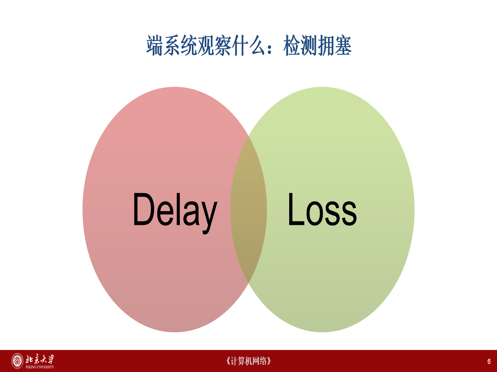
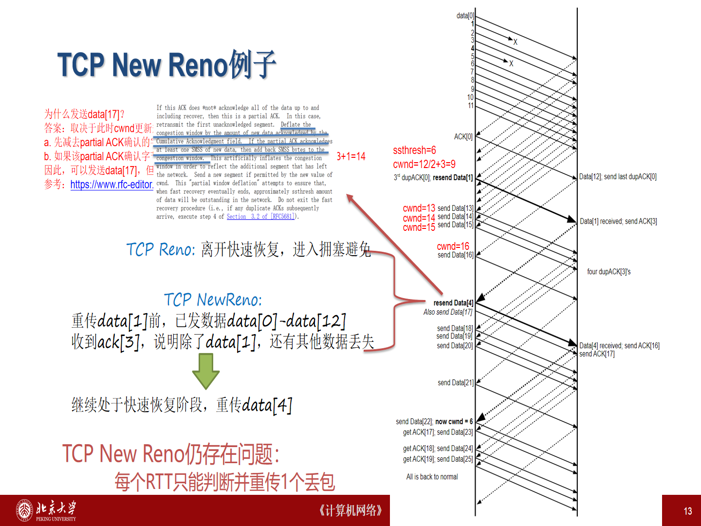
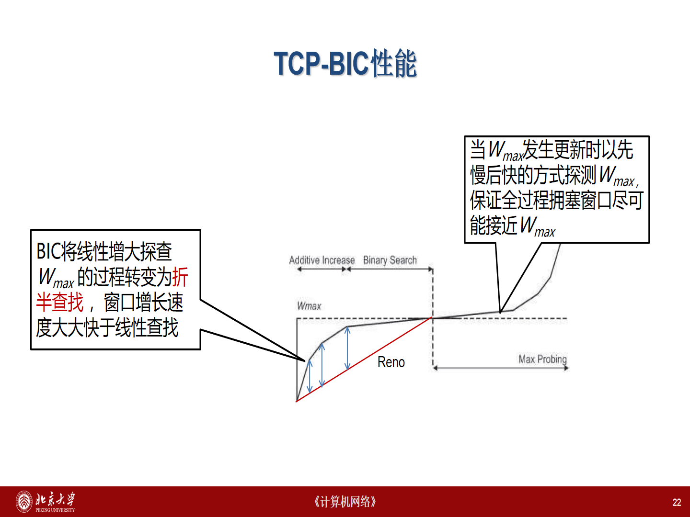
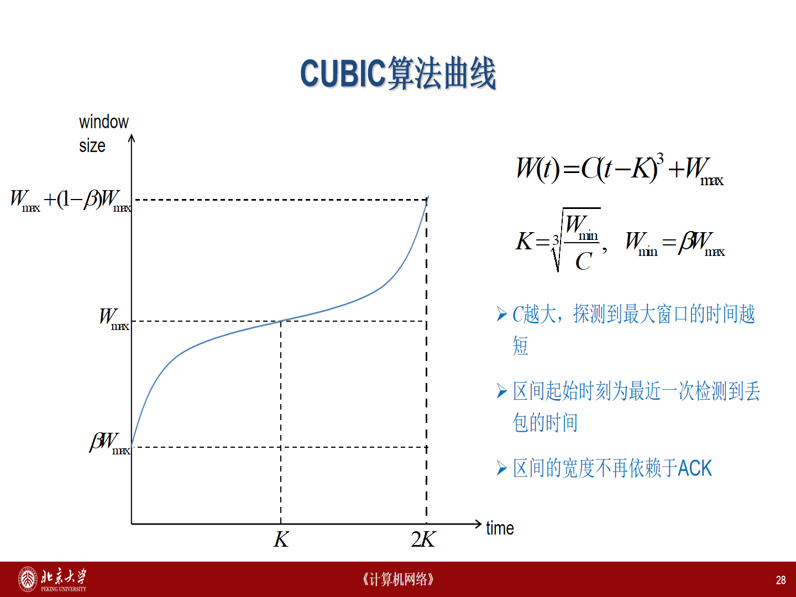
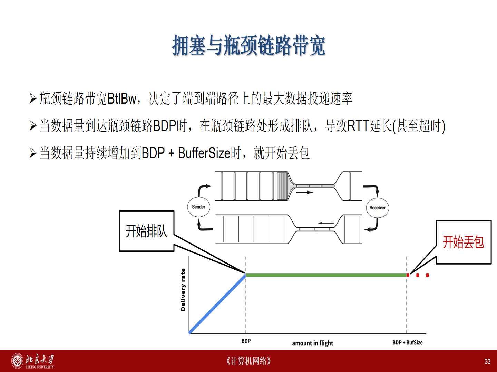
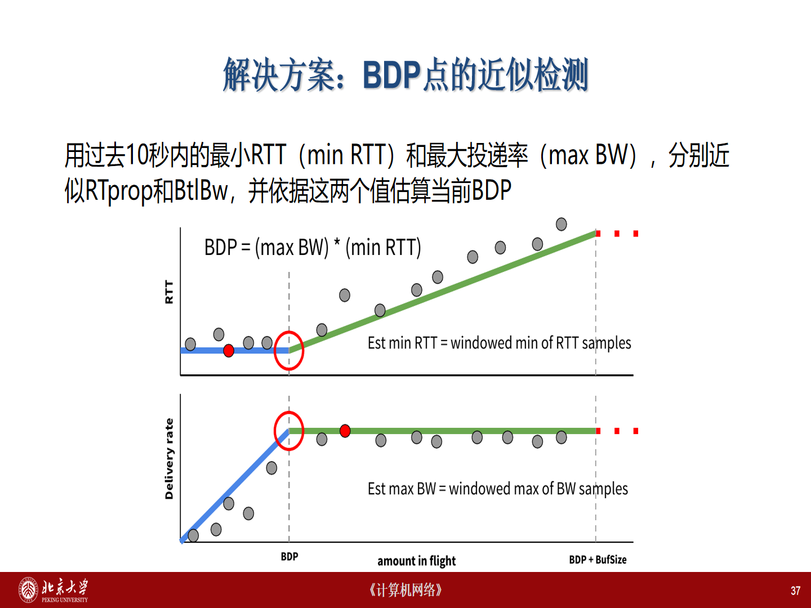
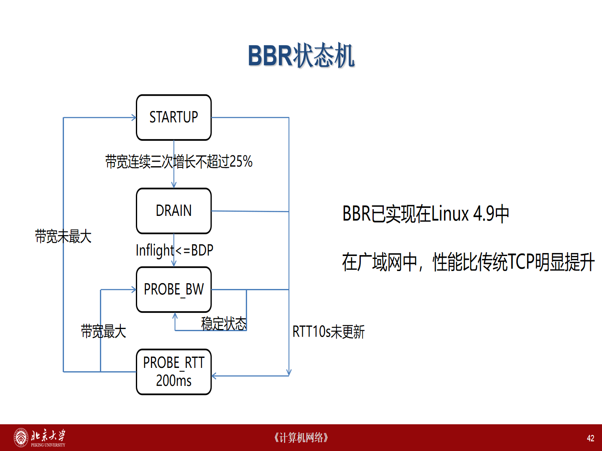
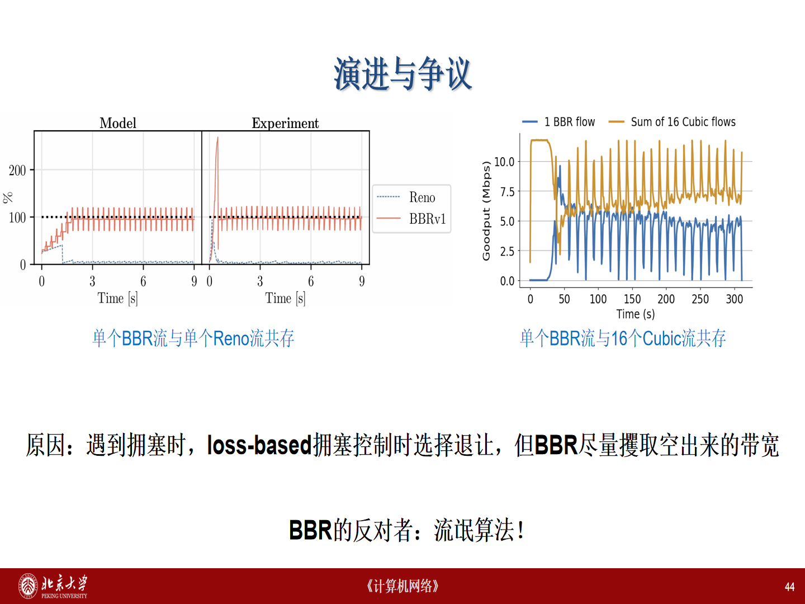
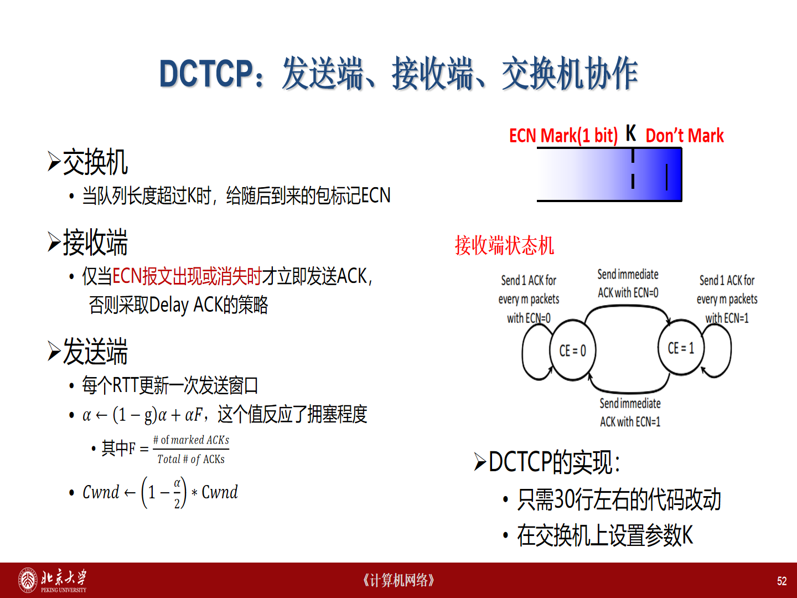
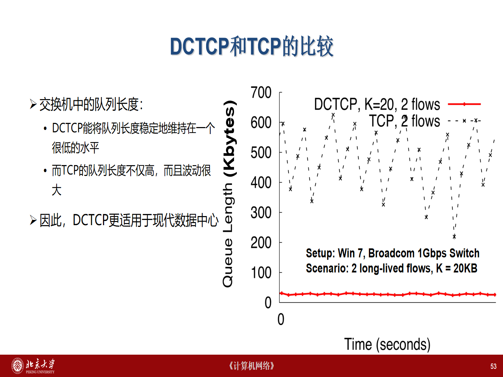

# 传输层（四）：新型拥塞控制

> 对应教学网《第三讲_传输层（4）新型拥塞控制》，55页，2026年秋。按知识点合并重复目录和动画页，保留算法、公式、例题和关键图。本文中的“校注”用于区分课件简化、排版错误与准确含义。

## 1. 拥塞控制的观察量与控制量（第2–8页）

拥塞控制回答两个问题：端系统能观察到什么，以及可以改变什么。发送端无法直接看到每个路由器的队列，只能从丢包、重复ACK、超时、RTT、ACK到达速率或显式拥塞标记中推断网络状态。控制量通常是拥塞窗口`cwnd`、发送速率及报文发送节奏（pacing）。

流量控制保护接收方缓存，拥塞控制保护网络。二者共同限制发送量，允许在途数据通常不超过`min(cwnd,rwnd)`，实际发送还受应用供给和实现约束。窗口大小与速率也不相同：近似速率为窗口除以RTT，而pacing还决定窗口中的数据在时间上如何发出。

检测到拥塞后需要退让，但不能永久保持低速。网络容量恢复或竞争流退出后，发送方仍要试探可用带宽。算法主要在拥塞避免、丢包恢复和带宽探测之间取舍。慢启动只占连接的一部分，却会明显影响短连接完成时间。

### 1.1 Tahoe与Reno回顾

| 情形 | Tahoe | Reno |
| --- | --- | --- |
| 尚未达到慢启动阈值 | 以ACK为时钟增大窗口，典型每RTT近似翻倍 | 同左 |
| 拥塞避免 | 每RTT近似增加1 MSS | 同左 |
| 三个重复ACK | 快速重传，并回到很小窗口慢启动 | 快速重传后进入快速恢复 |
| 超时 | 大幅缩小窗口并慢启动 | 同样回到慢启动 |

课件用1 MSS表示早期初始窗口。它是历史设置，不能当作现代实现的固定值。Reno的快速恢复通过重复ACK推断仍有报文离开网络，避免一次单包丢失就完全丧失ACK时钟。

## 2. 初始窗口优化（第10页）

初始窗口越小，短流越容易需要多个RTT才能完成。课件列出从Tahoe的1 MSS、RFC 3390的与MSS相关的初始窗口，到RFC 6928所讨论的约10 MSS的演进。增加初始窗口可减少启动往返次数，同时也增加突发流量，需要考虑链路容量和缓存。

校注：RFC 6928的上界表达涉及MSS和字节数，不能把“10 MSS”理解成任何MSS下都没有其他约束。不同操作系统和版本的实际默认值也需要按实现核实。

## 3. NewReno：一个窗口内多个丢包（第12–13页）

### 3.1 Partial ACK的含义

发送端在三个重复ACK后重传最早未确认的数据，记录进入恢复时已经发送的最高数据位置。如果此次重传是唯一丢失部分，那么新累计ACK应越过所有在恢复前发送的数据。若ACK虽前进却没有确认到恢复边界，它就是**部分确认（Partial ACK）**：当前缺口修复后，后面仍有缺口。

Reno可能在第一个新ACK后就离开快速恢复。NewReno保留恢复状态，继续重传新的最早未确认段，直到一个累计ACK覆盖恢复边界。这样能处理一个窗口内多个丢包，而不必每次都等待新的三个重复ACK或超时。

课件例题：重传`data[1]`前已经发送`data[0]`至`data[12]`，随后收到图中`ack[3]`，因此继续重传`data[4]`。这里必须沿用图中的ACK编号解释，不能与“确认号等于下一期望字节”的真实TCP字节编号混用。

为什么还能发送`data[17]`？按课件给定状态，窗口先从16 MSS减去此次部分确认的3 MSS，变为13 MSS，再因确认的数据至少一个MSS而补回1 MSS，得到14 MSS。因此可发送`data[17]`，不能再发送`data[18]`。该计算依赖图中已有在途数据，不能脱离时序直接把14解释成“还能新发14段”。

### 3.2 局限

累计ACK一次只能揭示当前最前面的洞，典型情况下每RTT只能发现并重传一个新缺口。丢失较多时恢复慢，因此需要SACK提供更精细的接收信息。

校注：课件把RFC 6582与1995年并列。1995年是NewReno早期工作的历史时间，RFC 6582发布于2012年，不应写成“RFC 6582（1995）”。

## 4. SACK：反馈已经收到的非连续区间（第14–15页）

SACK是Selective Acknowledgment，即**选择确认**，不是机制名称本身就等于“选择重传”。双方在SYN阶段通过SACK-Permitted选项声明能力，后续ACK中的SACK选项报告已收到但尚不能被累计确认覆盖的数据块。

每个块由32位左边界和32位右边界表示，区间为`[Left Edge, Right Edge)`。右边界是最后收到字节的序号加1。发送端结合累计ACK和SACK块维护接收记分板，找出中间空洞，选择适当数据重传。

- 选项Kind为5。
- 长度为`2+8n`字节，2字节是Kind和Length，n是块数。
- TCP选项空间至多40字节，因此无其他选项时最多容纳4块。若同时使用时间戳等选项，通常可容纳的块数更少。
- SACK不改变TCP最终按序交付字节流的语义。它改善的是发送方对接收状态的了解与恢复效率。
- 一个尚未确认的洞也可能源于乱序，不能仅凭某次SACK就不加判断地断言所有洞都永久丢失。

## 5. 大BDP场景与BIC（第17–23页）

带宽时延积`BDP = bandwidth × RTT`近似表示填满管道所需的在途数据量。若容量或RTT很大，Reno每RTT只增加1 MSS，从乘性减小后的窗口恢复到原高窗口可能耗时很长。

### 5.1 二分搜索窗口

BIC将合适窗口的探测视为搜索。设丢包时窗口为`Wmax`，减小后的窗口为`Wmin`。若较小窗口下成功收到ACK，就试探二者之间的中点。越靠近历史可用窗口，增长步幅越小，从而在较高利用率附近谨慎探测。

课件伪代码将中点与当前窗口之差限制在`Smin`和`Smax`之间，然后通过每ACK小步更新实现窗口增长。要注意它是教学示意：窗口单位、每ACK增量与每RTT目标增量必须保持一致，不能把示意伪代码直接照搬成生产实现。

超过历史`Wmax`而没有丢包，说明上界已经变化。BIC按近似对称的方式从谨慎增长恢复为更快探测，不再把旧`Wmax`当成永久容量。

### 5.2 RTT公平性

若窗口调整主要受ACK或RTT推动，短RTT连接会更快完成多次增长，从而先占据带宽。BIC提高了高BDP链路利用率，但仍有RTT公平性问题，延迟ACK和ACK丢失也让实现比理想搜索复杂。

## 6. CUBIC：以距上次拥塞的时间为自变量（第25–28页）

CUBIC用三次函数平滑近似BIC的增长形状。设上次拥塞前窗口为`Wmax`，发生拥塞后保留比例为β，令时间t从该次拥塞事件开始计算，则：

$$
W(t)=C(t-K)^3+W_{max},\qquad
K=\sqrt[3]{\frac{(1-\beta)W_{max}}{C}}.
$$

其中`C>0`控制探测激进程度。这样`W(0)=βWmax`，`W(K)=Wmax`，满足图中起点和历史最大窗口的关系。

**校注：**原图同时写`Wmin=βWmax`与`K=∛(Wmin/C)`，这与图中起点一般不一致。若β表示保留比例，应使用上面的`(1-β)Wmax`。如果另一种文献把β定义成“减少比例”，公式又会改写，因此必须先明确β的定义。

- `t<K`：窗口以凹曲线逼近历史最大窗口，越接近越谨慎。
- `t≈K`：增长较平缓，给连接时间稳定在历史容量附近。
- `t>K`：以凸曲线继续探测新的容量，增长重新加快。

时间函数减少了窗口目标对RTT的直接依赖，但不代表实际吞吐量完全与RTT无关，也不保证任何混合流场景都严格公平。真实实现仍由ACK驱动发送，并包含TCP友好区间等规则。课件中的操作系统默认算法和内核版本属于历史说明，不作为当前设备配置判断。

## 7. Vegas与Westwood（第30–31页）

### 7.1 Vegas：在丢包前观察排队

Vegas使用RTT估计排队程度。以当前窗口W和无排队时基准往返时间`BaseRTT`为例：

$$
Expected\approx W/BaseRTT,\qquad Actual\approx W/RTT.
$$

若实际速率接近期望值，说明排队不严重，可以线性增窗；若差距显著，说明部分在途数据只是占据队列，应减小窗口。它希望避免“必须填满缓存、发生丢包后才退让”。这类时延信号也受路径变化、基准RTT估计和反向路径影响。

课件还提到更精细的重传判断。应理解为利用已有发送时间和超时估计更早识别潜在丢包，而不是简单地拿某次RTT与任意固定常数比较。

### 7.2 Westwood：ACK速率估计带宽

Westwood在发送端持续观察ACK确认数据的到达速率，估计可用带宽，再在拥塞事件后据此设置窗口和慢启动阈值。它特别关注无线链路：无线误码丢包不一定说明网络队列已经拥塞，机械减半可能过度牺牲吞吐量。ACK压缩和反向路径拥塞会污染带宽估计，需要滤波和稳健处理。

## 8. BBR：瓶颈带宽与传播往返时延（第33–44页）

### 8.1 管道模型

$$
BDP=BtlBw\times RTprop.
$$

`BtlBw`是瓶颈可交付速率，`RTprop`是尽量排除排队的传播往返时间。达到BDP时，管道已接近充分利用；继续增加在途数据主要造成排队。接近`BDP+BufferSize`后，有限缓存可能溢出。

基于丢包的算法往往把队列填充到发生丢包，再退让。BBR尝试识别管道模型，在维持吞吐的同时减少不必要排队。它并不意味着实际`cwnd`永远严格等于BDP：发送节奏和在途上限是不同控制量，探测阶段也会暂时偏离BDP。

### 8.2 两种估计不能同时处于最佳观测条件

充分利用瓶颈才能测到高投递率，但较多在途量可能形成队列；要观测无排队RTT，又需要排空队列。因此BBR采用历史窗口内的最大投递率与最小RTT，交替探测。

校注：课件将最大带宽和最小RTT都概括为“过去10秒”。经典BBRv1通常分别采用约10个往返轮次的带宽最大值窗口和10秒的最小RTT窗口，两者不可混为同一计时窗口。以下状态参数对应课件介绍的经典BBRv1，而非所有BBR版本。

### 8.3 四个状态

| 状态 | 目标与动作 | 主要退出条件或后续 |
| --- | --- | --- |
| STARTUP | 指数提高发送速率，快速探测瓶颈 | 连续若干轮投递率没有足够增长；课件采用连续3轮增长不超过25% |
| DRAIN | 降低发送速率，排空STARTUP额外积累的队列 | 在途量回落到估计BDP附近 |
| PROBE_BW | 周期性略增速率探测、略减速率排空，其余轮次接近估计带宽发送 | 稳态循环，同时更新模型 |
| PROBE_RTT | 暂时减少在途量，刷新最小RTT | 经典设置将窗口压到约4个包，满足低在途量后的持续时间和轮次条件，再返回 |

课件用8个RTT描述PROBE_BW周期：1个探测、1个排空、6个稳定。PROBE_RTT的约200ms不是任意网络下全过程都严格200ms，尤其低速或长RTT场景还受满足进入条件和测量轮次影响。因此“只占2%时间”是按10秒周期作的直观估算，不是普遍性能保证。

### 8.4 公平性与版本演进

BBR提升吞吐和降低排队的目标，不等于已解决共存公平性。课件介绍BBRv1与Reno/CUBIC竞争时的争议：丢包算法退让后，BBR的模型与探测策略可能继续占用资源。BBRv2尝试更温和地探测，但结果依赖缓存、RTT、流数和实现。

图中实验分别比较单BBR与单Reno，以及单BBR与16个CUBIC流，不能跨场景把曲线当成统一成功率或性能排名。应结合课件列出的ICNP 2017、IMC 2019、IMC 2022研究理解实验条件。

## 9. DCTCP：数据中心的低队列拥塞控制（第46–54页）

### 9.1 数据中心的三个问题

课件按典型应用区分时延敏感短流、吞吐敏感长流和很小的突发流。这些大小范围是所引研究场景，不是所有数据中心流量的定义。

1. **Incast**：多个worker几乎同时向aggregator返回结果，竞争同一个输出端口。即使每条流很小，总突发也可能超过缓存，丢包后重传放大任务尾延迟。
2. **Queue buildup**：长流持续占据同一出口队列，短流在它们后面等待。
3. **Buffer pressure**：多个端口共享缓存，某些端口长流占用过多空间，另一些端口也可能无空闲缓冲。

目标是在高吞吐下保持较低队列，给突发留空间，并缩短短流排队时间。

### 9.2 交换机、接收端、发送端协作

交换机在瞬时队列超过阈值K时，对支持ECN的报文标记拥塞，而不是必须等到缓存溢出才给反馈。接收端通过ACK反馈标记状态，标记状态切换时及时确认，减少延迟ACK对标记比例统计的失真。

发送端估计本轮被标记的数据比例F，用平滑值α表示拥塞程度：

$$
\alpha\leftarrow(1-g)\alpha+gF,\quad 0<g<1,
$$

$$
cwnd\leftarrow\left(1-\frac{\alpha}{2}\right)cwnd.
$$

例如α=0.2时窗口乘0.9，α=1时乘0.5。轻度拥塞只作小幅退让，避免传统“见到拥塞就减半”带来的过大震荡。

**校注：**原页写成`(1-g)α+αF`，后项应为`gF`，否则不是正确的指数加权平均。课件以“被标记ACK数/全部ACK数”解释F，严格实现通常按被确认的标记字节占比统计，以免不同ACK确认的数据量不同造成偏差。

### 9.3 低队列为何同时帮助多个目标

低队列减少排队时延，未占满的缓存可以接收短时突发，ECN让发送端在丢包前得到反馈，按拥塞程度缩窗则保留较平滑的吞吐。三端都必须具备相应支持，不能把DCTCP当成任意互联网连接上只更换客户端即可无条件获益的算法。

本图实验条件为Win7、Broadcom 1Gbps交换机、2条长连接、K=20KB。它支持该设置下DCTCP队列较低且稳定，不能直接推广为任何设备、负载都具有相同比例收益。

## 10. 复习对照

| 方法 | 主要新增信息或控制方式 | 重点解决问题 | 主要注意点 |
| --- | --- | --- | --- |
| NewReno | Partial ACK与恢复边界 | 一窗口多个丢包 | 恢复多个洞仍可能需要多个RTT |
| SACK | 非连续已接收区间 | 更精确的丢包恢复 | 选项空间有限，不改变按序字节流 |
| BIC | 二分搜索窗口 | 高BDP下增窗过慢 | RTT公平性与ACK行为 |
| CUBIC | 以时间驱动的三次窗口目标 | 高速长距离利用率 | β定义、友好区间、实际公平性 |
| Vegas | RTT与期望/实际速率差 | 在丢包前发现排队 | 基准RTT及路径变化 |
| Westwood | ACK确认速率估计带宽 | 无线等非拥塞丢包场景 | ACK压缩和带宽估计误差 |
| BBR | 最大投递率与最小RTT模型 | 吞吐与排队的折中 | 探测、公平性、版本差异 |
| DCTCP | ECN标记比例 | 数据中心突发与长短流共存 | 交换机和端系统协同支持 |

理解算法时，先列出观察量、控制量、拥塞反应和探测方法，再讨论它在何种链路、RTT与竞争流条件下有效。不能只记“某算法比某算法快”。

## 来源与版本说明

本篇使用2026-11-09保存并核对哈希的教学网课件及已准备笔记。2026-11-17未能在线核实课件是否更新；课件中的历史部署数据和实验截止日期不作为当前通知。课件哈希、页码与配图记录见[本轮来源记录](sources/network-transport-tutorial-2026-11-17.json)。
