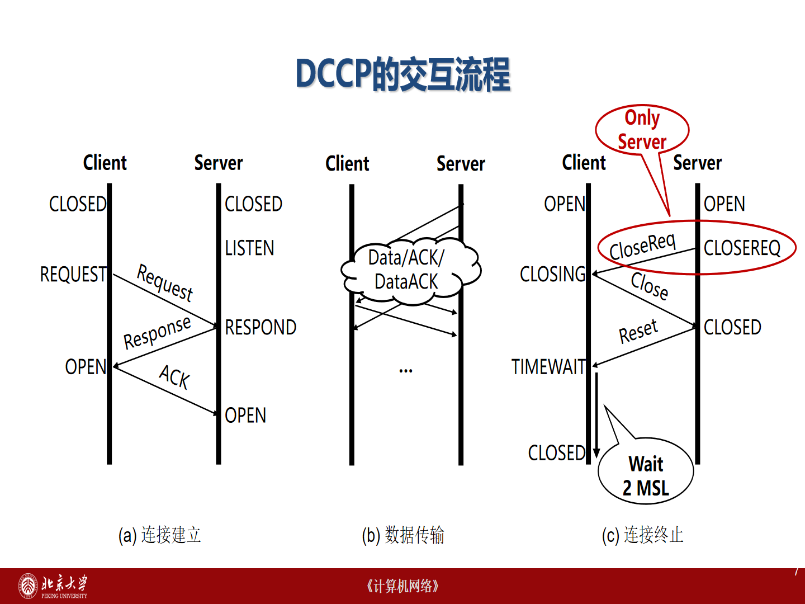
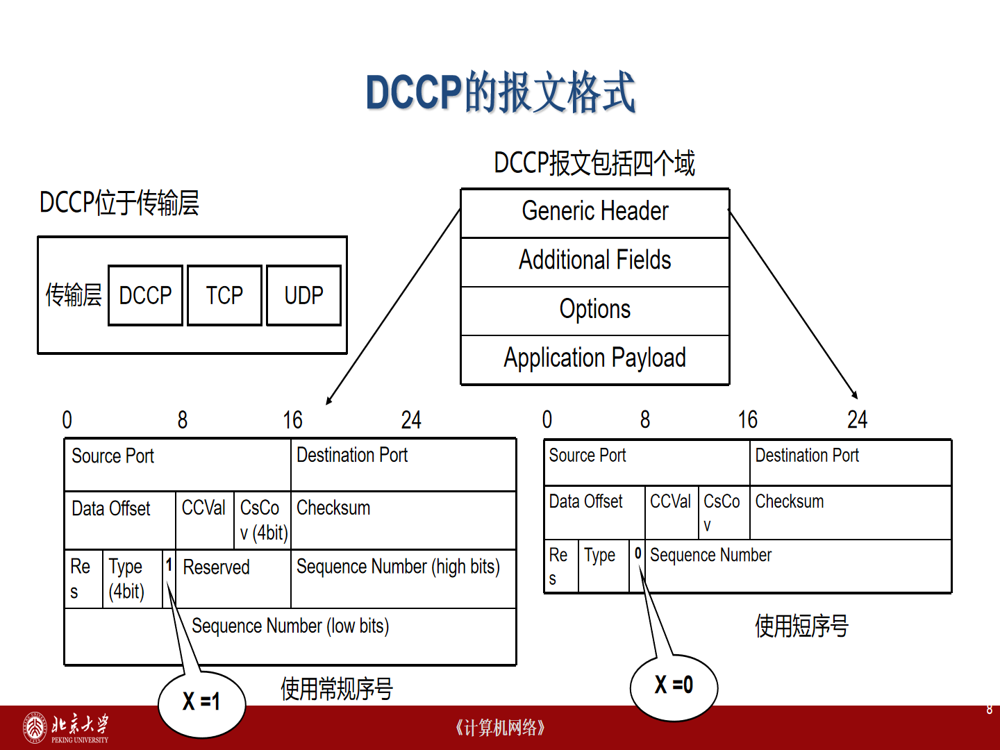
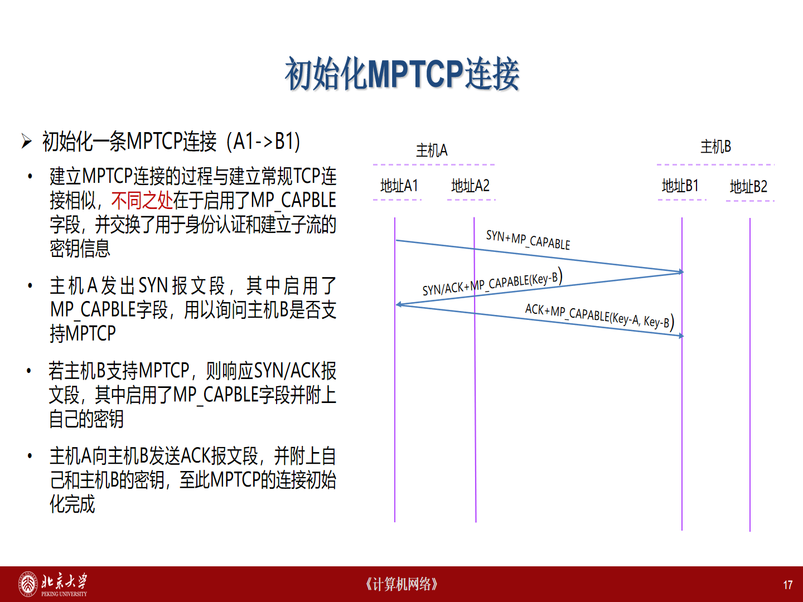
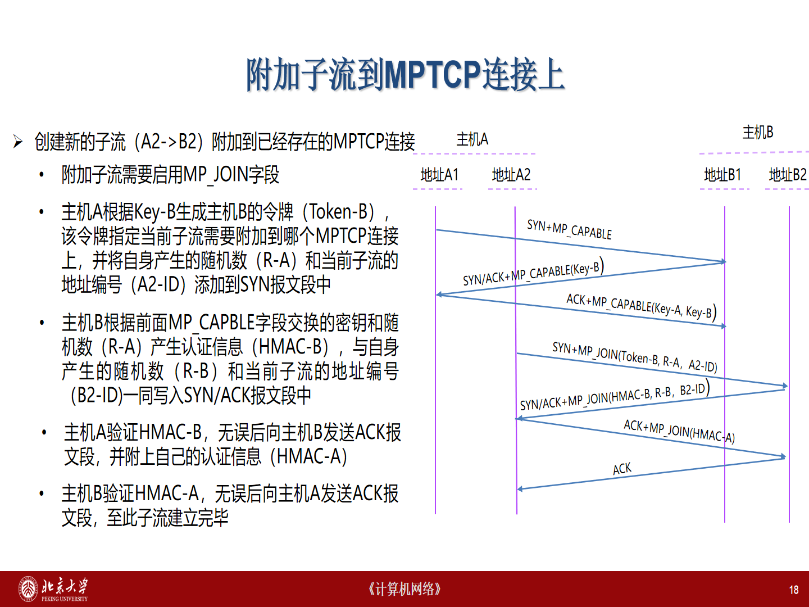
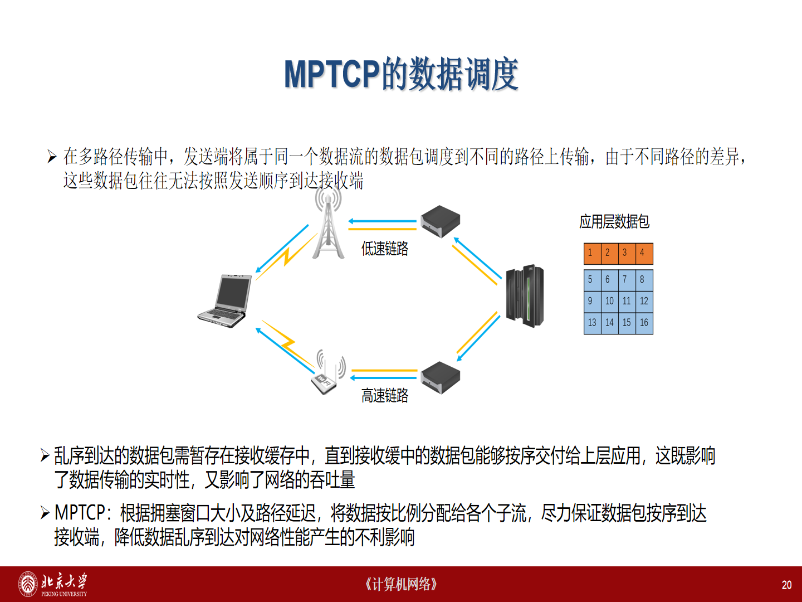
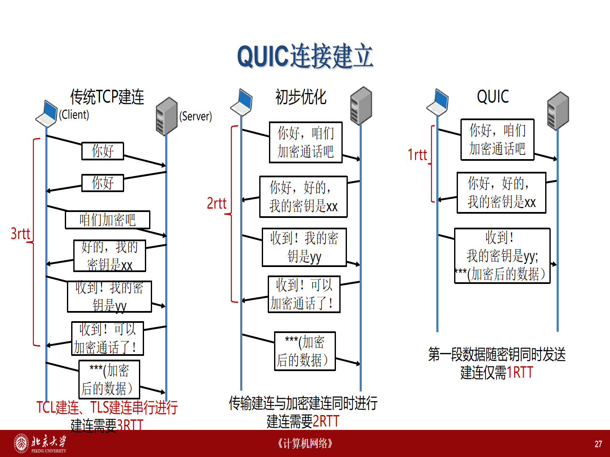
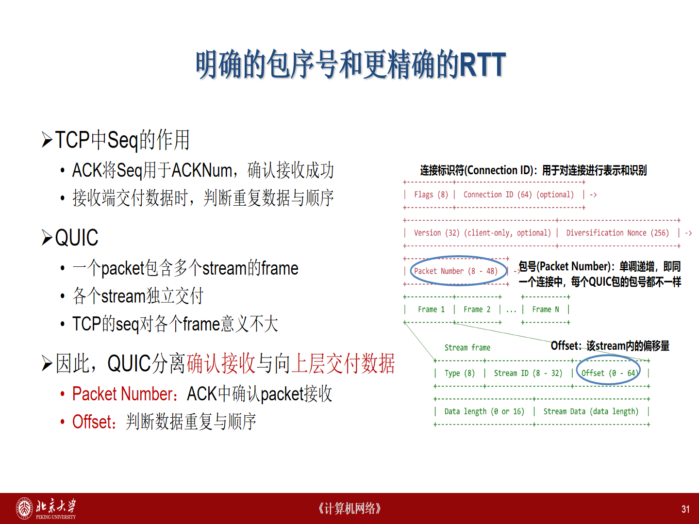
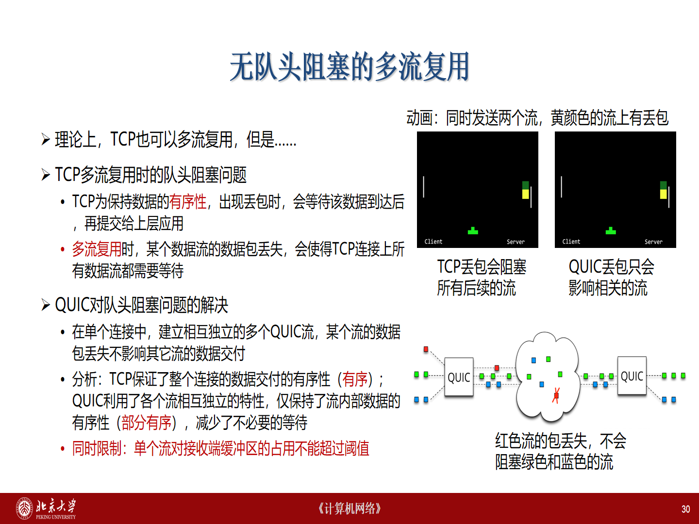

# 传输层（五）：DCCP、MPTCP与QUIC

> 对应教学网《第三讲_传输层（5）新型传输层协议》，37页。源文件封面写“2025年秋”，按2026年11月9日保存的教学网版本整理，未擅自改作2026年。合并目录与复习页，保留协议结构、状态交互和关键图。产品部署比例、软件版本按课件的历史背景理解。

## 1. 三种协议解决的不同问题

| 协议 | 提供的核心服务 | 改进对象 |
| --- | --- | --- |
| DCCP | 带拥塞控制的不可靠数据报服务 | UDP缺少通用拥塞控制，但应用又不希望可靠重传延迟 |
| MPTCP | 多个TCP子流共同承载一条可靠字节流 | 单条TCP连接不能直接聚合多个接入路径 |
| QUIC | 基于UDP的加密、多流、可靠传输 | TCP/TLS握手、跨流队头阻塞、连接迁移与内核迭代困难 |

“基于UDP”不等于没有可靠性，“面向连接”也不等于保证数据可靠交付。应分别判断连接状态、可靠性、顺序、流控和拥塞控制。

## 2. DCCP：不可靠数据报也需要拥塞控制（第3–11页）

### 2.1 动机

视频会议和在线游戏等应用可以容忍少量丢包，但对时延敏感。UDP保持报文边界、不替应用重传，适合这类场景。问题在于UDP本身不要求发送端在网络拥塞时减速：若应用持续高速发送，既可能恶化自己的丢包，也会占用TCP退让后的带宽。

DCCP（Datagram Congestion Control Protocol）为数据报通信增加连接管理、序号、ACK和拥塞反馈，但保留不可靠交付。课件的“UDP+拥塞控制”是功能类比，**DCCP本身是IP之上的独立传输协议，不是在UDP报文中封装DCCP**。

DCCP数据可能丢失或乱序，协议不提供TCP式可靠有序字节流，也不提供同等意义的接收窗口流量控制。应用必须按自己的容错目标处理缺失数据。

### 2.2 半连接

一个DCCP连接是全双工的，可看成两个半连接。A到B的半连接包含A发出的数据和B返回的拥塞反馈；B到A方向有自己的控制状态。两个方向可以采用不同的拥塞控制机制，适应双向应用不对称的流量特征。

同一方向既要发送数据又要携带反向确认信息时，可以合并成DataAck报文，减少开销。

### 2.3 报文类型与交互

| 报文类型 | 用途 |
| --- | --- |
| Request | 客户端请求打开连接 |
| Response | 服务端响应连接请求 |
| Ack | 携带确认信息 |
| Data | 数据报 |
| DataAck | 数据与确认合并 |
| CloseReq | 服务端请求对方启动关闭 |
| Close | 关闭连接 |
| Reset | 终止连接或报告复位 |
| Sync / SyncAck | 大量丢包后恢复序号同步、处理半开连接 |

建立过程采用Request、Response、Ack，随后进入OPEN传输状态。课件展示由服务端发送CloseReq、客户端发送Close、服务端发送Reset的关闭例子，并保留TIMEWAIT以处理旧报文。不能据此把CloseReq当成双方都可任意发送的通用关闭消息，也不应把示例描述成协议唯一允许的所有终止路径。

### 2.4 报文结构

报文依次包含Generic Header、类型相关的Additional Fields、Options和Application Payload。通用首部包括源/目的端口、数据偏移、拥塞控制相关字段、校验和覆盖信息、类型和序号等。X位区分常规长序号与短序号格式：图中长序号48位、短序号24位。

序号用于识别接收事件、反馈丢失和同步，并不迫使发送端重传。校验和覆盖字段支持协议定义的覆盖范围，不能把“数据报不可靠”理解为完全无需检测损坏。

### 2.5 CCID2和CCID3

连接建立时通过CCID标识协商拥塞控制方式，课件重点介绍：

- **CCID2：TCP-like Congestion Control。**维持发送窗口，以ACK反馈接收状态。丢包或ECN提示拥塞时缩窗，没有拥塞时逐步增窗，形状类似TCP AIMD。
- **CCID3：TCP-Friendly Rate Control（TFRC）。**接收方反馈丢包相关统计等信息，发送方计算允许速率并按速率发送，变化更平滑，适合对发送速率波动敏感的媒体应用。

校注：TFRC规范使用的是丢失事件率等参数，不是把每一个丢包都等价视为独立拥塞事件。课件“ACK可以不含序列号”应理解为CCID3无需像SACK那样逐块报告所有收到的序号，不能据此删除DCCP报文类型规定的通用确认字段。

**关键结论：有ACK和序号不意味着可靠重传。**DCCP可确认接收情况以调节速率，但没有义务补齐每个已丢失的应用数据报。

## 3. MPTCP：一条应用字节流、多个TCP子流（第13–22页）

### 3.1 为什么使用多路径

手机可能同时具备Wi-Fi和蜂窝网络，服务器或数据中心可能有多个网络接口。普通TCP连接由一组端点地址和端口标识，不会自动把单个连接拆到多个接口上。MPTCP用多条子流承载同一条应用连接，可以聚合带宽，并在某一路径失效或恶化时保留连接。

这里的“路径”主要指可建立子流的一对端点地址/端口，不意味着主机可以指定互联网中每个中间路由器，子流仍受IP路由决定。

### 3.2 所处层次与兼容性

MPTCP位于应用套接字抽象与TCP子流之间：应用仍使用单一可靠字节流，各子流分别以普通TCP报文格式在网络上传输，扩展信息放在TCP选项中。TCP基本首部保持兼容，网络层无需理解MPTCP。

MPTCP连接由一个或多个子流组成。每个子流有自己的TCP序号空间，同时连接层还需跟踪整条应用数据流的顺序与确认，才能把不同子流收到的字节重新拼接。课件主要讨论连接和调度，不展开完整数据序号映射字段。

### 3.3 首个连接：MP_CAPABLE

1. A向B发送带MP_CAPABLE的SYN，询问是否支持MPTCP。
2. B通过SYN/ACK声明支持，并按协议版本交换密钥材料。
3. A发送最终ACK，完成初始MPTCP连接建立。

这些密钥材料用来派生连接标识和后续子流验证信息，不应直接等同于TLS会话加密密钥。MPTCP本身并不替应用自动提供TLS式数据机密性。课件使用的交互图与MPTCP版本有关，学习目标是理解能力协商及建立连接上下文，不能假定所有版本逐字段完全相同。

### 3.4 附加子流：MP_JOIN

新子流通过MP_JOIN关联到已存在的MPTCP连接。令牌（Token）帮助接收端定位连接，双方交换随机数和HMAC认证信息，验证新子流确实属于该连接，而不是仅凭一个可猜测的连接编号任意加入。

按照课件例子，A2与B2建立新子流：A发送Token-B、随机数R-A和地址标识，B返回自己的随机数与认证信息，A验证并发回认证信息，B验证后子流可用。关键点是**附加子流不重新创建一条独立的应用连接**。

### 3.5 地址管理和关闭

- `ADD_ADDR`通知新增可用地址，可包含端口、地址编号和认证信息。新增地址信息不等于立即启用新子流。
- `REMOVE_ADDR`撤销指定地址，通知对端不要继续把它当作有效路径。
- `MP_JOIN`可以通过建立新子流体现新的可用路径。
- 单个子流可以按TCP方式关闭，其他子流仍可继续承载连接。
- `MP_FASTCLOSE`用于快速终止整条MPTCP连接，需验证相应认证材料，不能与普通单子流FIN混淆。

### 3.6 调度和重排序

多路径带宽不能机械相加。若先发的字节走慢路径，后发字节走快路径，接收端可能已有后续数据，却因为前面的空洞不能按序交付应用。乱序缓存占用增加，还可能限制吞吐或放大时延。

调度器需要综合路径可用窗口、RTT、速率等因素分配数据，使路径之间的到达时间尽量匹配。低时延业务可能优先使用好路径，而不是任何时候都把所有路径打满。某条子流失败时也需要连接层恢复策略，不能仅依赖“路径多”就宣称不丢数据或无延迟。

### 3.7 耦合拥塞控制与公平性

课件给出三个目标：总体吞吐不低于最优单一路径的合理基线；共享瓶颈处不要过度侵占单路径TCP；在这些约束下把流量移向较不拥塞的路径。

例子：一条MPTCP连接的2个子流与1条普通TCP共享同一瓶颈。若每个子流独立竞争为一个普通TCP，MPTCP可能得到约2/3带宽。连接级公平的目标则是让MPTCP整体与普通TCP各获得约1/2，而不是凭“开两条子流”占优势。

因此各子流窗口增长需要耦合。课件用“总增长不超过一个单路径连接”表达直观原则，实际算法会考虑各路径RTT和窗口等条件，不能用一个固定总速率代替所有耦合算法。

### 3.8 部署说明

课件列出移动设备、Linux和商业产品的采用情况。其版本号与“当前最新”字样属于制作课件时的描述，笔记不将这些旧数字视为2026年的最新状态。MPTCP部署还受对端支持、中间设备、策略与计费限制影响。

## 4. QUIC：用户态、加密、多流传输（第24–36页）

### 4.1 TCP/TLS组合的痛点

TCP常在操作系统内核实现，应用难以按自身节奏修改和部署传输优化。连接建立与加密握手还会增加首个应用字节之前的等待。HTTP/2将多个逻辑请求复用到一条TCP字节流时，底层某处丢失会阻止后续所有字节交付，进而影响多个逻辑流。

课件以传统TCP加较旧TLS握手“3 RTT”作比较，这是特定握手方式下的教学示例。现代TLS 1.3、连接复用及恢复模式会改变时延，不能写成所有TCP+TLS总是3 RTT。

### 4.2 分层与功能

QUIC报文作为UDP载荷发送，在用户态实现连接管理、加密握手、可靠传输、流控、拥塞控制与多流复用。HTTP/3运行于QUIC之上，HTTP请求与响应语义仍由HTTP层定义。说QUIC“替代部分HTTP功能”主要指把多流等能力下沉到传输层，并非取消HTTP语义。

QUIC拥塞控制可以模块化选择，如使用CUBIC等算法。因此QUIC并不是“用UDP所以不退让”的无拥塞控制协议。

### 4.3 握手

QUIC把传输参数协商和TLS加密握手结合，典型首次建立连接可以在约1 RTT后发送应用数据。具备恢复状态时可以尝试0-RTT早期数据，但有重放风险和应用限制，也可能被服务端拒绝。不能把0-RTT理解为无需安全握手或所有请求都适合提前发送。

### 4.4 包、帧与流

一个UDP数据报承载QUIC包，包中可以包含多个帧，不同帧负责流数据、确认或控制信息。课件把包头简化为Flags、Connection ID、Packet Number等，实际长短首部、包类型和加密级别更复杂。

- **Connection ID**标识连接，帮助连接在IP或端口变化后保持关联。
- **Packet Number**用于标识包的传送和确认。
- **Stream ID**区分不同字节流。
- **Offset**表示某个流内字节位置，用于去重和有序交付。

同一个包可以含多个流的帧。包是网络传输及丢失判断单位，流是向应用交付的单位，两者不能混同。

### 4.5 多流与队头阻塞

TCP保证整条字节流的顺序，因此一个缺口会拦住后面的所有字节。QUIC分别保证每个可靠流内部的顺序：某流丢失一段数据，不要求另一个已完整到达的流等待。

“无队头阻塞”准确地说是减少**跨流的传输层队头阻塞**。同一流内部仍会等待缺失字节；多个流仍共享网络容量、连接级拥塞控制及某些资源限制，不能保证一个流丢包对其他流吞吐完全没有间接影响。流级和连接级流控还需要防止单流占满接收缓存。

### 4.6 重传与RTT测量

TCP重传相同字节时仍使用相同序号，因此一个ACK可能难以判断确认的是第一次发送还是重传，RTT采样需避免歧义。QUIC重发的是丢失的信息或帧内容，并放入新的包，使用新的包号；对端ACK可以明确确认哪一次包传送。流内Offset保持数据位置语义，不因重新装包而改变。

ACK还可报告接收方确认延迟，帮助发送方区分网络往返与接收方等待确认的时间。不能无条件减去任意ACK Delay，需遵守协议的加密级别、限值与估计规则。

校注：包号的唯一性和递增应理解为在相应**包号空间**内，QUIC的Initial、Handshake和Application Data并不是所有阶段共用一个简单全局序号。课件为解释重传歧义而作了简化。

### 4.7 连接迁移

普通TCP连接通常依赖端点IP和端口四元组，Wi-Fi转蜂窝网络后端点改变，往往要重建连接。QUIC通过Connection ID识别连接，使地址改变后继续关联原连接。

迁移仍需验证新路径，并遵守反放大等安全约束。新路径的容量和RTT可能不同，因此不能直接沿用旧路径的高发送速率，也不能把连接迁移等同于默认同时使用多路径。MPTCP的多路径聚合与QUIC的连接迁移是不同能力。

### 4.8 加密与部署

QUIC集成TLS，保护载荷及大量控制信息，并通过首部保护减少中间设备依赖易变字段。**并非整个包的每个比特都不可见**，某些首部信息仍用于路由、版本或连接识别。课件“整个QUIC包被加密”是过度概括。

用户态实现使应用能更快部署版本更新，版本协商处理不同实现兼容性。实际版本协商、重试和网络条件可能引入额外往返，不能将课件“无额外时延”当作任何情况下的保证。

第36页中2017年的流量比例、2020年的企业部署以及当时“推进中”的扩展都是历史材料。HTTP/3基于QUIC这一架构结论可以保留，但旧进展列表不能冒充今天的标准状态。

## 5. 易混点与复习题

1. **DCCP为何既有ACK又不可靠？**ACK给拥塞控制提供接收反馈，是否重传应用数据是另一项服务承诺。
2. **MPTCP为什么不能简单逐子流独立运行Reno？**多个子流可能共享瓶颈，独立竞争会把一条应用连接伪装成多条公平竞争者。
3. **多路径为什么可能比单路径慢？**异构路径造成乱序，慢路径上的前缀数据可能拦住应用交付。
4. **QUIC为何需要包号和Offset两套编号？**前者确认一次包传输，后者表示流内数据位置，分离后可减少重传歧义。
5. **QUIC是否消除一切队头阻塞？**没有。它主要避免多个独立流被一个TCP字节流的缺口共同阻塞。
6. **QUIC与MPTCP能否互相替代？**二者重点不同，应分别比较加密、多流、迁移、路径聚合及部署条件，不能只按“都用了多条通道”归类。

## 来源与版本说明

本篇使用2026-11-09保存并核对哈希的教学网课件及已准备笔记。2026-11-17未能在线核实课件是否更新；课件中的历史部署数据和实验截止日期不作为当前通知。课件哈希、页码与配图记录见[本轮来源记录](sources/network-transport-tutorial-2026-11-17.json)。
