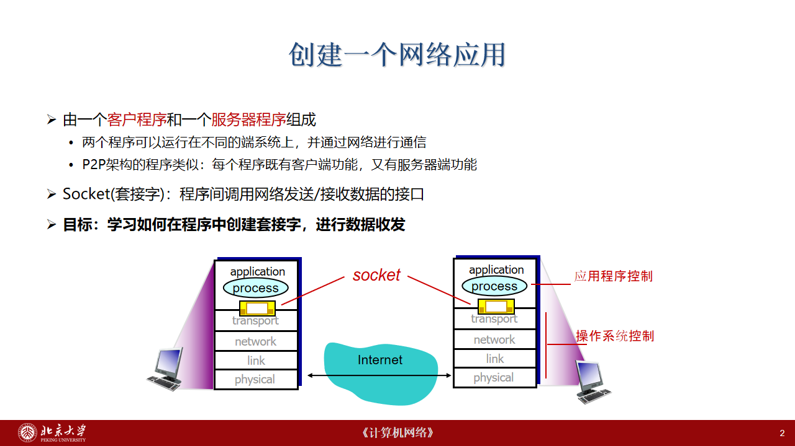
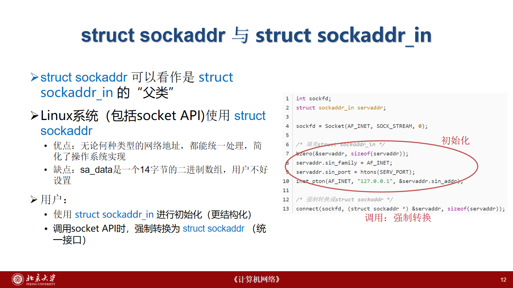
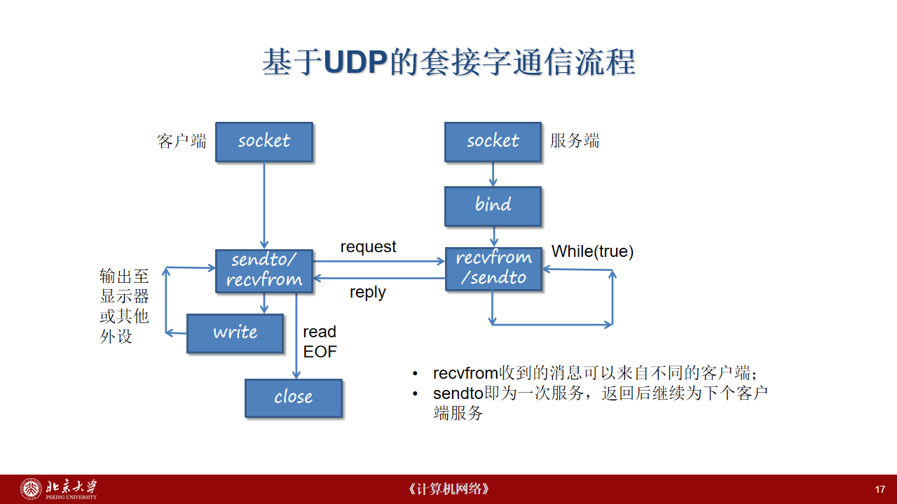
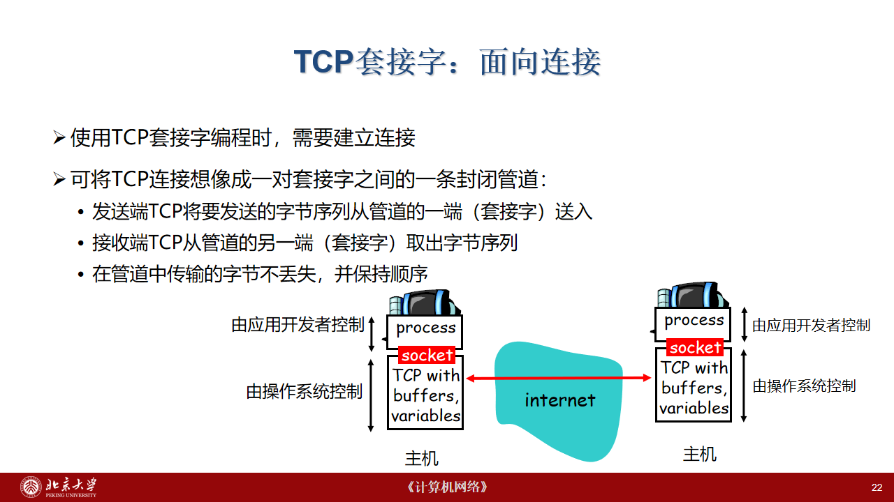
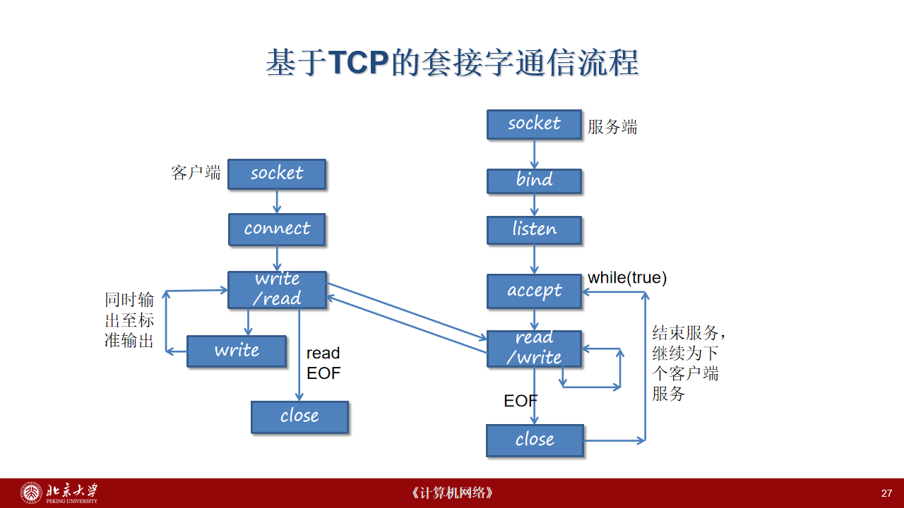
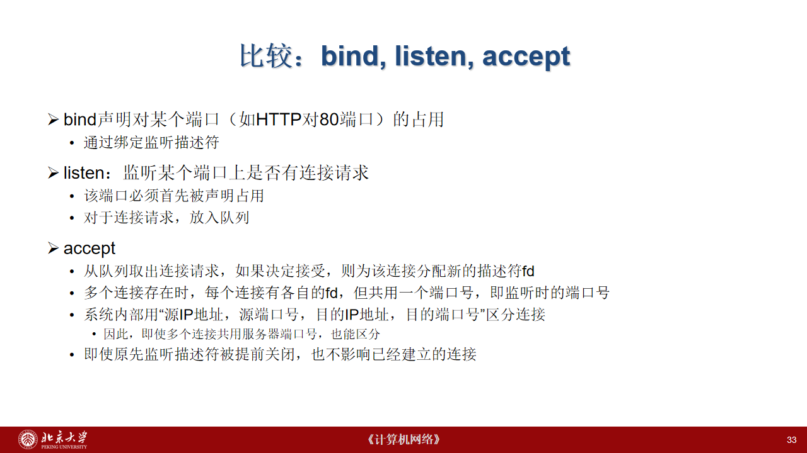

# 习题课：Socket 编程入门

> 对应课件：Computer networks 2026 秋《Socket 编程入门》，35 页。讲授内容按 UDP、TCP 和接口语义重组，保留回显示例及关键图。标为“校注”的内容纠正课件笔误或限定简化表述。代码是阅读用的 POSIX/Linux 示例，未执行、未作为实验结果。

## 1. 从网络应用到套接字

网络应用通常包含客户端和服务器，二者可以位于不同端系统；P2P 程序往往同时承担两种角色。客户端主动发起交互，服务器等待请求。Socket 是应用调用操作系统网络服务的接口，而不是应用自己实现的传输层。



本课贯穿的例子是**回显服务**：客户端从键盘读取一行，发送给服务器，服务器把收到的数据原样返回，客户端显示结果。业务简单，但可以完整展示地址、端口、连接和收发流程。

Linux 的 socket 用文件描述符表示，因此可使用 `read`、`write`、`close`。它与普通文件共用部分接口，并不意味着行为完全一致：网络读取可能阻塞、短读或遇到连接关闭；UDP 又有不同于 TCP 的报文边界。

## 2. 创建套接字与设置地址

### 2.1 socket

```c
int socket(int domain, int type, int protocol);
```

成功返回非负描述符，失败返回 `-1` 并设置 `errno`。

| 参数 | 本课常用值 | 意义 |
|---|---|---|
| domain | AF_INET | IPv4 地址族 |
| domain | AF_INET6 | IPv6 地址族 |
| domain | AF_UNIX | 本机进程间通信 |
| type | SOCK_DGRAM | 数据报套接字，IPv4 常用 UDP |
| type | SOCK_STREAM | 字节流套接字，IPv4 常用 TCP |
| protocol | 0 | 为所选地址族和类型选择默认协议 |

课件把 Socket API 的历史追溯到 BSD UNIX。这里重点不是记历史年份，而是理解“创建、配置、使用、释放”的生命周期。AF_UNIX 不走远端 IP 网络，但不能由此断言任何负载下都比管道快。

### 2.2 IP、端口与地址结构

IP 地址定位网络接口，端口帮助传输层区分通信端点。端口不是操作系统 PID；一个进程可持有多个 socket，一个服务器端口也可服务多个 TCP 连接。

IPv4 常用结构的关键成员：

```c
struct sockaddr_in addr;
memset(&addr, 0, sizeof addr);
addr.sin_family = AF_INET;
addr.sin_port = htons(8000);
addr.sin_addr.s_addr = htonl(INADDR_ANY);
```

- `sin_family` 指定地址族；`sin_port` 为 16 位端口。
- `sin_addr` 保存 IPv4 地址，其地址字段为 32 位。
- 端口和 IPv4 数值字段使用网络字节序。`htons` 转换 16 位主机序整数，`htonl` 转换 32 位主机序整数；反向为 `ntohs`、`ntohl`。
- `INADDR_ANY` 用于绑定本机适用的接口地址，不是客户端应连接的远端地址。
- `inet_pton(AF_INET, "127.0.0.1", &addr.sin_addr)` 将文本地址转成二进制；成功返回 1，非法文本返回 0，错误返回 -1。其结果已经是网络表示，不应再重复 `htonl`。

Socket API 接受通用的 `struct sockaddr *`，实际构造 IPv4 地址时用 `struct sockaddr_in`，调用时转换指针并传入真实结构长度：

```c
bind(fd, (const struct sockaddr *)&addr, sizeof addr);
```



**校注：**课件用“父类”帮助理解 `sockaddr`，但 C 结构体没有这里所说的类继承；这是统一接口的类比，不能把任意地址内容直接填入一个固定的 14 字节数组。需要容纳不同地址族时通常使用 `sockaddr_storage`。

### 2.3 bind 与 close

```c
int bind(int fd, const struct sockaddr *addr, socklen_t addrlen);
int close(int fd);
```

`bind` 为套接字指定本地地址。服务器通常绑定已知端口，方便客户端找到它；客户端常让系统自动分配本地地址和临时端口。端口 0 表示请求系统选择可用端口，可用 `getsockname` 查询结果。

**校注：**课件中的客户端端口范围是教学简化；真实临时端口范围由操作系统配置决定，不是统一的 1024—50000。

`close` 释放当前描述符。UDP 没有连接关闭握手。TCP 的正常关闭涉及协议行为，但描述符引用、未发送数据、错误及相关选项都会影响具体行为，不应简单理解成调用后对端立刻完成全部关闭流程。

## 3. UDP：每次发送一个数据报

UDP 不要求先进行 TCP 式连接握手。一个数据报包含自己的边界，发送端通常在 `sendto` 中给出目的地址，接收端可由 `recvfrom` 得到发送者地址。

```c
ssize_t sendto(int fd, const void *buf, size_t len, int flags,
               const struct sockaddr *dest, socklen_t addrlen);
ssize_t recvfrom(int fd, void *buf, size_t len, int flags,
                 struct sockaddr *src, socklen_t *addrlen);
```

返回值是实际处理的字节数，失败为 `-1`。发送参数的长度是输入值；接收参数的长度是输入/输出指针：调用前给出地址缓冲区容量，返回后获得地址长度。循环接收时应重新设置地址长度。

**校注：**课件 `sendto` 原型把最后一项写成指针，不能照抄。`connect` 的最后一项同样是长度值；只有 `accept`、`recvfrom` 等输出地址的相关接口用长度指针。

### 3.1 UDP 回显流程



服务器：`socket → bind → recvfrom → sendto → 再次 recvfrom`。
客户端：`socket → 输入 → sendto → recvfrom → 显示 → 下一轮或 close`。

客户端可以不显式 `bind`，首次发送时由系统分配本地端口；服务器根据本次报文的来源地址回复。若希望接收别人主动发来的报文，需要让发送者知道接收端的地址和端口，通常显式绑定已知端口。

下面是课件服务器核心的规范化写法，省略完整头文件和进程退出策略，不是可直接提交的实验程序：

```c
int fd = socket(AF_INET, SOCK_DGRAM, 0);
if (fd < 0) { /* 记录 errno 并退出 */ }
struct sockaddr_in server = {0};
server.sin_family = AF_INET;
server.sin_port = htons(8000);
server.sin_addr.s_addr = htonl(INADDR_ANY);
if (bind(fd, (struct sockaddr *)&server, sizeof server) < 0) {
    /* 处理错误并 close(fd) */
}
/* 以上失败分支必须终止本流程，不能继续使用无效 fd。 */
for (;;) {
    char buf[4096];
    struct sockaddr_in peer;
    socklen_t peerlen = sizeof peer;
    ssize_t n = recvfrom(fd, buf, sizeof buf, 0,
                         (struct sockaddr *)&peer, &peerlen);
    if (n < 0) {
        if (errno == EINTR) continue;
        break;
    }
    ssize_t sent = sendto(fd, buf, (size_t)n, 0,
                          (struct sockaddr *)&peer, peerlen);
    if (sent < 0 || sent != n) { /* 记录发送失败；勿拆成多个报文补写 */ }
}
close(fd);
```

与课件逐行对应：创建 IPv4 UDP socket；清零并初始化地址；绑定 8000；取得发送者地址；用实际接收长度回显。`recvfrom` 的地址参数必须是 `&peer` 的相应转换，不能误把结构体值当成指针。

客户端先验证参数、解析服务器地址，然后在 `fgets` 读到一行后发送。若按文本输出，应留一个字节给终止符：

```c
/* fd 和 server 已正确创建、初始化，并且地址解析已成功 */
char line[4096], reply[4096];
while (fgets(line, sizeof line, stdin) != NULL) {
    size_t len = strlen(line);
    ssize_t sent = sendto(fd, line, len, 0,
                          (struct sockaddr *)&server, sizeof server);
    if (sent < 0 || (size_t)sent != len) break;
    ssize_t n = recvfrom(fd, reply, sizeof reply - 1, 0, NULL, NULL);
    if (n < 0) break;
    reply[n] = '\0';
    fputs(reply, stdout);
}
```

这段仅展示课件的文本回显路径。真实应用还应验证回复来源，处理超时、丢包、重复、乱序和重试，避免无限等待。若传输二进制，不能依赖 `strlen` 和 `fputs`。

### 3.2 UDP 不能套用 TCP 的“补读剩余部分”

UDP 数据报超过接收缓冲区时，常规接收会发生截断；被截掉的余部不会在下一次 `recvfrom` 中作为同一个报文的后半段继续出现。下一次接收是下一个报文。

所以应设计最大报文长度、足够缓冲区以及必要的截断检测机制，而不是反复读取直到凑满。同样，不应把一个应用报文的剩余字节用第二次 `sendto` 补发，那会变成两个数据报。

零长度 UDP 数据报合法，返回 0 不等于 TCP 的 EOF。UDP 不保证可靠、按序、无重复交付；回显示例不自动提供这些保证。

## 4. TCP：先建立连接，再读写字节流

TCP 提供可靠、有序的字节流抽象。其内部具有缓冲区、序号和重传机制，但应用仍要处理连接失败；“可靠”不意味着任何网络故障下都能永久保证交付。



最重要的区别是：**TCP 没有应用消息边界。**发送端两次写入不对应接收端两次读取，一次写入可能被分成几次读取，多次写入也可能在一次读取中得到。

### 4.1 connect、listen、accept

```c
int connect(int fd, const struct sockaddr *addr, socklen_t addrlen);
int listen(int fd, int backlog);
int accept(int fd, struct sockaddr *addr, socklen_t *addrlen);
```

- 客户端对服务器地址调用 `connect`；对阻塞 socket，成功后可进行连接上的读写。
- 服务器先 `bind`，再 `listen`，把 socket 用作监听端点。
- `accept` 从等待处理的连接中取得一个，返回**新的已连接描述符**，原监听描述符继续用于接收后续连接。
- `accept` 的地址参数输出对端地址；不关心时可传 `NULL, NULL`。
- 这些调用失败返回 `-1`。课件 `listen` 原型中用分号隔开参数、`accept` 中结构名拼写错误，均不应复制。

**校注：**`backlog` 描述待处理连接队列的相关上限，具体语义受系统实现限制，不是“服务器最多同时服务多少个已建立客户端”的总配额。

### 4.2 TCP 回显流程



服务器：`socket → bind → listen → accept → 连接上的读写 → close(connfd)`；监听 socket 可以继续 `accept`。
客户端：`socket → connect → 输入与读写 → close`。

```c
/* listenfd 已成功完成 socket、bind、listen */
for (;;) {
    int connfd = accept(listenfd, NULL, NULL);
    if (connfd < 0) {
        if (errno == EINTR) continue;
        break;
    }
    /* 在 connfd 上执行回显服务，直到 EOF 或错误 */
    close(connfd);
}
close(listenfd);
```

这是顺序服务框架：一个客户端未结束时，其他已连接客户端可能仍在等待应用处理。并发服务可以用多进程、多线程或 I/O 多路复用；不要把内核能排队连接误认为应用已经同时处理它们。

### 4.3 read、write 与短读短写

```c
ssize_t read(int fd, void *buf, size_t count);
ssize_t write(int fd, const void *buf, size_t count);
```

**校注：**POSIX 返回类型是 `ssize_t`，课件简写为 `int` 不适合直接用于完整实现。

对于 TCP：`read > 0` 表示读到这些字节；`read == 0` 表示已到接收方向的 EOF；`read < 0` 表示错误。读取少于请求长度可以完全正常，不能自动判定消息结束。`write` 返回正数但小于请求数时，仅这部分被接受，需要继续处理剩余字节。

下例补足课件回显函数的“完整写入”逻辑，仅适用于这里的阻塞流式 socket；未处理所有生产级情况，例如 SIGPIPE 的整体策略：

```c
static int write_all(int fd, const char *buf, size_t len) {
    size_t done = 0;
    while (done < len) {
        ssize_t n = write(fd, buf + done, len - done);
        if (n > 0) { done += (size_t)n; continue; }
        if (n < 0 && errno == EINTR) continue;
        return -1;
    }
    return 0;
}

static int echo_stream(int fd) {
    char buf[4096];
    for (;;) {
        ssize_t n = read(fd, buf, sizeof buf);
        if (n > 0) {
            if (write_all(fd, buf, (size_t)n) < 0) return -1;
        } else if (n == 0) {
            return 0;
        } else if (errno != EINTR) {
            return -1;
        }
    }
}
```

服务器可以收到多少回显多少，不必识别文本行。客户端若要“一行输入对应一行显示”，却必须明确何时收齐响应。可按换行符解析、按长度前缀解析，或在这个特殊的原样回显协议中按本次发送长度循环收取：

```c
/* 已成功 write_all(fd, line, len)；原样回显且一次只挂起一个请求 */
size_t got = 0;
while (got < len) {
    ssize_t n = read(fd, reply + got, len - got);
    if (n > 0) got += (size_t)n;
    else if (n < 0 && errno == EINTR) continue;
    else { /* 提前 EOF 或失败：响应不完整，必须退出本次流程 */ break; }
}
/* 只有 got == len 才按完整响应处理；用 fwrite 可避免终止符问题。 */
```

这里必须保证 `reply` 容量至少为 `len`。这不是通用应用协议的替代品；实际协议仍需约定消息类型、长度、编码和错误处理。课件 `str_cli` 的“一次 write 后一次 read”只展示基本调用，不能视为完整的行协议实现。

## 5. 监听端口、连接与描述符



`bind` 选定本地地址，`listen` 开启监听，`accept` 取得一个已连接端点。多个客户端连接服务器同一个端口，但各有独立的连接描述符。TCP 在既定协议上下文中以源 IP、源端口、目的 IP、目的端口区分连接，因此新连接不要求服务器换一个端口。

关闭监听描述符不会自动关闭已经取得的连接描述符；关闭某个连接也不会自动关闭监听描述符。释放每个成功取得的描述符是应用的责任，课件服务器循环省略的 `close(connfd)` 不能在完整实现中忘掉。

## 6. 接口选择与进一步学习

| 接口 | 适用关注点 |
|---|---|
| read / write | 通用描述符 I/O，常用于已连接 TCP |
| recv / send | Socket I/O，可通过 flags 指定额外行为 |
| recvfrom / sendto | 显式取得来源或指定目的地址，常用于 UDP |
| close | 释放描述符，不同协议的关闭语义不同 |

UDP 也可以调用 `connect` 来设置默认对端，并据系统语义限制接收来源；这不会变成 TCP，不会执行 TCP 握手，也不会添加可靠性。已连接 UDP 可使用 `read/write` 或 `send/recv`，但仍然保留数据报语义。

复习时应能解释：为什么客户端通常不显式绑定端口；为什么 accept 返回新 fd；为什么 TCP 要自己定义消息边界；为什么 UDP 截断不能补读；为何所有系统调用都应检查返回值。

课件建议继续阅读教材 2.7、Linux man 手册与《UNIX 网络编程》，再学习阻塞/非阻塞、`select/poll/epoll` 和 pthread。非阻塞情况下 `EAGAIN/EWOULDBLOCK` 表示当前暂不能完成，应结合事件等待处理，不能直接照搬本课阻塞循环忙等。

### 讲者备注补充：终端 EOF 与网络 EOF

课件在客户端流程中用 Ctrl+D 表示结束键盘输入。准确说，Unix 终端在相应条件下让标准输入读到 EOF，应用随后自行调用 close；按键本身不直接关闭网络套接字。TCP read 返回 0 表示对端发送方向已结束，不表示双方所有资源都已释放，也不能把 read 一次返回的数据自动称为“一行”。这些细节已与课件备注中的 EINTR、字节序、顺序服务和回显函数说明一起核对。

## 来源与版本说明

本篇使用2026-11-09保存并核对哈希的教学网课件及已准备笔记。2026-11-17未能在线核实课件是否更新；课件中的历史部署数据和实验截止日期不作为当前通知。课件哈希、页码与配图记录见[本轮来源记录](sources/network-transport-tutorial-2026-11-17.json)。
