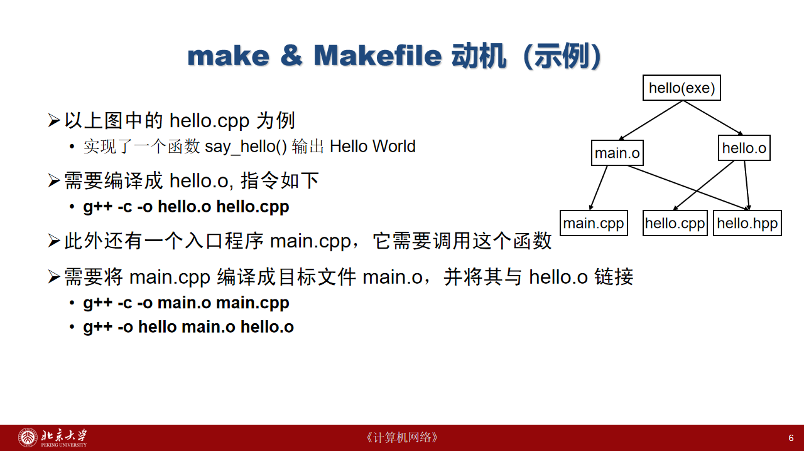
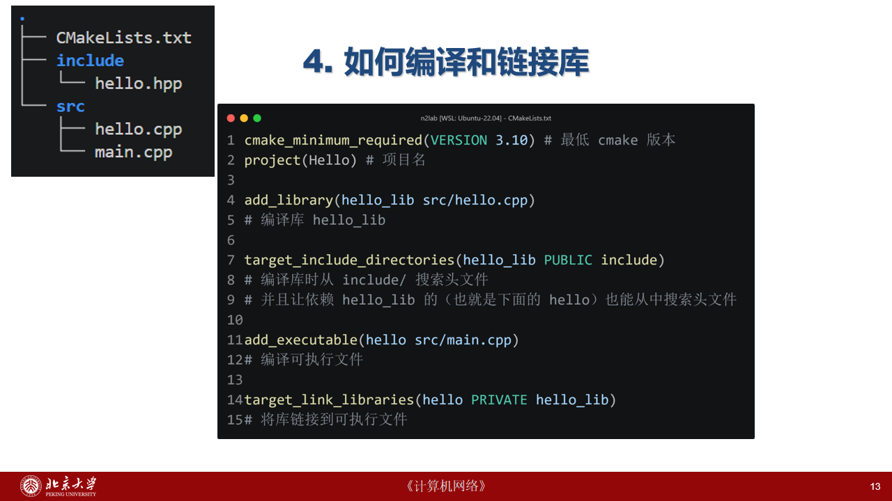
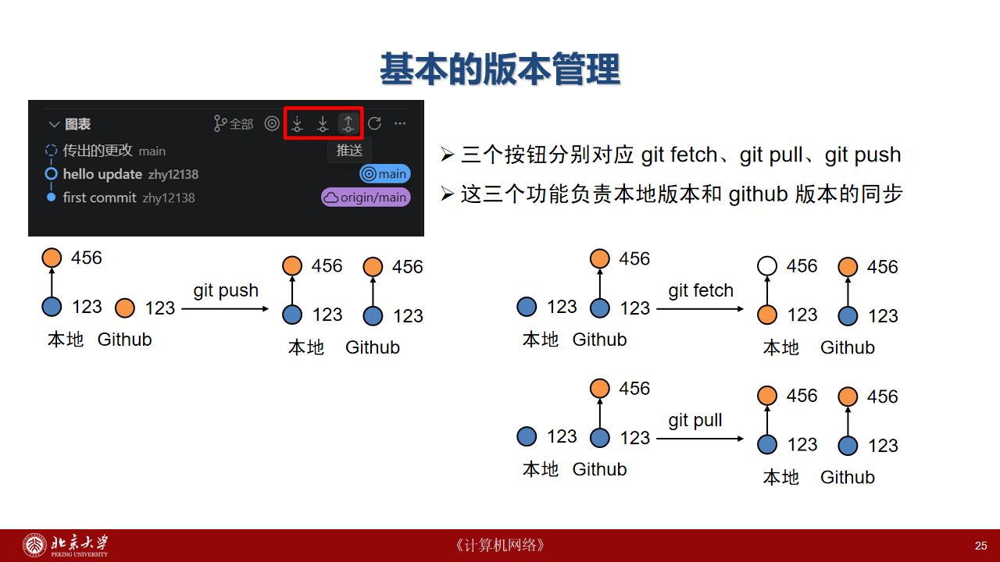
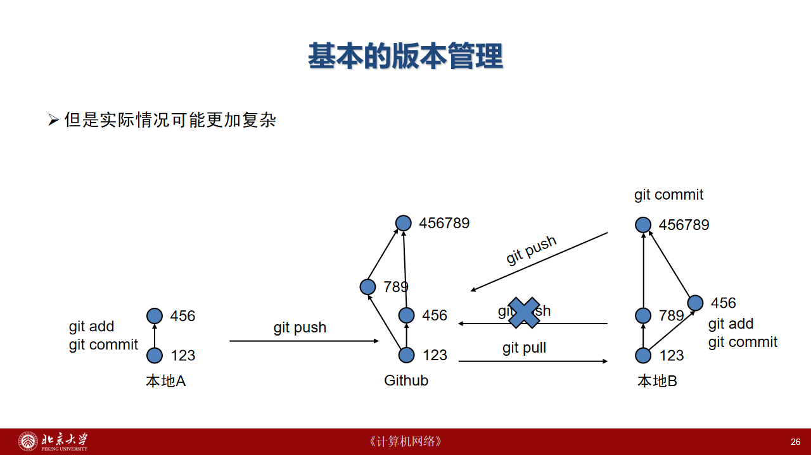
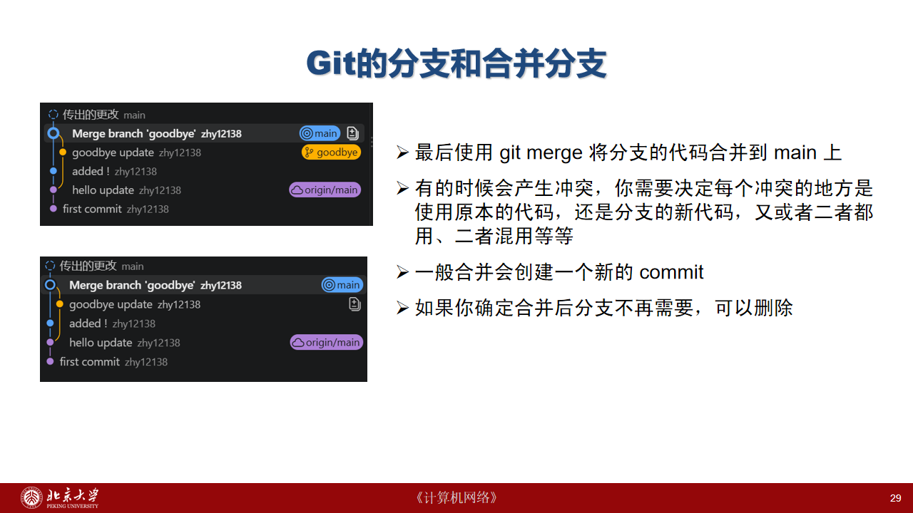
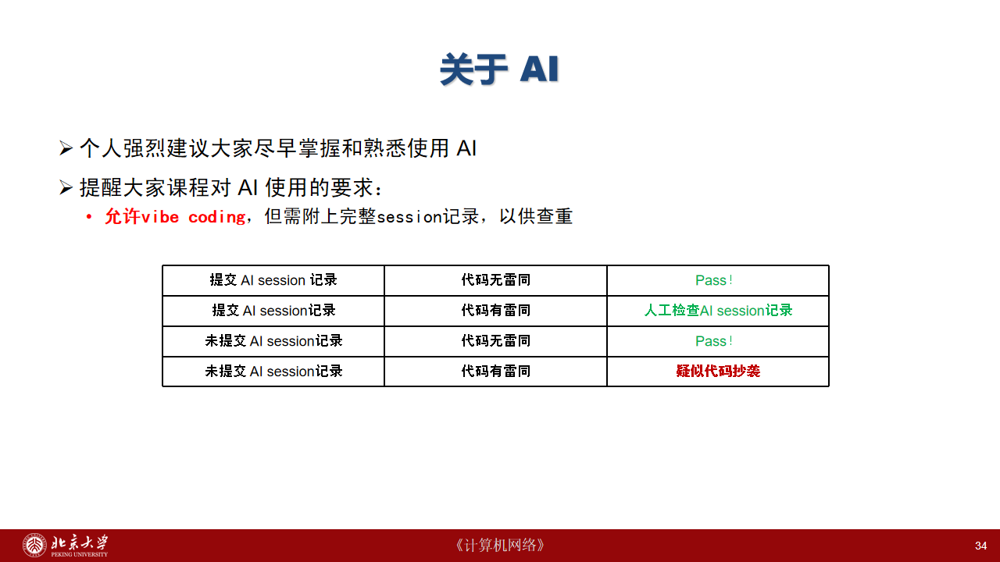

# 习题课：CMake、Git 与实验入门

> 对应课件：《Tutorial 1：CMake 与 Git》，朱厚源，修改自 2025 秋版本，共 35 页。教学网附件实际为 ZIP 示例包，包含本课件及 CMake/Git 示例，不能仅凭下载后扩展名把它当作 Socket 或 Lab 实现讲义。本文保留四个 CMake 示例、Git 工作流、Docker 入门及课件中的实验说明。代码和命令用于学习，未运行、未提交实验。

## 1. 为什么需要构建工具

一个 C++ 程序往往由多个源文件组成：拆分功能可改善复用、维护和协作，但构建时需要知道哪些文件要编译、哪些对象需要链接，以及修改一个头文件后要重编哪些目标。

课件的 Hello World 示例把声明、实现和入口分离：

```cpp
// include/hello.hpp
#pragma once
void say_hello();
```

```cpp
// src/hello.cpp
#include "../include/hello.hpp"
#include <iostream>
void say_hello() {
    std::cout << "Hello World" << std::endl;
}
```

```cpp
// src/main.cpp
#include "../include/hello.hpp"
int main() {
    say_hello();
    return 0;
}
```

`hello.hpp` 是接口声明；`hello.cpp` 提供函数定义；`main.cpp` 调用它。编译和链接是不同阶段：编译把源文件转成目标文件，链接把多个目标文件及所需库组成可执行程序。

课件使用的示意命令为：

```sh
g++ -c -o hello.o hello.cpp
g++ -c -o main.o main.cpp
g++ -o hello main.o hello.o
```

这些命令采用源文件位于当前目录的表达。若按上面的 `src/` 目录实际组织，应调整源路径；不能直接照搬后假定当前路径也相同。



图中 `hello` 依赖 `main.o` 和 `hello.o`，两者又依赖各自源文件及共享头文件。修改 `hello.cpp` 只需重编其相关目标并重新链接；修改 `hello.hpp` 可能使两个目标都需要重编。这就是 make 管理依赖和增量构建的动机。

## 2. make、Makefile、CMake 的关系

make 根据 Makefile 中的**目标、依赖、构建命令**决定如何构建。典型规则的结构是：

```make
目标: 依赖项
	构建命令
```

传统 Makefile 的命令行通常以制表符开头。目标不一定是实际文件，也可为 `clean` 等抽象任务设置伪目标；课件“make 面向文件”的概括强调的是其常见依赖模型，不应理解为它只能表示文件。

CMake 是更高一层的构建配置工具：根据 `CMakeLists.txt` 生成适合平台的底层构建系统，例如 Makefile、Ninja 或其他工程文件。它不替代 C++ 编译器，也不意味着工程不再需要底层构建工具。

推荐区分两个阶段：

```sh
cmake -S . -B build
cmake --build build
```

1. 配置/生成：读取源码目录的 CMakeLists，选择编译器和生成器，建立构建目录。
2. 构建：由 CMake 调用该构建目录对应的底层工具。

参数 `-S` 指定源码目录，`-B` 指定构建目录，`-G` 指定生成器。源码外构建让中间文件留在 `build/`，避免和源码混杂。课件的 `cmake -B build` 在当前目录作为源码目录时表达相同的常用意图。

## 3. 四个递进的 CMake 示例

### 3.1 hello0：单源文件可执行程序

```cmake
cmake_minimum_required(VERSION 3.10)
project(Hello)
add_executable(hello main.cpp)
```

- `cmake_minimum_required` 指定最低 CMake 版本及相关策略基线。
- `project` 定义项目；本例未限定语言，按 CMake 默认启用相关语言。
- `add_executable` 定义目标 `hello`，并列出其源文件。

单文件 `main.cpp` 中定义 `say_hello()` 并由 `main()` 调用。课件构建演示：

```sh
cmake -B build
cmake --build build
./build/hello
```

课件展示程序输出 `Hello World`。这属于课件演示，不是本次笔记生成过程中实际运行的结果。Windows、多配置生成器等环境的输出文件后缀和目录可能不同。

### 3.2 hello1：拆分声明、实现与入口

目录包含 `include/hello.hpp`、`src/hello.cpp` 和 `src/main.cpp`。CMakeLists 的关键目标定义改为：

```cmake
cmake_minimum_required(VERSION 3.10)
project(Hello)
add_executable(hello src/main.cpp src/hello.cpp)
```

C++ 源码仍使用 `#include "../include/hello.hpp"`。两个 `.cpp` 都必须进入构建；只有声明而漏掉 `hello.cpp` 的函数定义时，链接阶段可能出现未定义引用。

头文件无需单独编译成普通目标文件。编译器预处理源文件时读取它，构建工具则需要跟踪相应依赖。相对包含路径虽然可用，却使源码与目录层级耦合。

### 3.3 hello2：为目标配置头文件搜索路径

```cmake
cmake_minimum_required(VERSION 3.10)
project(Hello)
add_executable(hello src/main.cpp src/hello.cpp)
target_include_directories(hello PRIVATE include)
```

两个源文件此时可写：

```cpp
#include "hello.hpp"
```

`target_include_directories` 把 `include/` 作为目标的头文件搜索目录。`PRIVATE` 表示仅作为本目标的编译需求，不向依赖它的其他目标传播。

这样源码只表达“我要使用 hello.hpp”，路径管理留在构建配置里。不要把它误解为把头文件复制到了构建目录。

### 3.4 hello3：把复用逻辑抽成库

```cmake
cmake_minimum_required(VERSION 3.10)
project(Hello)

add_library(hello_lib src/hello.cpp)
target_include_directories(hello_lib PUBLIC include)

add_executable(hello src/main.cpp)
target_link_libraries(hello PRIVATE hello_lib)
```



`hello_lib` 负责实现 `say_hello()`；`hello` 只负责入口，并依赖该库。`PUBLIC include` 有两层作用：库自身编译需要该目录；使用该库的目标也需要它以包含公开头文件。`target_link_libraries` 建立链接关系，并传播库公开的使用要求。

| 作用域 | 当前目标使用 | 传播给依赖目标 |
|---|---:|---:|
| PRIVATE | 是 | 否 |
| PUBLIC | 是 | 是 |
| INTERFACE | 否 | 是 |

表中的 INTERFACE 是补充理解，不是课件额外实验。这里 `hello PRIVATE hello_lib` 表示 hello 自身链接该库；hello_lib 的 PUBLIC 使用要求仍然会被 hello 消费。不要误以为 PRIVATE 会阻断被依赖库向当前目标提供必需的头文件路径。

`add_library` 未显式指定 STATIC/SHARED 时，具体类型受相关配置影响；不应仅看这行就断言所有环境下一定生成静态库。

### 3.5 指定 C++ 标准

课件示例：

```cmake
cmake_minimum_required(VERSION 3.10)
project(Tutorial)
set(CMAKE_CXX_STANDARD 11)
set(CMAKE_CXX_STANDARD_REQUIRED True)
```

该配置应在相应目标创建前设置，以初始化目标属性。`CMAKE_CXX_STANDARD_REQUIRED` 要求满足所指定的标准级别；关闭时，CMake 在某些编译器条件下允许标准选项降级，不保证恰好降到紧邻的前一版本。

补充：要求标准版本与是否允许编译器扩展是不同问题，后者由 `CMAKE_CXX_EXTENSIONS` 等控制。实际项目应按实验说明指定标准，而不是仅因为示例为 C++11 就自行修改课程配置。

### 3.6 Ninja

课件 Lab0 示例使用：

```sh
# 此命令假定已经进入 build 目录，源码目录是其父目录
cmake .. -G "Ninja"
```

也可明确写成：

```sh
cmake -S . -B build -G Ninja
cmake --build build
```

Ninja 是底层构建后端，强调高效执行依赖图；CMake 生成它需要的构建文件。不同生成器处理同一构建描述，不代表产物必然逐字节相同。已有 build 目录通常已绑定生成器，不能随意在原目录中混换。

进一步示例：[cmake-examples](https://github.com/ttroy50/cmake-examples)。该链接来自课件，本次没有下载、安装或运行仓库代码。

## 4. Docker：知道实验环境如何进入即可

Docker 用容器组织运行环境。课件提供 Dockerfile、docker-compose 等相关材料，并说明当前阶段不要求深入掌握 Docker；后续 xlab 环境可能减少或取消使用 Docker 的必要性，应以当前实验说明为准。

常见命令的含义：

```sh
docker ps
docker exec -it mycontainer /bin/bash
docker run --help
```

- `docker ps` 查看运行中的容器。
- `docker exec -it ...` 在已有运行容器中启动交互进程，不是创建新容器。
- `docker run` 用于基于镜像创建并运行容器，具体挂载、端口、镜像与权限必须按课程配置。

[Docker CLI 文档](https://docs.docker.com/reference/cli/docker/)是课件提供的参考。本文没有启动容器、拉取镜像或修改环境权限。理解容器内外文件路径、挂载关系和端口映射比机械复制命令更重要。

## 5. Git 与 GitHub：提交不等于上传

Git 是分布式版本管理工具；GitHub 是托管远端仓库的平台。课程推荐使用 Git 管理实验代码，但课件没有把它说成所有实验的强制提交方式。

三个本地概念应分开：

1. 工作区：当前实际编辑的文件。
2. 暂存区：准备进入下一次提交的内容。
3. 提交历史：由 commit 保存的版本快照及父子关系。

典型流程：

```sh
git status
git add path/to/file
git commit -m "说明这次修改"
```

VS Code 的“暂存更改”对应 add；填写说明并提交对应 commit。提交后本地分支前进，远端 GitHub 不会自动改变。

课件演示先在 GitHub 创建空仓库，再按平台提示关联本地仓库。这只是演示流程，不意味着本笔记要求新建仓库或把实验代码公开；远端地址、访问权限与课程保密要求必须单独核对。

## 6. fetch、pull、push 和多人协作



- `fetch` 获取远端对象并更新相应远端跟踪引用，通常不自动合并到当前工作分支。
- `pull` 先获取，再按配置执行整合，可能是 merge，也可能是 rebase；不能简单等同于“覆盖本地文件”。
- `push` 把本地提交推送到远端并请求更新分支引用，需要权限并遵循远端限制。

VS Code 图中的本地 `main` 和远端跟踪 `origin/main` 可以指向不同提交。`origin/main` 是本地对远端状态的记录，必须通过适当网络操作更新，不能把它当成永远实时的服务器状态。



若 A、B 从共同版本各自提交，A 已先 push，B 的本地分支可能不再包含远端最新提交。普通 push 往往会被拒绝，以防丢失已有历史。正确思路是获取远端、理解差异、按团队策略整合、解决冲突、检查结果，再推送。不要为了“推上去”直接强制覆盖。

图中的编号是演示版本标签，不是需要照抄的真实 commit ID。合并后的结果应包含预期的双方修改，而不是简单选“本地全部”或“远端全部”。

## 7. 分支与合并

Git 分支是指向提交的可移动引用，提交历史可以形成有向无环图；把它画成树有助于入门，但并非所有历史都是树。刚初始化且尚无首次提交的仓库也有特殊的未出生分支状态，不能假设已经有可用历史。

课件把独立功能放到新分支，与 main 分开开发，需要时也可推送新分支。示意命令：

```sh
git switch -c feature
# 在 feature 上修改、检查并提交
git switch main
git merge feature
```

合并有冲突时必须理解两侧修改，在冲突文件中形成正确内容，再暂存并按 Git 提示完成操作。仅去掉冲突标记不保证程序正确。



**校注：**课件说合并通常生成新 commit，但快进合并可以只移动分支引用，不创建额外合并提交。合并完成且确认分支不再需要后可以删除分支引用；这不等于删除已被主分支保留的代码。删除本地分支和删除远端分支也不是同一个动作。

## 8. 查看状态与回退的风险

```sh
git log
git status
```

`log` 查看提交历史，`status` 查看当前分支及工作区/暂存区状态。在提交、整合和推送前后检查状态，有助于避免误把尚未提交的改动当成已经保存。

课件比较了下面两个命令，**这里只解释，未执行，也不建议未经备份直接试验**：

| 命令 | HEAD/分支位置 | 暂存区 | 工作区 |
|---|---|---|---|
| git reset --soft HEAD^ | 移到父提交 | 保留 | 保留 |
| git reset --hard HEAD^ | 移到父提交 | 重置 | 重置被跟踪内容，存在丢失改动风险 |

`HEAD^` 通常指当前提交的第一个父提交；初始提交没有父提交。soft 常用于重新组织本地提交；hard 不应被当成无风险的“撤销”。对已经共享的历史，回退还涉及协作问题，不能擅自 reset 后强推。

## 9. 课件中的实验信息：保留原文语境，不冒充当前通知

### 9.1 Lab0

课件称 Lab0 不计分，主要用于熟悉环境，并给出“约 5 分钟”的经验估计；这不是对任何机器的完成时间保证。关于 xlab 后续可能不再需要 Docker 的描述属于当时安排，使用时仍应核对最新通知。

### 9.2 Lab1

课件说明 Lab1 是在 TCP 上实现应用层协议 **myFTP**，实验材料入口为 [edu.n2sys.cn](https://edu.n2sys.cn)，测试说明见 Lab1 的 3.3 节；提交方式当时等待后续 xlab 通知。

课件原始截止文本为 **2026-10-25（周日）23:59:59**。这是该版本课件里的历史时间，不是本次核验出的当前截止日期，也不是新发现的一份待交作业。本笔记没有实现 myFTP、运行测试、上传作业或核实当前提交状态。

### 9.3 AI 使用要求

课件第 34 页明确写明：**允许 vibe coding，但需附上完整 session 记录，以供查重。**必须保存真实过程，不能事后编造聊天、实验或调试记录。



表格分为四种情况：

| session 记录 | 代码比较情况 | 课件中的处理表述 |
|---|---|---|
| 已提交 | 无雷同 | Pass |
| 已提交 | 有雷同 | 人工检查 AI session 记录 |
| 未提交 | 无雷同 | Pass |
| 未提交 | 有雷同 | 疑似代码抄袭 |

表格描述查重处理，并不撤销正文对使用 AI 时附完整 session 的要求。不能因为其中一格出现 Pass 就推导出“用了 AI 也不用保存记录”。涉及实际作业时，还需检查更新后的课程规则。

## 10. 复习检查

- 能否从源文件和头文件依赖解释为何要增量构建？
- 能否区分 CMake 配置阶段和底层构建阶段？
- 能否解释四个 Hello 示例分别解决了什么组织问题？
- 为什么 hello_lib 的头文件目录应为 PUBLIC，而不是仅 PRIVATE？
- 为什么本地 commit 后 GitHub 仍可能不变？
- fetch、pull、push 分别改变哪一部分状态？
- 为什么多人开发时普通 push 可能被拒绝，为什么不能直接强推？
- 为什么 reset --hard 不能当成普通查看命令？
- 使用 AI 辅助实验时，应如何保留完整、真实的 session？

课件建议有问题在 Piazza 提问。本文只整理学习材料，不把讨论平台、历史实验通知或示例命令转化为已经执行的操作。

## 来源与版本说明

本篇使用2026-11-09保存并核对哈希的教学网课件及已准备笔记。2026-11-17未能在线核实课件是否更新；课件中的历史部署数据和实验截止日期不作为当前通知。课件哈希、页码与配图记录见[本轮来源记录](sources/network-transport-tutorial-2026-11-17.json)。
